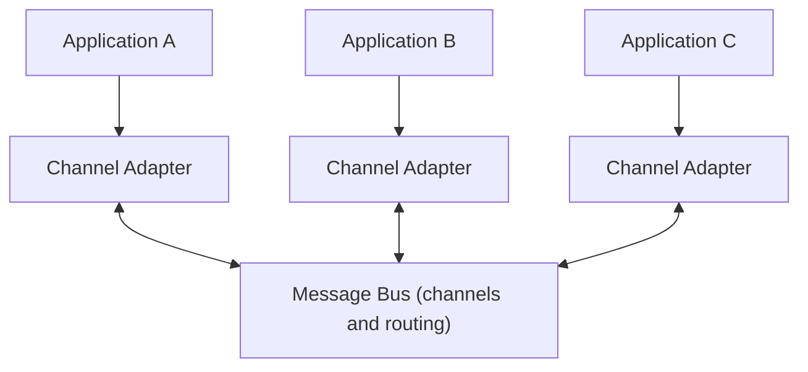

# Message Bus

## Description

The Message Bus is an integration architecture in which several existing, heterogeneous applications cooperate through a common messaging infrastructure while remaining decoupled. New applications join and old ones leave without the rest having to change.

The analogy is a computer's hardware bus, which connects the processor, memory and peripherals. Here, the bus is the middleware that connects applications, with messages far more granular than the low-level read and write operations of hardware.

The pattern combines three elements: a common communication infrastructure (channels, routers, publish-subscribe channels), adapters that connect each system to the bus and translate its data, and a common structure of commands and formats that lets participants ask each other for operations.

## Problems it solves

- Existing systems, on different platforms and languages, need to share data and respond in a unified way to business requests.
- Adding or removing applications must not disrupt the others.
- Without common formats and commands, each pair of systems needs its own point-to-point integration.
- Some interactions have one recipient, others need to reach several.

## When to use

- There is a portfolio of applications that must collaborate flexibly and evolve independently.
- The enterprise wants a common vocabulary of commands and data across systems.
- New participants are expected to be added frequently.

## When to avoid

- A few applications with a stable integration, where direct connections are enough.
- When there's no willingness to maintain a shared data and command model, because the bus loses its purpose.
- When the bus would become a single point of failure and contention without proper high availability.

## Trade-offs

| Benefit | Cost / Risk |
| --- | --- |
| Decoupled applications that join and leave without affecting the others | Central infrastructure to operate and scale |
| Fewer point-to-point integrations | Requires consensus on common formats and commands |
| Reuse of adapters and channels | The bus can become a bottleneck or single point of failure |
| Cooperation among heterogeneous technologies | Governance and versioning of the shared model |

- **Canonical model:** the common format is what keeps coupling low, but it needs to be managed.
- **Routing:** routers and per-data-type channels direct each message to the right endpoint.
- **Availability:** the bus must be redundant, since many applications depend on it.

## Diagram

Each application connects to the bus through an adapter, and the bus offers common channels and routing so they can collaborate without knowing each other.

## Related patterns

- [Channel Adapter](/architecture/eip/messaging-channels/channel-adapter) — connects each application to the bus.
- [Datatype Channel](/architecture/eip/messaging-channels/datatype-channel) — directs message types to specific endpoints.
- [Publish-Subscribe Channel](/architecture/cloud-design-patterns/messaging/publisher-subscriber) — reaches multiple receivers.
- [Message Channel](/architecture/eip/messaging-channels/message-channel) — the channels that make up the bus.
- [Canonical Data Model](/architecture/eip/message-transformation/canonical-data-model) — a data format common to all participants.
- [Command Message](/architecture/eip/message-construction/command-message) — a common command structure across systems.
- [Message Router](/architecture/eip/message-routing/message-router) — directs messages within the bus.
- [Service Activator](/architecture/eip/messaging-endpoints/service-activator) — invokes application services from messages.
- [Messaging](/architecture/microservices/communication-styles/messaging) — the integration style the bus relies on.

## Reference

- [Pattern page on Enterprise Integration Patterns](https://www.enterpriseintegrationpatterns.com/MessageBus.html)
