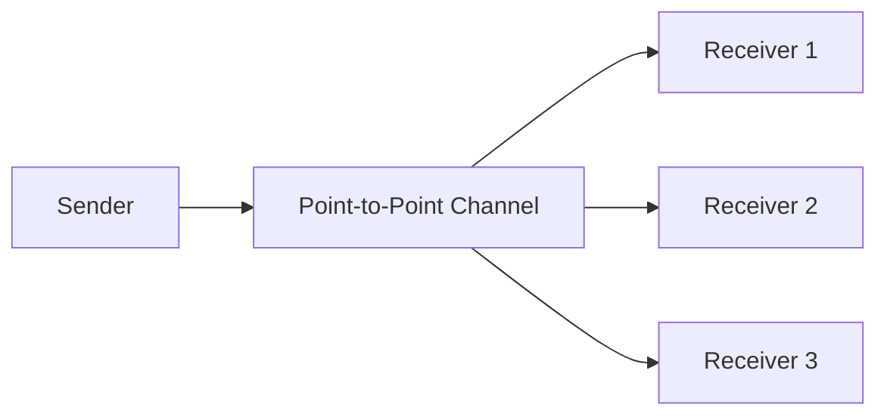

# Point-to-Point Channel

## Description

The Point-to-Point Channel guarantees that each message sent is consumed by exactly one receiver. Several receivers can be attached to the same channel, but when they compete for the same message, the channel lets only one of them get it. The receivers don't need to coordinate with each other.

It's the natural channel for messages that represent a procedure call or the transfer of a document, where the action must happen only once. The sender has assurance that the operation won't be executed twice by different consumers.

Because the channel delivers each message to a single consumer, several receivers can work in parallel, each handling different messages, which scales processing without additional synchronization effort in the application code.

## Problems it solves

- The sender needs a guarantee that only one receiver will execute the call or receive the document.
- Several receivers must be able to share the work without processing the same message twice.
- Receivers shouldn't need their own coordination protocol to avoid duplication.

## When to use

- Sending commands or requests that must be executed only once.
- Transferring documents to a specific processor.
- Distributing load across several instances of the same service.
- Request-reply exchanges, where each reply goes back to a single requester.

### When to avoid

- When several different consumers each need to receive the same information; use a publish-subscribe channel.
- When strict processing order is required and there are many concurrent consumers, since concurrency can reorder handling.

## Trade-offs

| Benefit | Cost / Risk |
| --- | --- |
| Each message is handled only once | Only one consumer sees the message; new interested parties don't get a copy |
| Horizontal scaling with competing consumers | Processing order across consumers isn't guaranteed |
| No explicit coordination between receivers | If the consumer fails after receiving, redelivery and duplicate handling are needed |

- **Delivery:** in practice, the guarantee is one delivery to the channel and one retrieval by a consumer; failures can cause redelivery, so make receivers idempotent.
- **Backlog:** if there are no receivers, messages pile up in the channel; monitor its depth.

## Diagram

The sender publishes to the channel and each message is delivered to only one of the receivers attached to it.

## Related patterns

- [Message Channel](/architecture/eip/messaging-channels/message-channel) — the general concept this pattern specializes.
- [Publish-Subscribe Channel](/cloud/cloud-design-patterns/messaging/publisher-subscriber) — the alternative in which all subscribers receive a copy.
- [Competing Consumers](/cloud/cloud-design-patterns/messaging/competing-consumers) — several receivers competing for messages on the same channel.
- [Idempotent Receiver](/cloud/cloud-design-patterns/messaging/idempotent-consumer) — tolerates redeliveries from the channel.
- [Request-Reply](/architecture/eip/message-construction/request-reply) — a two-way exchange often built on point-to-point channels.
- [Command Message](/architecture/eip/message-construction/command-message) — a message that requests an action, typical of this channel.
- [Document Message](/architecture/eip/message-construction/document-message) — a message that transfers data.
- [Messaging](/architecture/microservices/communication-styles/messaging) — the integration style the pattern belongs to.

## Reference

- [Pattern page on Enterprise Integration Patterns](https://www.enterpriseintegrationpatterns.com/PointToPointChannel.html)
