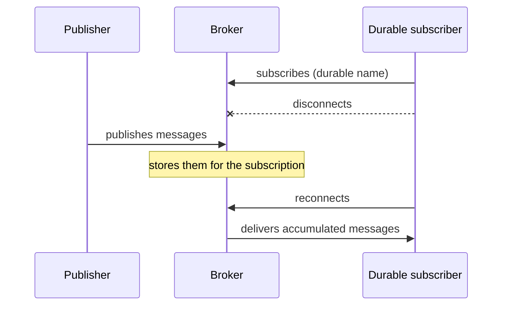

# Durable Subscriber

## Description

Durable Subscriber is a subscriber to a Publish-Subscribe Channel whose subscription survives its disconnection. The messaging system keeps the messages published while the subscriber is offline and delivers them when it reconnects.

For the connected subscriber and for the broker, nothing changes compared with an ordinary subscription; the difference only shows up during the offline period. A durable subscription is usually identified by a name registered with the broker.

Without this, a subscriber that crashes, restarts, or is down for maintenance loses everything published in the meantime.

## Problems it solves

- Message loss caused by a temporarily disconnected subscriber.
- The need to rebuild state lost after an outage.

## When to use

- When every event matters and the subscriber may go offline.
- When delivery must be guaranteed to slow or intermittent subscribers.

### When to avoid

- When only the latest state matters (old messages lose their value).
- When the buildup of messages for absent subscribers could exhaust the broker.

## Trade-offs

| Benefit | Cost / Risk |
| --- | --- |
| No messages lost to downtime | The broker must store messages indefinitely |
| Simple recovery on reconnect | Abandoned subscriptions accumulate data |
| Identical behavior to an ordinary subscription when online | Burst of delayed messages on reconnect |

- Combine with Message Expiration to limit the buildup, and monitor subscription sizes.

## Diagram

The broker keeps the messages while the subscriber is away and delivers them when it comes back.

## Related patterns

- [Publish-Subscribe Channel](/cloud/cloud-design-patterns/messaging/publisher-subscriber) — the channel the durable subscriber subscribes to.
- [Guaranteed Delivery](/architecture/eip/messaging-channels/guaranteed-delivery) — message persistence in the broker, the basis of durability.
- [Point-to-Point Channel](/architecture/eip/messaging-channels/point-to-point-channel) — a channel where the queue already retains messages.
- [Message Expiration](/architecture/eip/message-construction/message-expiration) — limits the buildup of messages.
- [Message Endpoint](/architecture/eip/messaging-endpoints/message-endpoint) — the subscriber is a receiving endpoint.
- [Polling Consumer](/architecture/eip/messaging-endpoints/polling-consumer) — a possible consumption mode.
- [Event-Driven Consumer](/architecture/eip/messaging-endpoints/event-driven-consumer) — a possible consumption mode.

## Reference

- [Pattern page on Enterprise Integration Patterns](https://www.enterpriseintegrationpatterns.com/DurableSubscription.html)
