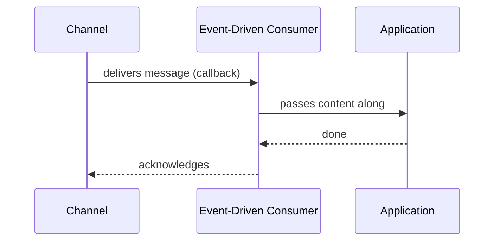

# Event-Driven Consumer

## Description

Event-Driven Consumer is a consumer that the messaging system itself invokes, through a callback, when a message arrives on the channel. While there are no messages, the consumer can stay idle, with no dedicated thread. It's also called an asynchronous receiver.

The model gives an immediate response and avoids repeatedly querying the channel. Whether delivery is truly event-driven is an implementation detail of the messaging client; what matters is that the application is triggered when a message is available.

Watch out for acknowledgment: acknowledging automatically on delivery, before processing, is simple but loses the work if processing fails; in that case the consumer is not a Transactional Client.

## Problems it solves

- Latency caused by polling.
- Idle threads waiting for messages.
- Consumption loop code repeated in every application.

## When to use

- When the message should be handled as soon as possible.
- When volume is irregular and keeping consumers active would be wasteful.

### When to avoid

- When the consumer needs to control the incoming rate, since push can overload it.
- When processing should only happen in specific windows.

## Trade-offs

| Benefit | Cost / Risk |
| --- | --- |
| Low latency | The consumer can be flooded if there's no prefetch limit |
| No empty queries | Less control over pacing |
| Simple callback-based code | Automatic acknowledgment can lose messages |

- Limit the number of in-flight messages (prefetch) to protect the consumer.

## Diagram

The channel triggers the consumer, which passes the content to the application and acknowledges at the end.

## Related patterns

- [Polling Consumer](/architecture/eip/messaging-endpoints/polling-consumer) — pull-based alternative.
- [Message Endpoint](/architecture/eip/messaging-endpoints/message-endpoint) — a kind of receiving endpoint.
- [Competing Consumers](/cloud/cloud-design-patterns/messaging/competing-consumers) — several event-driven consumers on the same channel.
- [Message Dispatcher](/architecture/eip/messaging-endpoints/message-dispatcher) — distributes received messages to performers.
- [Selective Consumer](/architecture/eip/messaging-endpoints/selective-consumer) — accepts only some of the messages.
- [Durable Subscriber](/architecture/eip/messaging-endpoints/durable-subscriber) — a subscriber that doesn't lose messages while offline.
- [Transactional Client](/architecture/eip/messaging-endpoints/transactional-client) — client-controlled acknowledgment.
- [Observer (GoF)](/coding/gof/behavioral/observer) — the same notification model at the object scale.

## Reference

- [Pattern page on Enterprise Integration Patterns](https://www.enterpriseintegrationpatterns.com/EventDrivenConsumer.html)
