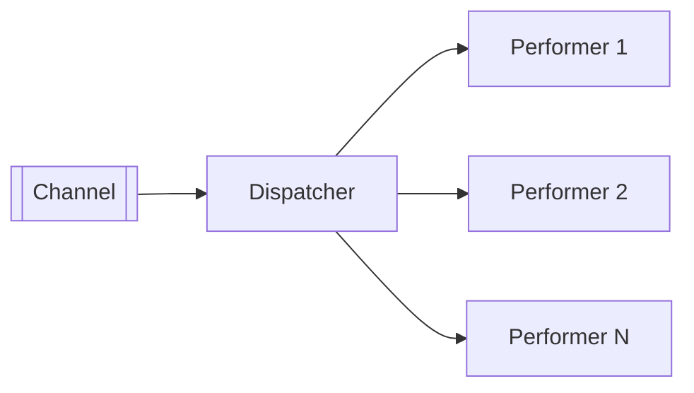

# Message Dispatcher

## Description

Message Dispatcher coordinates several consumers of the same channel. It has two roles: the dispatcher takes each message off the channel and hands it on; the performer receives the message and does the processing, and may call on the rest of the application.

Performers can be created on demand or taken from a pool, each in its own thread, which allows messages to be processed in parallel with a single consumer on the channel. The dispatcher can send any message to any performer or pick specialized performers based on the message's properties.

It differs from Competing Consumers, where each consumer has its own connection to the channel and competes directly; here there's a single point of reading that distributes internally.

## Problems it solves

- A single consumer that processes messages serially and can't keep up.
- The cost of maintaining many connections to the channel.
- The need to route messages to different handlers according to type.

## When to use

- When you want concurrency inside a single consumer process.
- When different message types require distinct handlers.

### When to avoid

- When message order must be strictly preserved.
- When horizontal scaling with Competing Consumers is enough.

## Trade-offs

| Benefit | Cost / Risk |
| --- | --- |
| Parallelism with a single connection | Processing order is not guaranteed |
| Internal routing by type | The dispatcher can become a bottleneck and a single point of failure |
| A pool of performers controls resources | Managing performer threads and failures adds complexity |

- Define what happens to the message if a performer fails and if the pool is full.

## Diagram

The dispatcher reads from the channel and distributes each message to a performer.

## Related patterns

- [Competing Consumers](/cloud/cloud-design-patterns/messaging/competing-consumers) — alternative where each consumer reads from the channel.
- [Selective Consumer](/architecture/eip/messaging-endpoints/selective-consumer) — filtering that the dispatcher can do.
- [Event-Driven Consumer](/architecture/eip/messaging-endpoints/event-driven-consumer) — a common way to feed the dispatcher.
- [Polling Consumer](/architecture/eip/messaging-endpoints/polling-consumer) — another way to feed it.
- [Message Endpoint](/architecture/eip/messaging-endpoints/message-endpoint) — the dispatcher is part of the endpoint.
- [Transactional Client](/architecture/eip/messaging-endpoints/transactional-client) — each performer can have its own transaction.
- [Datatype Channel](/architecture/eip/messaging-channels/datatype-channel) — alternative of separating types by channel.

## Reference

- [Pattern page on Enterprise Integration Patterns](https://www.enterpriseintegrationpatterns.com/MessageDispatcher.html)
