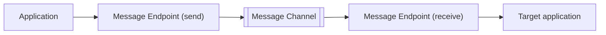

# Message Endpoint

## Description

Message Endpoint is the layer that connects an application to a messaging channel. It is both a client of the messaging system and a part of the application: it knows the messaging client API on one side and the application's data and commands on the other.

When sending, the endpoint converts what the application wants to communicate into a message and publishes it to the channel. When receiving, it extracts the content from the message and hands it to the application in a usable form. The rest of the application keeps dealing only with its own objects and requests, without knowing message formats, channels, or messaging API details.

In practice, the endpoint is an "umbrella" pattern: the other patterns in the group (Messaging Gateway, Messaging Mapper, Polling Consumer, Event-Driven Consumer, Service Activator, etc.) describe facets and variations of how to build it.

## Problems it solves

- Applications that weren't written for messaging need to send and receive messages over channels.
- Business code coupled to message formats, channel names, and the messaging client API is hard to test and evolve.
- A single place is needed where sending and receiving decisions (transactions, acknowledgment, consumption) are made.

## When to use

- Whenever an application takes part in a messaging integration, whether producing or consuming messages.
- When you want to isolate the application from the chosen messaging technology.

### When to avoid

- When the application code is already messaging-native and an extra layer would only repeat the client API.
- In very simple, throwaway integrations where the separation doesn't pay off.

## Trade-offs

| Benefit | Cost / Risk |
| --- | --- |
| Application isolated from messaging details | An additional layer to build and maintain |
| Central place to handle transactions, acknowledgments, and errors | A poorly built abstraction can hide important behaviors (ordering, duplicates) |
| Switching messaging technology has a localized impact | Each application tends to have its own endpoint, with a risk of inconsistency |

- Sending and receiving endpoints have different responsibilities and are usually designed separately.
- Observability (send, consume, and failure metrics) is simpler when concentrated in the endpoint.

## Diagram

Each application accesses the channel through its endpoint, which translates between the application's world and the messaging world.

## Related patterns

- [Messaging Gateway](/architecture/eip/messaging-endpoints/messaging-gateway) — encapsulates sending behind a domain interface.
- [Messaging Mapper](/architecture/eip/messaging-endpoints/messaging-mapper) — converts between domain objects and messages.
- [Polling Consumer](/architecture/eip/messaging-endpoints/polling-consumer) — receiving where the application decides when to fetch.
- [Event-Driven Consumer](/architecture/eip/messaging-endpoints/event-driven-consumer) — receiving where the messaging system triggers the application.
- [Service Activator](/architecture/eip/messaging-endpoints/service-activator) — connects messages to an application service.
- [Channel Adapter](/architecture/eip/messaging-channels/channel-adapter) — endpoint for applications that don't know messaging.
- [Message Channel](/architecture/eip/messaging-channels/message-channel) — the channel the endpoint connects to.
- [Message](/architecture/eip/message-construction/message) — the unit of data exchanged by the endpoint.

## Reference

- [Pattern page on Enterprise Integration Patterns](https://www.enterpriseintegrationpatterns.com/MessageEndpoint.html)
