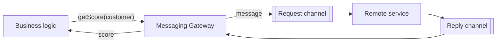

# Messaging Gateway

## Description

Messaging Gateway is a class that encapsulates all access to the messaging system and exposes an interface to the application in domain terms. Instead of building messages, setting properties, and choosing channels, the business code calls a method such as `getCreditScore(customer)`, with typed parameters.

Only the gateway knows there's messaging behind it. It creates the message, sends it over the channel and, when there's a reply, receives it, correlates it, and returns it to the caller as an ordinary value. It is the messaging specialization of Fowler's Gateway pattern.

Because the gateway is an ordinary interface, it's easy to swap it for a stub in tests or for another implementation (for example, a synchronous call) without touching the business logic.

## Problems it solves

- Business code littered with direct calls to the messaging API.
- Difficulty testing the application without a broker.
- Application coupling to message formats and channel names.

## When to use

- When several parts of the application need to send messages or request something via messaging.
- When you want to be able to replace messaging with another form of integration with little impact.

### When to avoid

- When the application has a single, trivial send point and the extra layer would just be indirection.
- When the business logic needs fine-grained control over message properties that the gateway would hide.

## Trade-offs

| Benefit | Cost / Risk |
| --- | --- |
| Clean business code focused on the domain | One more class per integration |
| Testability with fake gateways | A synchronous interface can hide the asynchronous nature of messaging |
| Replaceable messaging | Hiding latency and failures can encourage inappropriate use |

- A gateway with a synchronous return over asynchronous messaging requires correlation and timeout handling.
- It's usually the place where Request-Reply and Correlation Identifier are applied.

## Diagram

The business logic calls a domain method; the gateway takes care of building the message, sending it, and correlating the reply.

## Related patterns

- [Message Endpoint](/architecture/eip/messaging-endpoints/message-endpoint) — the gateway is one way to organize the endpoint.
- [Messaging Mapper](/architecture/eip/messaging-endpoints/messaging-mapper) — often used by the gateway to convert objects into messages.
- [Request-Reply](/architecture/eip/message-construction/request-reply) — interaction style that the gateway usually encapsulates.
- [Correlation Identifier](/architecture/eip/message-construction/correlation-identifier) — used to match replies with requests.
- [Service Activator](/architecture/eip/messaging-endpoints/service-activator) — the receiving-side equivalent of the gateway on the sending side.
- [Gateway (PoEAA)](/application/poeaa/base/gateway) — the general pattern of which this is a specialization.
- [Facade (GoF)](/coding/gof/structural/facade) — also simplifies access to a complex subsystem.

## Reference

- [Pattern page on Enterprise Integration Patterns](https://www.enterpriseintegrationpatterns.com/MessagingGateway.html)
