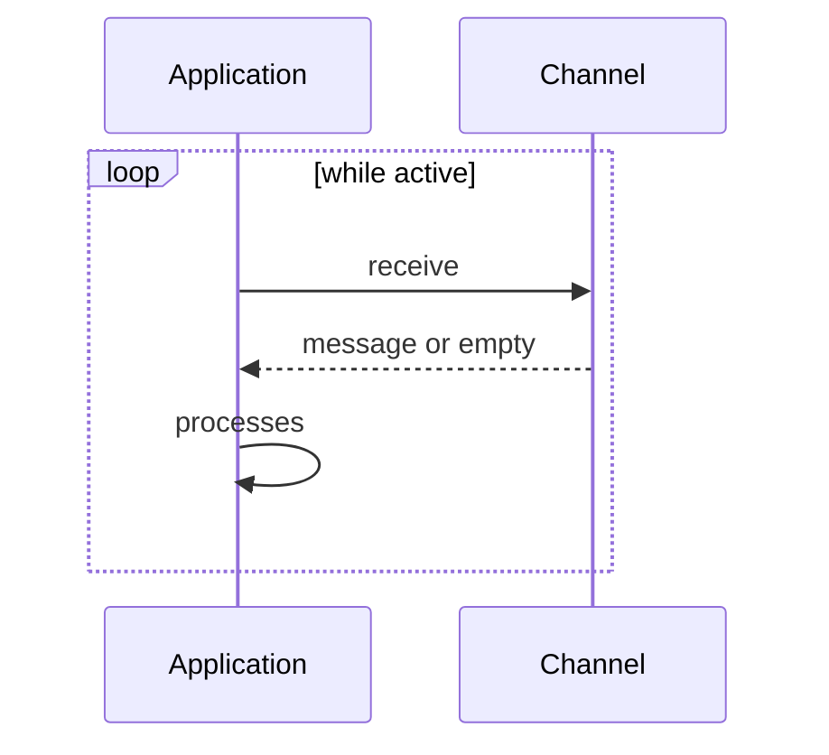

# Polling Consumer

## Description

Polling Consumer is a consumer that only receives a message when the application asks for one. It works as a loop: ask for a message, process it, ask for the next. This way the application controls the pace and decides when it's ready to work.

Messaging APIs usually offer a blocking receive, which waits until a message arrives, and a non-blocking one, which returns immediately if there is none. The former ties up a thread; the latter can waste cycles if arrival is slow.

It's the opposite of the Event-Driven Consumer, where the messaging system triggers the application.

## Problems it solves

- A consumer that needs to limit its processing rate (natural backpressure).
- An application that can only process messages in certain windows.
- Environments where no callback is available.

## When to use

- When the application needs to control when and how many messages it consumes.
- In batch processing or in defined windows.

## When to avoid

- When delivery latency must be minimal and the polling interval would hurt it.
- When empty polling creates unnecessary cost (for example, services billed per request).

## Trade-offs

| Benefit | Cost / Risk |
| --- | --- |
| Pace and load controlled by the consumer | Latency until the next poll |
| Implementation simplicity | Empty queries consume resources |
| Easy to combine with batches | Blocking receive occupies threads |

- The polling interval is a tuning parameter between latency and cost.

## Diagram

The application asks for messages in a loop and processes each one that arrives.

## Related patterns

- [Event-Driven Consumer](/architecture/eip/messaging-endpoints/event-driven-consumer) — push-based alternative.
- [Message Endpoint](/architecture/eip/messaging-endpoints/message-endpoint) — the polling consumer is a kind of receiving endpoint.
- [Competing Consumers](/architecture/cloud-design-patterns/messaging/competing-consumers) — several polling consumers on the same channel.
- [Transactional Client](/architecture/eip/messaging-endpoints/transactional-client) — the receive can be transactional.
- [Selective Consumer](/architecture/eip/messaging-endpoints/selective-consumer) — the polling can be filtered.
- [Durable Subscriber](/architecture/eip/messaging-endpoints/durable-subscriber) — a subscriber that can also use polling.
- [Message Dispatcher](/architecture/eip/messaging-endpoints/message-dispatcher) — distributes what the consumer receives.
- [Polling Publisher](/architecture/microservices/transactional-messaging/polling-publisher) — use of polling on the publisher side.

## Reference

- [Pattern page on Enterprise Integration Patterns](https://www.enterpriseintegrationpatterns.com/PollingConsumer.html)
