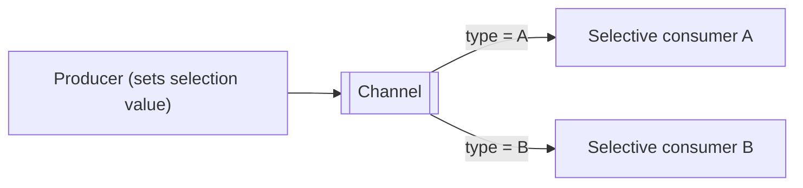

# Selective Consumer

## Description

Selective Consumer is a consumer that filters the messages on the channel and accepts only those that meet its criteria. The producer sets a selection value in the message (for example, a type or a property) and the consumer declares a selector over that value.

On point-to-point channels, several selective consumers work as competing consumers, but each message goes to only one that accepts it; messages with no compatible consumer stay on the channel until they expire. On publish-subscribe channels, each subscriber only receives the copies it's interested in, and the system can avoid sending copies that would be discarded.

This lets a single channel behave like several Datatype Channels, which helps when the number of supported channels is limited.

## Problems it solves

- A consumer that receives messages it doesn't care about.
- Proliferation of channels, one per message type.
- Unnecessary traffic from discarded copies.

## When to use

- When a channel carries several message types and each consumer handles a subset.
- When the messaging system supports server-side selectors.

### When to avoid

- When dedicated channels per type are available at an acceptable cost.
- When messages with no compatible consumer could sit idle indefinitely.

## Trade-offs

| Benefit | Cost / Risk |
| --- | --- |
| Fewer channels to manage | A badly written selector leaves orphaned messages |
| Less useless traffic | Filtering load on the broker |
| Specialized consumers | Coupling between the producer and the consumer's criteria |

- Document the selection value contract and monitor messages that nobody consumes.

## Diagram

Each consumer receives only the messages whose selection value meets its criterion.

## Related patterns

- [Message Filter](/architecture/eip/message-routing/message-filter) — discards messages mid-flow, instead of at the consumer.
- [Datatype Channel](/architecture/eip/messaging-channels/datatype-channel) — alternative with one channel per type.
- [Content-Based Router](/architecture/eip/message-routing/content-based-router) — actively routes based on content.
- [Competing Consumers](/cloud/cloud-design-patterns/messaging/competing-consumers) — selective consumers compete among the compatible ones.
- [Publish-Subscribe Channel](/cloud/cloud-design-patterns/messaging/publisher-subscriber) — each subscriber filters its copies.
- [Message Dispatcher](/architecture/eip/messaging-endpoints/message-dispatcher) — can choose performers by properties.
- [Message Endpoint](/architecture/eip/messaging-endpoints/message-endpoint) — the selector is part of the endpoint.

## Reference

- [Pattern page on Enterprise Integration Patterns](https://www.enterpriseintegrationpatterns.com/MessageSelector.html)
