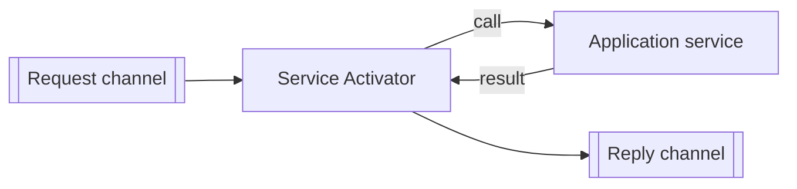

# Service Activator

## Description

Service Activator sits between the messaging channel and an application service. It receives messages from the channel and invokes the corresponding service, making it accessible through messaging without the service knowing about it.

It can handle one-way requests or Request-Reply exchanges, where the result is sent to the reply channel. The service is usually a simple local call, for example part of a service layer. The activator can always call the same service or pick the target based on the message, for example through reflection.

Because the activator takes care of all the messaging details, the service is called as by any other client and can be reused through other means of access.

## Problems it solves

- Exposing an existing service via messaging without changing it.
- Mixing business logic with message consumption code.

## When to use

- When a service should be invoked by command or request messages.
- When the same service is also accessible through other means (API, local call).

## When to avoid

- When the service is already messaging-native.
- When the required conversion is so large that it calls for a separate transformation component.

## Trade-offs

| Benefit | Cost / Risk |
| --- | --- |
| Service independent of messaging | An additional component per service |
| The service is reused across several access channels | Error handling and redelivery must be defined in the activator |
| Single place to adapt messages to calls | An asynchronous reply requires correlation |

- Decide how to handle invalid messages, sending them to an Invalid Message Channel.

## Diagram

The activator translates the message into a service call and, if needed, returns the result over another channel.

## Related patterns

- [Message Endpoint](/architecture/eip/messaging-endpoints/message-endpoint) — the activator is a kind of receiving endpoint.
- [Messaging Gateway](/architecture/eip/messaging-endpoints/messaging-gateway) — the counterpart on the sending side.
- [Command Message](/architecture/eip/message-construction/command-message) — the typical message that triggers the service.
- [Request-Reply](/architecture/eip/message-construction/request-reply) — interaction supported by the activator.
- [Event-Driven Consumer](/architecture/eip/messaging-endpoints/event-driven-consumer) — the usual way of receiving.
- [Polling Consumer](/architecture/eip/messaging-endpoints/polling-consumer) — another way of receiving.
- [Message Dispatcher](/architecture/eip/messaging-endpoints/message-dispatcher) — can distribute messages to several activators.
- [Invalid Message Channel](/architecture/eip/messaging-channels/invalid-message-channel) — destination for messages the service doesn't understand.

## Reference

- [Pattern page on Enterprise Integration Patterns](https://www.enterpriseintegrationpatterns.com/MessagingAdapter.html)
