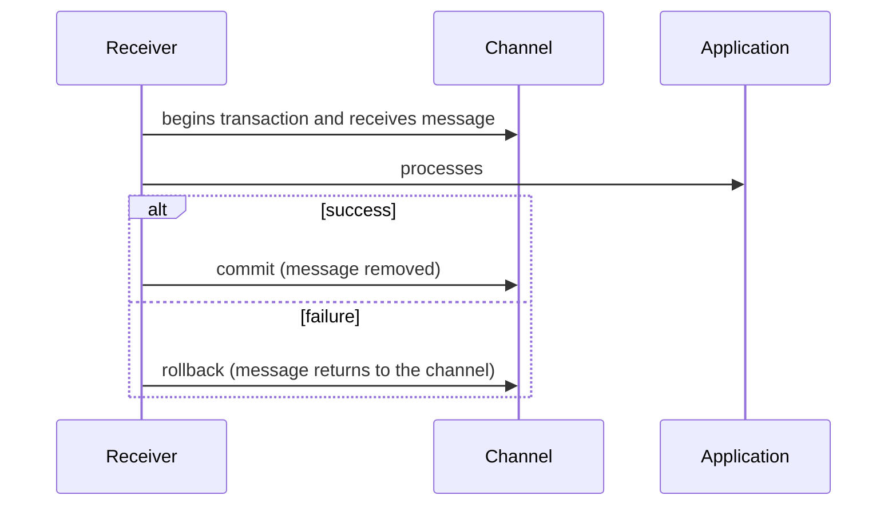

# Transactional Client

## Description

Transactional Client makes the client's session with the messaging system transactional, so that the client itself defines the transaction boundaries. On the sending side, the message is only actually placed on the channel when the sender commits. On the receiving side, the message is only removed from the channel when the receiver commits.

This way, if the receiver fails midway through processing, it rolls back and the message remains available for another attempt. Transactional and non-transactional senders and receivers can coexist on the same channel.

In widely distributed systems, transactional semantics are expensive in performance, and many cloud messaging services prefer alternatives, such as visibility timeout (the received message is hidden and reappears if not acknowledged).

## Problems it solves

- Message loss when the consumer fails after receiving it and before finishing the work.
- Partial sending: a group of messages that should go out together goes out only halfway.
- The need to coordinate messages with other transactional resources.

## When to use

- When processing a message must be all-or-nothing.
- When several messages must be published atomically.

### When to avoid

- In high-throughput, highly distributed systems where the transactional cost is unacceptable.
- When the consumer is idempotent and can use simple acknowledgment with redelivery.

## Trade-offs

| Benefit | Cost / Risk |
| --- | --- |
| All-or-nothing processing | Lower performance and higher contention |
| Automatic redelivery after rollback | Long transactions hold broker resources |
| Atomic sending of several messages | A distributed transaction with the database requires additional coordination |

- A messaging transaction doesn't cover the application's database unless there's coordination; for that, see the Transactional Outbox.
- Messages that always fail create redelivery loops and call for a Dead Letter Channel.

## Diagram

The message only leaves the channel on commit; on rollback it stays available for another attempt.

## Related patterns

- [Message Endpoint](/architecture/eip/messaging-endpoints/message-endpoint) — the endpoint is what controls the transaction.
- [Guaranteed Delivery](/architecture/eip/messaging-channels/guaranteed-delivery) — channel persistence, complementary to transactions.
- [Dead Letter Channel](/architecture/eip/messaging-channels/dead-letter-channel) — destination for messages that fail repeatedly.
- [Competing Consumers](/cloud/cloud-design-patterns/messaging/competing-consumers) — rollback returns the message to another consumer.
- [Polling Consumer](/architecture/eip/messaging-endpoints/polling-consumer) — can receive within a transaction.
- [Event-Driven Consumer](/architecture/eip/messaging-endpoints/event-driven-consumer) — likewise, with acknowledgment after the callback.
- [Transactional Outbox](/architecture/microservices/transactional-messaging/transactional-outbox) — alternative for atomicity between database and messaging.

## Reference

- [Pattern page on Enterprise Integration Patterns](https://www.enterpriseintegrationpatterns.com/TransactionalClient.html)
