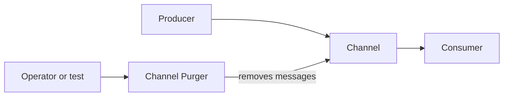

# Channel Purger

## Description

The Channel Purger removes unwanted messages from a channel. In its simplest form, it empties the channel completely to return the system to a known state. In a selective form, it removes only messages that match certain criteria, such as an identifier or the value of some field.

Persistent, asynchronous messaging can leave stray messages behind. They sit waiting and end up consumed by someone who shouldn't receive them, producing strange behavior that's hard to diagnose.

## Problems it solves

- Leftover messages from previous runs interfere with tests and with running systems.
- In request-reply, an old reply can be read by a new requester in place of the correct reply.
- Tests need to start from a consistent state.
- In production, it's sometimes necessary to remove specific messages without disturbing the rest.

## When to use

- Preparing test environments so that each run starts with empty channels.
- Cleaning up reply queues after requester failures.
- Removing problematic messages identified during operation.

## When to avoid

- When the messages have business value and can't be lost; prefer moving them to a [Dead Letter Channel](/architecture/eip/messaging-channels/dead-letter-channel).
- Without access control, since the operation is destructive.
- As a substitute for proper error handling and message expiration.

## Trade-offs

| Benefit | Cost / Risk |
| --- | --- |
| Quickly restores a clean state | Irreversible loss of the removed messages |
| Makes tests repeatable | Can delete legitimate messages if used carelessly |
| Allows selective removal in production | Requires restricted permissions and logging of the operation |

- It's a good idea to record what was removed, for example by copying it to a [Message Store](/architecture/eip/system-management/message-store).
- Many brokers offer a built-in purge operation, for example in the queue console.

## Diagram

The purger acts directly on the channel, removing all messages or only those that match the criteria.

## Related patterns

- [Dead Letter Channel](/architecture/eip/messaging-channels/dead-letter-channel) — preserves problematic messages instead of discarding them.
- [Message Store](/architecture/eip/system-management/message-store) — records what was purged.
- [Control Bus](/architecture/eip/system-management/control-bus) — can trigger the cleanup remotely.
- [Point-to-Point Channel](/architecture/eip/messaging-channels/point-to-point-channel) — the channel where leftover messages cause the most trouble.
- [Correlation Identifier](/architecture/eip/message-construction/correlation-identifier) — prevents mixing up replies, and serves as a criterion for selective purging.
- [Invalid Message Channel](/architecture/eip/messaging-channels/invalid-message-channel) — alternative destination for invalid messages.

## Reference

- [Pattern page on Enterprise Integration Patterns](https://www.enterpriseintegrationpatterns.com/ChannelPurger.html)
