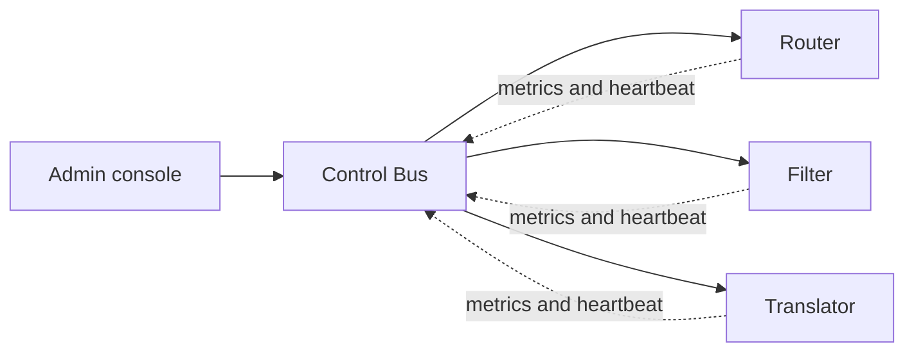

# Control Bus

## Description

The Control Bus is a management channel that runs parallel to the application's data flow. It uses the same messaging infrastructure but carries control messages: configuration commands, status requests, heartbeats, metrics, and behavior changes.

Every component of the solution connects to two subsystems: the business message flow and the Control Bus. This way, a single administration tool can monitor and command components spread across multiple platforms, networks, and locations, without having to reach into them one by one.

## Problems it solves

- Administering a distributed integration solution across several platforms and geographic regions.
- Keeping management information from mixing with business data.
- Reconfiguring routers, filters, and other components at runtime, without restarting them.
- Collecting health and metrics from heterogeneous components in a uniform way.

## When to use

- A solution with many distributed components that need to be monitored and configured centrally.
- A need to change routing rules or turn routes on and off dynamically.
- When messaging infrastructure already exists and can be reused for management.

## When to avoid

- Small solutions with few components, where file-based configuration or a local console is enough.
- When control commands require a synchronous, guaranteed response that the asynchronous channel can't provide.
- When there's no adequate access control, since the channel allows changing the system's behavior.

## Trade-offs

| Benefit | Cost / Risk |
| --- | --- |
| Centralized, uniform administration | The control channel is a sensitive target and requires authentication and authorization |
| Separation between business and management data | Each component needs a second connection and command-handling logic |
| Runtime reconfiguration | Dynamic changes make it harder to reproduce the system's state |
| Reuses the messaging infrastructure | If the broker itself fails, control is unavailable too |

- Control messages are asynchronous, so the effect of a command isn't immediate.
- It's worth standardizing the format of commands and metrics across components.

## Diagram

The console sends commands to the components through the Control Bus, and they respond with metrics and heartbeats over the same channel, which is separate from the data flow.

## Related patterns

- [Detour](/architecture/eip/system-management/detour) — the Control Bus commands the Detour's route switch.
- [Test Message](/architecture/eip/system-management/test-message) — complements heartbeats by checking that the components' output is correct.
- [Message History](/architecture/eip/system-management/message-history) — helps analyze what the Control Bus observes.
- [Wire Tap](/architecture/eip/system-management/wire-tap) — passive instrumentation that can feed management.
- [Message Store](/architecture/eip/system-management/message-store) — stores message information for reporting.
- [Content-Based Router](/architecture/eip/message-routing/content-based-router) — a component whose routing rule is often changed via the Control Bus.
- [External Configuration Store](/architecture/cloud-design-patterns/deployment-and-topology/external-configuration-store) — an alternative based on a centralized configuration repository instead of messages.

## Reference

- [Pattern page on Enterprise Integration Patterns](https://www.enterpriseintegrationpatterns.com/ControlBus.html)
