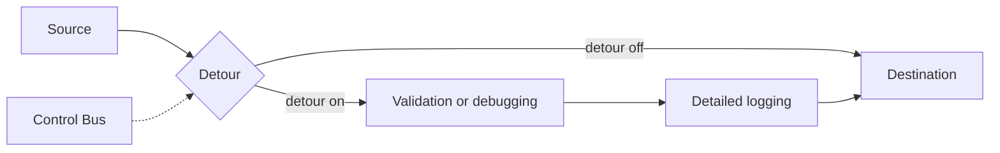

# Detour

## Description

The Detour is a simple, context-based router with two outputs. On the first, the message goes straight to the original destination, unchanged. On the second, it first passes through intermediate steps, such as validation, detailed logging, or transformation, and only then continues to the same destination.

The choice of output is controlled externally, usually by messages sent over the Control Bus. In normal operation the detour is off and the cost is minimal. When traffic needs to be inspected or altered, the detour is switched on without changing the permanent topology.

## Problems it solves

- Inspecting the flow is easy with a Wire Tap, but modifying or intercepting messages requires an active mechanism.
- Passing messages through extra validation, testing, or debugging steps only when needed.
- Avoiding the permanent overhead of components that are only occasionally useful.

## When to use

- Debugging a problem in production by temporarily inserting an analysis or correction component.
- Tests and validations that shouldn't run all the time.
- When you need to change the message's content or path without redesigning the flow.

## When to avoid

- If you only need to observe messages, [Wire Tap](/architecture/eip/system-management/wire-tap) is safer, since it doesn't interfere with the flow.
- If the extra steps should always be applied, just put them in the normal flow.
- When there's no reliable control channel to trigger the detour.

## Trade-offs

| Benefit | Cost / Risk |
| --- | --- |
| Extra steps only kick in when needed | The detour router is one more point of failure and latency |
| Switch on and off without changing the topology | System behavior comes to depend on a dynamic control state |
| Can alter messages, not just observe them | A detour left on by mistake degrades performance or alters data improperly |

- Messages in transit during the route switch may follow different paths, which affects ordering.
- The detour's state should be visible in observability tooling.

## Diagram

The router sends the message straight to the destination or through the intermediate steps, depending on the command received from the Control Bus.

## Related patterns

- [Control Bus](/architecture/eip/system-management/control-bus) — triggers the switch between the two outputs.
- [Wire Tap](/architecture/eip/system-management/wire-tap) — passive observation, whereas the Detour allows intervention.
- [Content-Based Router](/architecture/eip/message-routing/content-based-router) — the Detour is a router whose decision comes from context rather than content.
- [Publish-Subscribe Channel](/architecture/cloud-design-patterns/messaging/publisher-subscriber) — an alternative for distributing copies to observers.

## Reference

- [Pattern page on Enterprise Integration Patterns](https://www.enterpriseintegrationpatterns.com/Detour.html)
