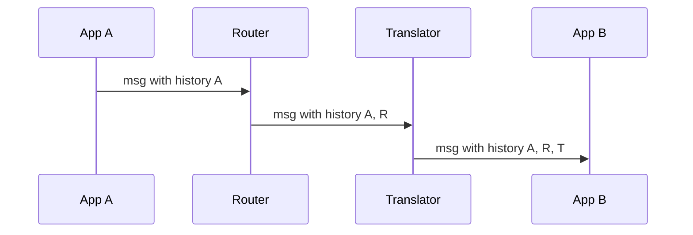

# Message History

## Description

The Message History attaches to the message itself the list of components it has passed through since its origin. Each component, including the originator, adds an entry to the list, usually with an identifier and, if useful, a timestamp.

The list lives in the header, separate from the business payload, keeping system control data apart from application data. This restores some of the visibility that messaging's loose coupling hides: the receiver gets to know where the message came from and which route it took.

## Problems it solves

- In messaging, the receiver usually doesn't know who sent the message or which steps it went through, which makes debugging harder.
- Assessing the impact of changing a message format by discovering which applications produce it.
- Tracking aggregated messages, which combine several inputs, each with its own history.

## When to use

- Flows with many intermediate components where the message's actual path is hard to determine.
- Debugging and impact analysis in loosely coupled solutions.
- When you want traceability without querying an external repository.

### When to avoid

- When the history would reveal internal topology to external recipients.
- When messages are very small and the growing header would weigh on traffic.
- If distributed tracing already covers the need with a dedicated system.

## Trade-offs

| Benefit | Cost / Risk |
| --- | --- |
| Path tracking built into the message | The header grows with each step |
| Control data separated from the payload | All components must follow the convention |
| Useful for debugging and impact analysis | May expose internal details of the architecture |

- With aggregations, you have to decide between keeping a tree with each input's history or only the main message's.
- The history isn't a substitute for persistent storage; if the message is lost, so is its trail.

## Diagram

At each component the message gains an entry in its history, so the destination knows the entire path it has traveled.

## Related patterns

- [Message Store](/architecture/eip/system-management/message-store) — keeps message data in a central location.
- [Wire Tap](/architecture/eip/system-management/wire-tap) — another way to observe traffic.
- [Control Bus](/architecture/eip/system-management/control-bus) — used to manage the components that maintain the history.
- [Correlation Identifier](/architecture/eip/message-construction/correlation-identifier) — links related messages, while the history shows the path.
- [Distributed Tracing](/architecture/microservices/observability/distributed-tracing) — the equivalent approach in microservices, with spans collected externally.

## Reference

- [Pattern page on Enterprise Integration Patterns](https://www.enterpriseintegrationpatterns.com/MessageHistory.html)
