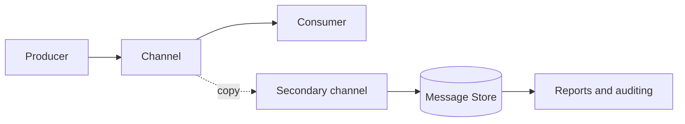

# Message Store

## Description

The Message Store captures information about every message in a central location. When a message is sent to a channel, a copy goes to a secondary channel from which the store collects it. The component itself can do the duplication, or a [Wire Tap](/architecture/eip/system-management/wire-tap) can be inserted into the channel.

Sending the copy is fire-and-forget, so it doesn't delay the main flow. Generally only the fields useful for later analysis are stored, such as identifier, channel, timestamp, and perhaps the body, instead of everything.

## Problems it solves

- Loose coupling makes the solution's dynamic behavior hard to observe.
- Generating reports on traffic without disturbing the transient flow of messaging.
- Capturing complete messages increases traffic, so only what's necessary should be stored.

## When to use

- Auditing, performance analysis, and reconstructing what happened in a flow.
- Reports on volumes, latencies, and routes.
- Reprocessing or later investigation of failures.

### When to avoid

- Messages with sensitive data, unless adequate access control and retention are in place.
- High volumes of large messages, where the full copy has a disproportionate cost.
- If the history must be the source of truth for state, in which case event sourcing is the right fit.

## Trade-offs

| Benefit | Cost / Risk |
| --- | --- |
| Central visibility of traffic | Growing storage and network cost |
| Analysis without affecting the main flow | Sensitive copies require protection and a retention policy |
| Foundation for auditing and reports | Storing only metadata limits later investigations |

- Asynchronous sending can lose copies on failures, so the store isn't a guaranteed record.
- Deciding what to keep and for how long is an important design decision.

## Diagram

Each message goes on to the consumer, and a copy reaches the central store, from which reports are produced.

## Related patterns

- [Wire Tap](/architecture/eip/system-management/wire-tap) — a common mechanism for feeding the store.
- [Message History](/architecture/eip/system-management/message-history) — adds the path traveled to the stored information.
- [Control Bus](/architecture/eip/system-management/control-bus) — manages data capture and querying.
- [Event Sourcing](/cloud/cloud-design-patterns/data-management/event-sourcing) — stores events as the source of truth, whereas the Message Store serves observation.
- [Audit Logging](/architecture/microservices/observability/audit-logging) — an audit trail that the store can back.

## Reference

- [Pattern page on Enterprise Integration Patterns](https://www.enterpriseintegrationpatterns.com/MessageStore.html)
