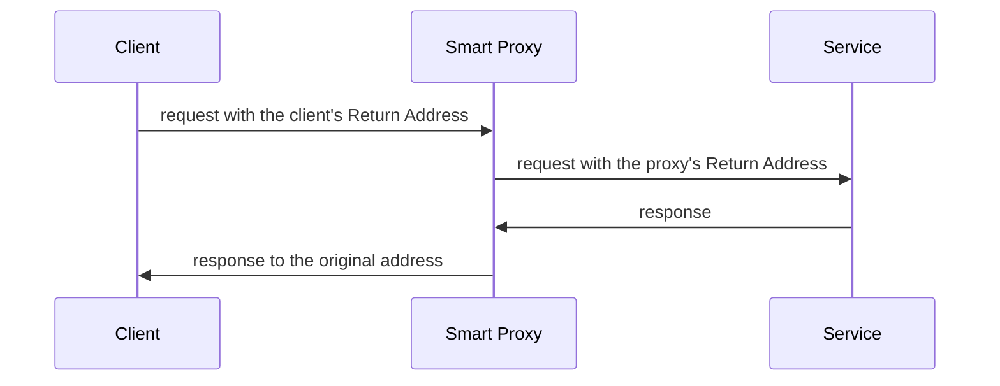

# Smart Proxy

## Description

The Smart Proxy is placed on a service's request channel. For each request, it stores the requester's original Return Address and replaces it with a reply channel of its own. The service, unaware, replies to the proxy.

When the reply arrives, the proxy looks up the stored address, uses a message router to forward the reply to the original requester, and in the meantime observes both the request and the reply. This makes it possible to measure times, count calls, and record results.

## Problems it solves

- A pair of Wire Taps can only track a component that publishes to a fixed output channel.
- Services that reply to the Return Address supplied by each requester can't be followed in a simple way.
- Measuring latency and recording request-reply pairs without changing the service.

## When to use

- Monitoring request-reply services whose replies go to variable addresses.
- Getting response-time metrics per service or per client.
- Instrumenting services that can't be modified.

## When to avoid

- If the service publishes to a fixed output channel, two [Wire Taps](/architecture/eip/system-management/wire-tap) are enough.
- When the proxy's added latency isn't acceptable.
- For communication without a reply (events or commands only).

## Trade-offs

| Benefit | Cost / Risk |
| --- | --- |
| Observes requests and replies of dynamic services | The proxy holds state (addresses) and becomes a point of failure |
| Requires no changes to the service | Adds a network hop and latency |
| Enables per-call metrics | More complexity in correlating replies with requests |

- Replies that never arrive leave pending entries, so the state needs to expire.
- Depends on a [Correlation Identifier](/architecture/eip/message-construction/correlation-identifier) to match replies to requests.

## Diagram

The proxy swaps the return address, receives the reply, and passes it on to the client, observing the full cycle.

## Related patterns

- [Return Address](/architecture/eip/message-construction/return-address) — the address the proxy stores and replaces.
- [Correlation Identifier](/architecture/eip/message-construction/correlation-identifier) — associates replies with requests.
- [Request-Reply](/architecture/eip/message-construction/request-reply) — the interaction the proxy mediates.
- [Wire Tap](/architecture/eip/system-management/wire-tap) — a simpler solution for fixed output channels.
- [Proxy](/coding/gof/structural/proxy) — the equivalent in class design: an intermediary that controls access to the real object.

## Reference

- [Pattern page on Enterprise Integration Patterns](https://www.enterpriseintegrationpatterns.com/SmartProxy.html)
