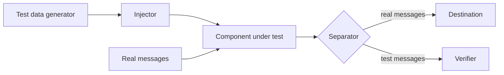

# Test Message

## Description

The Test Message injects synthetic messages into the normal flow and checks the result that comes out the other side. Heartbeats sent to the Control Bus show that a component is alive, but not that its output is correct; a component can keep processing and still corrupt the result because of an internal fault.

The pattern has four roles: a test data generator, an injector that marks the messages (usually with a header field), a separator that pulls the test replies out of the output (typically via a Content-Based Router), and a verifier that compares the actual result with the expected one.

## Problems it solves

- Verifying the health of the processing, not just the presence of the component.
- Detecting silent failures that produce incorrect output without bringing the process down.
- Telling test data apart from real data, without contaminating business results.

## When to use

- Critical components where wrong results are more dangerous than unavailability.
- Continuous monitoring of transformation and routing pipelines.
- Validating the flow end to end in production, with controlled messages.

### When to avoid

- If test messages could cause real side effects (charges, sending emails).
- When messages can't be marked with a header field and the alternative is to use special values in business fields.
- Simple flows, where a basic health check is enough.

## Trade-offs

| Benefit | Cost / Risk |
| --- | --- |
| Verifies the correctness of the output, not just that the component is alive | Requires a generator, injector, separator, and verifier |
| Detects silent failures | Test messages that leak into the real flow cause damage |
| Can run continuously in production | Generates extra load and needs up-to-date expected data |

- Marking tests in business fields mixes control with data and should be a last resort.
- The expected result has to be maintained alongside the component's rules.

## Diagram

The injector inserts marked messages into the flow, the separator diverts them from the output, and the verifier compares the result with the expected one.

## Related patterns

- [Control Bus](/architecture/eip/system-management/control-bus) — receives heartbeats and failure alerts from the verifier.
- [Content-Based Router](/architecture/eip/message-routing/content-based-router) — the basis of the test message separator.
- [Return Address](/architecture/eip/message-construction/return-address) — can direct the test replies to the verifier.
- [Health Endpoint Monitoring](/cloud/cloud-design-patterns/resiliency/health-endpoint-monitoring) — service health checking, shallower than validating the result.

## Reference

- [Pattern page on Enterprise Integration Patterns](https://www.enterpriseintegrationpatterns.com/TestMessage.html)
