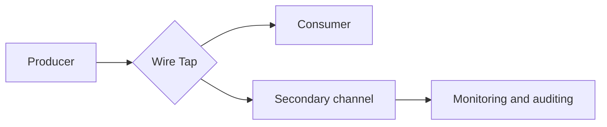

# Wire Tap

## Description

The Wire Tap is a passive branch on a point-to-point channel. It works like a fixed Recipient List with two outputs: each message is copied, unchanged, to both the original destination and a secondary channel.

The analysis logic (monitoring, auditing, debugging) lives in a separate component that consumes the secondary channel. Since the main channel's behavior doesn't change, the tap can be inserted into almost any channel with low risk to the existing solution.

## Problems it solves

- Point-to-point channels deliver each message to a single consumer, which makes it impossible to inspect all the traffic.
- The need to test, monitor, and diagnose flows without changing the components involved.
- Reusing generic instrumentation across several channels.

## When to use

- Monitoring and auditing messages on point-to-point channels.
- Diagnosing problems in environments where neither the producer nor the consumer can be changed.
- Feeding a [Message Store](/architecture/eip/system-management/message-store) or analysis tools with copies of the traffic.

### When to avoid

- On publish-subscribe channels, where adding another subscriber is enough.
- When the copies contain sensitive data and the secondary channel doesn't have the same protection as the original.
- When you need to modify or redirect messages, in which case [Detour](/architecture/eip/system-management/detour) is a better fit.

## Trade-offs

| Benefit | Cost / Risk |
| --- | --- |
| Observation without changing the main flow | Doubles the message volume and resource consumption |
| Easy to add to existing channels | The copy can leak sensitive data if the secondary channel is less protected |
| Decoupled analysis, in another component | The tap's router is a new point of failure and latency |

- Sending the copy should be fire-and-forget so it doesn't delay the main flow.
- The copy may arrive out of order or late relative to the original delivery.

## Diagram

The tap delivers the message to the consumer and an identical copy to the secondary channel, where an analysis component consumes it.

## Related patterns

- [Message Store](/architecture/eip/system-management/message-store) — stores the information captured by the tap.
- [Message History](/architecture/eip/system-management/message-history) — complements the tap with the path the message has traveled.
- [Detour](/architecture/eip/system-management/detour) — the active version, able to alter the flow.
- [Smart Proxy](/architecture/eip/system-management/smart-proxy) — makes it possible to track services whose replies go to a dynamic Return Address.
- [Control Bus](/architecture/eip/system-management/control-bus) — can turn taps on and off dynamically.
- [Publish-Subscribe Channel](/architecture/cloud-design-patterns/messaging/publisher-subscriber) — makes the tap unnecessary when the channel is already broadcast.
- [Log Aggregation](/architecture/microservices/observability/log-aggregation) — consolidates the logs produced by analyzing the copies.

## Reference

- [Pattern page on Enterprise Integration Patterns](https://www.enterpriseintegrationpatterns.com/WireTap.html)
