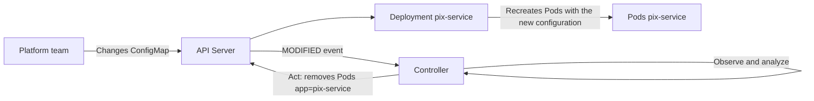

# Controller

## Description

The Controller pattern is a process that continuously watches a set of Kubernetes resources and acts to bring the actual state closer to the desired state declared in them. Kubernetes itself is essentially a fleet of controllers: the Deployment, ReplicaSet and StatefulSet controllers run in an endless reconciliation loop, and you can plug your own into the same mechanism.

The Kubernetes API is declarative: instead of telling it "create a Pod", you change the `replicas` field of a Deployment and the controllers do the rest. Every change produces an event, and every interested controller reacts in three steps: **observe** (follow change events of the resources), **analyze** (compute the difference from the desired state) and **act** (create, change or remove resources through the API). These actions produce new events, which other controllers may consume, without knowing one another.

A custom controller is just an application that runs permanently, in any language able to talk to the API. To store the configuration it reads, the simplest options are labels (indexed, good for selectors), annotations (non-identifying metadata, with no index cost) and ConfigMaps. When the domain calls for its own resource type, the next step is the [Operator](/architecture/kubernetes-patterns/advanced/operator).

## Problems it solves

- Need to extend Kubernetes with custom behavior without changing or breaking the platform code
- Repetitive manual operational tasks that depend on reacting to changes in existing resources
- Automations that must be declarative and continuously reconciled, instead of scripts that run once and let the state drift
- Coupling between the platform and its extensions: events provide a clear technical boundary

## When to use

- When the desired behavior can be expressed by watching and acting on standard resources (Deployment, Service, ConfigMap, Node)
- To restart workloads when a configuration changes, expose Services automatically or enforce metadata conventions across the platform
- When you do not have cluster administrator permission to register CustomResourceDefinitions
- When an annotation or a ConfigMap is enough to describe the user's intent

## When to avoid

- When the domain needs its own resource type, with schema validation, versioning and per-type RBAC: use an [Operator](/architecture/kubernetes-patterns/advanced/operator)
- When the problem is not declarative or the data does not fit the Kubernetes resource model: a dedicated API exposed through a Service may be simpler
- When a native resource already solves it (for example, a Deployment with a [Health Probe](/architecture/kubernetes-patterns/foundational/health-probe) already restarts unhealthy containers)
- When the team cannot take on maintaining one more permanent platform component

## Trade-offs

| Benefit | Cost / Risk |
| --- | --- |
| Platform extension without modifying Kubernetes | One more long-running component to operate, monitor and upgrade |
| Reactive, declarative automation that is continuously reconciled | Asynchronous event flow that is hard to debug, with no simple breakpoints |
| Any language can implement a controller | Naive controllers miss events or stop when the connection drops |
| Works with standard resources, without cluster administrator permissions | Labels, annotations and ConfigMaps have no validation or versioning like a CRD does |

- **Single replica:** controllers usually run as a Deployment with one replica, following the [Singleton Service](/architecture/kubernetes-patterns/behavioral/singleton-service); the API's optimistic locking prevents write conflicts.
- **Robustness:** watching events is not enough. Production controllers restart the stream when it drops and do a full listing from time to time to recover missed events.
- **Least privilege:** the controller's ServiceAccount should have only the verbs and resources it needs.
- **Labels or annotations:** use labels when you need a selector and annotations for the rest, since they are not indexed.
- **Idempotency:** reconciliation runs many times over the same state and must always produce the same result.

## Diagram



The controller watches ConfigMap events, uses the annotation to find which Pods depend on it and acts through the API; the Deployment recreates the Pods, which start already with the new configuration.

## Example

In the fintech, `pix-service` reads limits and cutoff times from a ConfigMap exposed as environment variables, which requires a restart to take effect. A custom controller restarts the Pods when the annotated ConfigMap changes. The first manifest is the ConfigMap with the declared intent; the second is the controller's Deployment, with one replica and the watched namespace coming from the [Downward API](/architecture/kubernetes-patterns/behavioral/self-awareness).

```yaml
apiVersion: v1
kind: ConfigMap
metadata:
  name: pix-service-config
  namespace: fintech
  annotations:
    # read by the controller: Pods to restart when this ConfigMap changes
    fintech.example/restart-pods-selector: "app=pix-service"
data:
  PIX_NIGHT_LIMIT_CENTS: "100000"
  PIX_MAX_TRANSFER_CENTS: "500000"
```

```yaml
apiVersion: apps/v1
kind: Deployment
metadata:
  name: config-restart-controller
  namespace: fintech
spec:
  replicas: 1 # a single instance reconciling
  selector:
    matchLabels:
      app: config-restart-controller
  template:
    metadata:
      labels:
        app: config-restart-controller
    spec:
      serviceAccountName: config-restart-controller # allowed to watch ConfigMaps and delete Pods
      containers:
        - name: controller
          image: registry.fintech.example/config-restart-controller:0.3.0
          env:
            - name: WATCH_NAMESPACE
              valueFrom:
                fieldRef:
                  fieldPath: metadata.namespace
          resources:
            requests:
              cpu: 50m
              memory: 64Mi
```

## Related patterns

- [Operator](/architecture/kubernetes-patterns/advanced/operator) — evolution of the Controller that uses CustomResourceDefinitions to model the application domain
- [Singleton Service](/architecture/kubernetes-patterns/behavioral/singleton-service) — controllers run with a single active instance so they do not act twice
- [Configuration Resource](/architecture/kubernetes-patterns/configuration/configuration-resource) — ConfigMaps and annotations are the simplest way to tell a controller the intent
- [Ambassador](/architecture/cloud-design-patterns/integration-and-modernization/ambassador) — a helper proxy in the same Pod can expose the Kubernetes API on localhost for the controller
- [Leader Election](/architecture/cloud-design-patterns/distributed-coordination/leader-election) — allows several controller replicas with only one active, for high availability

## Reference

- [Kubernetes Patterns, chapter 27: Controller](https://k8spatterns.com/)
- [Controllers (Kubernetes documentation)](https://kubernetes.io/docs/concepts/architecture/controller/)
- [Operator pattern (Kubernetes documentation)](https://kubernetes.io/docs/concepts/extend-kubernetes/operator/)
