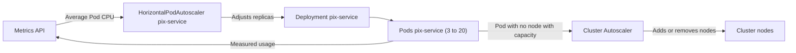

# Elastic Scale

## Description

The Elastic Scale pattern makes an application's capacity follow the load automatically, scaling in several dimensions: horizontally (number of Pod replicas), vertically (requests and limits of each Pod) and at the cluster level (number of nodes). Instead of a human watching the load and deciding how much to scale, Kubernetes measures actual usage and adjusts the desired state.

The most direct form is the **HorizontalPodAutoscaler (HPA)**, which reads metrics (CPU and memory, custom Pod or object metrics and external metrics, such as the depth of a queue) and computes the needed replicas, proportional to the ratio between the current value and the target. The **Vertical Pod Autoscaler (VPA)** recommends or applies requests and limits adjusted to actual consumption, and the **Cluster Autoscaler** adds or removes nodes when there are Pods that do not fit or idle nodes. Manual scaling, imperative or declarative, remains valid for predictable loads.

The levels are complementary and independent: tuning the application itself, setting correct requests (VPA), varying the number of Pods (HPA) and varying the number of nodes (Cluster Autoscaler). Autoscalers depend on [Predictable Demands](/architecture/kubernetes-patterns/foundational/predictable-demands) being declared, since the percentages are computed over the requests.

## Problems it solves

- Seasonal or unpredictable loads, where a fixed number of replicas is either too small or wastes resources
- Difficulty in accurately sizing how many replicas and how many resources each container needs
- Slow, error-prone manual intervention during traffic peaks
- Infrastructure cost paid during low-demand hours

## When to use

- When the load varies over the day, week or month, such as on boleto payment days or during large campaigns
- In stateless services, which scale well horizontally
- When there is a metric correlated with the number of Pods, such as CPU, requests per second or queue size
- When the cluster runs on a cloud able to provision and remove nodes on demand

## When to avoid

- When the chosen metric does not fall when Pods are added (memory in applications that do not release data is the classic case), since the HPA would scale up to the maximum
- In stateful applications that are hard to redistribute, where scaling horizontally is complex or risky
- When the load is stable and predictable: a fixed number of replicas is simpler
- When requests were not defined, since the usage percentages have no reference
- Without care, when HPA and VPA act on the same CPU and memory metrics, which can cause double scaling

## Trade-offs

| Benefit | Cost / Risk |
| --- | --- |
| Capacity follows demand without human intervention | Delayed reaction: metric collection, the HPA cycle and Pod startup |
| Lower cost, since you pay only for what is needed | Poorly chosen metrics cause excessive scaling or oscillation (thrashing) |
| Higher availability during traffic peaks | VPA restarts Pods to apply new requests, which can cause interruptions |
| Scaling at several levels, from Pods to nodes | Configuration and fine tuning are laborious and depend on experimentation |

- **Metric choice:** prefer a metric correlated, preferably linearly, with the number of Pods, such as CPU or requests per second.
- **Stabilization:** use stabilization windows and scaling policies to avoid oscillation, especially when scaling down.
- **Limits:** define minimum and maximum replicas, to have capacity in peaks and to protect the budget and dependencies, such as the database.
- **Apply the HPA to the Deployment:** applying it to a managed ReplicaSet loses the configuration on every update.
- **Readiness:** new replicas should receive traffic only when ready; combine with [Health Probe](/architecture/kubernetes-patterns/foundational/health-probe) and graceful shutdown.
- **VPA in recommendation mode:** starting with the mode that only suggests values helps tune requests without disruption.

## Diagram



The HPA compares measured usage with the target and adjusts the Deployment's replicas; if there is no room for the new Pods, the Cluster Autoscaler increases the number of nodes.

## Example

`pix-service` receives peaks at payment times. This HorizontalPodAutoscaler (`autoscaling/v2`) keeps average CPU at 60% of requests, between 3 and 20 replicas, scales up fast and down slowly to avoid oscillation. The Deployment must declare `resources.requests.cpu` and the cluster must have the metrics-server.

```yaml
apiVersion: autoscaling/v2
kind: HorizontalPodAutoscaler
metadata:
  name: pix-service
  namespace: fintech
spec:
  scaleTargetRef:
    apiVersion: apps/v1
    kind: Deployment
    name: pix-service
  minReplicas: 3
  maxReplicas: 20
  metrics:
    - type: Resource
      resource:
        name: cpu
        target:
          type: Utilization
          averageUtilization: 60
  behavior:
    scaleUp:
      stabilizationWindowSeconds: 0
      policies:
        - type: Percent
          value: 100
          periodSeconds: 60
    scaleDown:
      stabilizationWindowSeconds: 300 # waits 5 minutes before scaling down
```

## Related patterns

- [Predictable Demands](/architecture/kubernetes-patterns/foundational/predictable-demands) — declared requests and limits are the basis of the HPA, VPA and Cluster Autoscaler calculations
- [Declarative Deployment](/architecture/kubernetes-patterns/foundational/declarative-deployment) — the HPA should be applied to the Deployment, which preserves scaling across updates
- [Health Probe](/architecture/kubernetes-patterns/foundational/health-probe) — ensures newly created replicas receive traffic only when ready
- [Automated Placement](/architecture/kubernetes-patterns/foundational/automated-placement) — defines on which nodes new Pods are scheduled, and triggers the Cluster Autoscaler when there is no room
- [Queue-Based Load Leveling](/architecture/cloud-design-patterns/messaging/queue-based-load-leveling) — queue depth is a useful external metric for scaling consumers
- [Competing Consumers](/architecture/cloud-design-patterns/messaging/competing-consumers) — scaling consumer replicas increases parallelism over the same queue

## Reference

- [Kubernetes Patterns, chapter 24: Elastic Scale](https://k8spatterns.com/)
- [Horizontal Pod Autoscaling (Kubernetes documentation)](https://kubernetes.io/docs/tasks/run-application/horizontal-pod-autoscale/)
- [Node Autoscaling (Kubernetes documentation)](https://kubernetes.io/docs/concepts/cluster-administration/node-autoscaling/)
