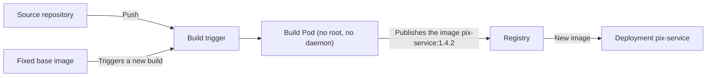

# Image Builder

## Description

The Image Builder pattern builds container images inside the Kubernetes cluster itself, using the platform's scheduler and resources to run the builds instead of an external build system. The classic approach compiles the image outside the cluster, pushes it to a registry and only then references the image in Deployments; here, build and run happen in the same place.

The gains come from unifying infrastructure: a single cluster reduces maintenance cost and simplifies capacity planning, and the Kubernetes scheduler is well suited to finding free resources for build jobs. Also, because the cluster knows both the build and the deployment, it can react automatically: if a base image with a vulnerability is fixed, all images that depend on it can be rebuilt and the applications redeployed without intervention.

The cost is security. Outside the cluster, the build runs isolated; inside, it shares the environment with production workloads. For this reason the pattern calls for **daemonless, non-root builds**, with tools that assemble the image without a privileged container daemon. The book (2019) illustrates the pattern with the OpenShift build subsystem (with Source-to-Image, Dockerfile builds, ImageStreams and rebuild triggers) and with Knative Build (a build resource whose steps become containers run in sequence in the Pod). These specific tools have changed since then: the book itself anticipates that Knative Build would be replaced by a successor project. Treat them as historical illustrations and check the current documentation of the tool you intend to adopt.

## Problems it solves

- Duplicated infrastructure: one cluster to run applications and another CI system to build the images
- Separate capacity planning and inefficient scheduling of build jobs on dedicated machines
- Distance between build and deployment, which makes it hard to rebuild and redeploy automatically when a base image changes
- Dependence on a privileged container daemon to assemble images

## When to use

- When company policy allows concentrating build and run in the same cluster
- When you want to automatically rebuild and redeploy applications when a base image is fixed
- When a cluster with capacity and scheduling already exists and can absorb the build jobs
- When the team can run builds without root privileges and isolate them from production workloads

## When to avoid

- When the security policy requires strong isolation between the build and production environments
- When a managed build service or the current CI already meets the need, at no extra operational cost
- When builds are heavy and may compete for resources with critical workloads, with no namespaces, quotas or dedicated nodes to isolate them
- When the team cannot maintain the build tooling inside the platform

## Trade-offs

| Benefit | Cost / Risk |
| --- | --- |
| A single infrastructure to build and run, with lower maintenance cost | Builds run in the same cluster as production workloads, widening the attack surface |
| Takes advantage of the Kubernetes scheduler to allocate build jobs | Heavy builds can compete for resources with critical services |
| Automatic rebuild and redeploy when the base image changes | Dependence on specific tools, some evolving quickly or already discontinued |
| Daemonless, non-root builds reduce the risk of container escape | In-cluster builds are often slower, without layer and dependency caching |

- **No privileges:** prefer daemonless, non-root build tools; avoid mounting the host daemon socket into the build container.
- **Isolation:** use namespaces, ResourceQuotas, [Predictable Demands](/architecture/kubernetes-patterns/foundational/predictable-demands) and dedicated nodes so builds do not affect services.
- **Slim image:** separate the build environment from the runtime (multi-stage or chained builds) so compilers do not reach production.
- **Cache:** a dependency repository inside the cluster reduces build time.
- **Credentials:** access to the registry and the source repository should use Secrets with minimal permissions.
- **Changing tools:** verify the current status of each tool before adopting it.

## Diagram

The build runs as a Pod of the cluster itself; the published image feeds the Deployment, and an update to a base image triggers a new build.

## Related patterns

- [Declarative Deployment](/architecture/kubernetes-patterns/foundational/declarative-deployment) — deploys the image produced by the build, with a controlled update strategy
- [Batch Job](/architecture/kubernetes-patterns/behavioral/batch-job) — a build is a finite workload, run to completion
- [Init Container](/architecture/kubernetes-patterns/structural/init-container) — build steps can run in sequence as the init containers of a Pod
- [Immutable Configuration](/architecture/kubernetes-patterns/configuration/immutable-configuration) — versioned, immutable images make the build result reproducible
- [Operator](/architecture/kubernetes-patterns/advanced/operator) — in-cluster build tools are often implemented as Operators with their own CRDs

## Reference

- [Kubernetes Patterns, chapter 25: Image Builder](https://k8spatterns.com/)
