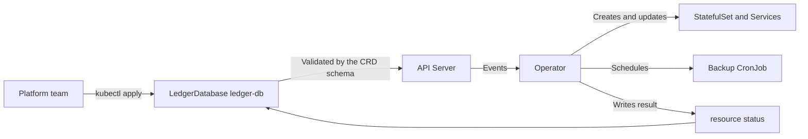

# Operator

## Description

The Operator pattern is a Controller that uses a CustomResourceDefinition (CRD) to encapsulate the operational knowledge of a specific application in an algorithmic, automated form. It extends the Kubernetes API with new domain resource types and runs a reconciliation loop that turns them into native resources and operational actions.

An Operator understands two domains: Kubernetes and the application it manages. Instead of a human following the runbook to install, upgrade, back up or restore a database, the team declares a resource such as `LedgerDatabase` and the Operator does the work, reporting the outcome in the `status` field. Because the custom resource is served by the API, it works with `kubectl`, per-type RBAC, namespaces, versioning and OpenAPI schema validation.

CRDs are usually of two kinds: **installation** CRDs (install and operate an application, such as a database or a Prometheus) and **application** CRDs (represent a domain concept, such as a service monitor). For cases a CRD cannot reach, there is also API aggregation, with a custom API server, which gives more freedom at the cost of much more code. There are frameworks for writing Operators, such as Operator SDK, Kubebuilder and Metacontroller, and they change over time.

## Problems it solves

- Complex or stateful applications whose operation (install, upgrade, scale, backup, restore) depends on specialized human knowledge
- Need for new domain concepts in the platform, described as declarative resources instead of scripts
- Lack of validation, versioning and per-type permissions when the configuration lives in ConfigMaps
- Weak integration with ecosystem tools, such as `kubectl`, GitOps and access control

## When to use

- When you want strong integration with Kubernetes tooling and to treat the domain as first-class resources
- To automate the lifecycle of stateful software, such as databases, queues and messaging systems
- When the domain is declarative and fits reactive reconciliation
- When you benefit from API groups, versions, namespaces and per-resource-type RBAC

## When to avoid

- When a simple [Controller](/architecture/kubernetes-patterns/advanced/controller) over standard resources is enough, without needing cluster administrator permission to register CRDs
- When the use case is not declarative or the data does not fit the Kubernetes resource model: prefer a dedicated API exposed through a Service or Ingress
- When a Helm chart or a well-written Deployment already meets the need, with no continuous operational logic
- When you need more storage flexibility than a CRD offers: consider an aggregated API server, aware of the cost

## Trade-offs

| Benefit | Cost / Risk |
| --- | --- |
| Operational knowledge that is versioned, testable and repeatable | Registering CRDs requires cluster administrator permission, since they are cluster-wide resources |
| Domain resources with `kubectl`, validation and per-type RBAC | More code and one more critical component to maintain and upgrade |
| Less human error in complex tasks such as backup and restore | A bug in the Operator can affect every managed instance |
| Continuously reconciled behavior, with visible status | CRD schema and version evolution requires a migration strategy |

- **Schema and status:** declare an OpenAPI schema and the `status` subresource so that configuration errors are detected early and the outcome is visible.
- **Lifecycle of the Operator itself:** installing and upgrading the Operator and its CRDs also needs a process, for example with a dedicated manager.
- **Overuse:** Kubernetes is not the answer to everything; model as a CRD only what is truly declarative.
- **Idempotency and failures:** the loop can be rerun at any time and must tolerate partial states.
- **Sensitive data:** operations such as backup and restore involve financial data; limit the Operator's permissions to what is necessary.

## Diagram



The team declares a `LedgerDatabase`; the Operator watches the resource, creates the necessary native resources, schedules the backups and updates the `status`, closing the reconciliation cycle.

## Example

The fintech's ledger runs on a database with replicas and backups. Instead of a runbook, the platform team defines a `LedgerDatabase` CRD (first manifest) and an Operator that reconciles it. The second manifest is an instance of the custom resource, declaring version, replicas and backup schedule.

```yaml
apiVersion: apiextensions.k8s.io/v1
kind: CustomResourceDefinition
metadata:
  name: ledgerdatabases.fintech.example
spec:
  group: fintech.example
  scope: Namespaced
  names:
    kind: LedgerDatabase
    singular: ledgerdatabase
    plural: ledgerdatabases
  versions:
    - name: v1
      served: true
      storage: true
      subresources:
        status: {}
      schema:
        openAPIV3Schema:
          type: object
          properties:
            spec:
              type: object
              required: [version, replicas]
              properties:
                version:
                  type: string
                replicas:
                  type: integer
                  minimum: 1
                backupSchedule:
                  type: string
            status:
              type: object
              properties:
                readyReplicas:
                  type: integer
                lastBackupTime:
                  type: string
```

```yaml
apiVersion: fintech.example/v1
kind: LedgerDatabase
metadata:
  name: ledger-db
  namespace: fintech
spec:
  version: "15.4"
  replicas: 3
  backupSchedule: "0 3 * * *" # every day at 3 AM
```

## Related patterns

- [Controller](/architecture/kubernetes-patterns/advanced/controller) — the basis of the Operator: the same reconciliation loop, but over standard resources
- [Stateful Service](/architecture/kubernetes-patterns/behavioral/stateful-service) — Operators often automate the operation of stateful applications that use StatefulSets
- [Singleton Service](/architecture/kubernetes-patterns/behavioral/singleton-service) — the Operator runs as a single active instance so it does not reconcile twice
- [Configuration Resource](/architecture/kubernetes-patterns/configuration/configuration-resource) — simple alternative to a CRD: a ConfigMap as the declarative description of the domain
- [Leader Election](/architecture/cloud-design-patterns/distributed-coordination/leader-election) — allows standby Operator replicas, with only one leader reconciling

## Reference

- [Kubernetes Patterns, chapter 23: Operator](https://k8spatterns.com/)
- [Operator pattern (Kubernetes documentation)](https://kubernetes.io/docs/concepts/extend-kubernetes/operator/)
- [Custom Resources (Kubernetes documentation)](https://kubernetes.io/docs/concepts/extend-kubernetes/api-extension/custom-resources/)
