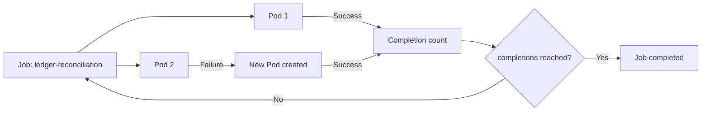

# Batch Job

## Description

The Batch Job pattern runs a finite, isolated unit of work in short-lived Pods, using the Kubernetes Job resource to make sure it finishes successfully even when containers or nodes fail. Unlike a Deployment or ReplicaSet, which keeps processes running indefinitely, a Job considers the work done when the expected number of Pods terminates successfully, and creates no more.

A bare Pod is not recreated if its node fails. The Job takes over that responsibility: it reschedules failed Pods, respects a retry limit and can run several executions in parallel. The `completions` field defines how many successful executions are required, `parallelism` how many run at the same time (the value is a desired ceiling, not a guarantee, and zero pauses the Job) and `restartPolicy` must be `OnFailure` or `Never`. Combining the two fields yields three types of Job: the **single Pod**, with the default values, completed when the Pod finishes successfully; the **fixed completion count**, with `completions` greater than one, suited to when the number of items is known and each justifies a Pod; and the **work queue**, with no `completions` and `parallelism` greater than one, in which the Pods coordinate among themselves what to process and the Job ends when one of them exits successfully and the others have also finished.

## Problems it solves

- Finite tasks that must finish reliably, without depending on a bare Pod that is lost if the node goes down
- Processing that must be retried automatically when it fails, with a retry limit
- Large volumes of work that must be split among several parallel executions
- Resources held by processes that have already finished, when the work should free capacity as it ends

## When to use

- In data migrations, reconciliations, report generation and one-off loads
- When the work has a well-defined start and end and can be safely repeated
- When you need to parallelize the processing of a queue or of a set of indexed items
- When the result only matters after completion, and the compute cost should be paid only during execution

## When to avoid

- For services that must stay up continuously: use a Deployment
- For recurring work at defined times: prefer the [Periodic Job](/architecture/kubernetes-patterns/behavioral/periodic-job)
- When the task is not idempotent and repeated executions after a failure cannot be tolerated
- For long flows with complex dependencies between steps, which call for a workflow orchestrator

## Trade-offs

| Benefit | Cost / Risk |
| --- | --- |
| Reliable execution, with automatic rescheduling after failures | A task may run more than once, so it must be idempotent |
| Configurable parallelism without extra coordination code | Requires sizing `completions`, `parallelism` and retry limits |
| Resources released when the work ends | Completed Pods remain until cleaned up, which calls for a retention policy |
| Simple, declarative model for one-off tasks | No dependencies between Jobs: orchestrating steps requires another tool |

- **Idempotency:** after a failure, the Pod is redone from the start; write results so that repeating does not duplicate entries.
- **Limits:** set `backoffLimit` and `activeDeadlineSeconds` so that a faulty Job does not retry forever.
- **Cleanup:** use `ttlSecondsAfterFinished` to remove completed Jobs automatically.
- **Job type:** the fixed count suits large, known items; the work queue suits small items, where one Pod per item would be excessive cost, and requires the Pods to coordinate.
- **Item mapping:** one Job per item allows tracking and scaling each one, but burdens the platform; one Job for all items requires a batch framework inside the application.
- **Continuous flow:** for an unbounded stream of items, a ReplicaSet is more suitable than a Job.

## Diagram



The Job creates Pods in parallel, replaces the ones that fail and is only marked as complete when the number of successful executions reaches the value of `completions`.

## Example

A daily reconciliation of the fintech's ledger, run by four Pods in two parallel lanes, with a retry limit and automatic cleanup.

```yaml
apiVersion: batch/v1
kind: Job
metadata:
  name: ledger-reconciliation
  namespace: fintech
spec:
  completions: 4
  parallelism: 2
  backoffLimit: 3
  activeDeadlineSeconds: 3600
  ttlSecondsAfterFinished: 86400
  template:
    metadata:
      labels:
        app: ledger-service
    spec:
      restartPolicy: OnFailure
      containers:
        - name: reconciler
          image: registry.fintech.example/ledger-service:1.4.2
          args: ["reconcile", "--date=2026-11-15"]
          resources:
            requests:
              cpu: 500m
              memory: 512Mi
```

`restartPolicy: OnFailure` is mandatory in a Job, and the `backoffLimit` and `activeDeadlineSeconds` limits prevent endless retries.

## Related patterns

- [Periodic Job](/architecture/kubernetes-patterns/behavioral/periodic-job) — the CronJob creates Jobs at defined times, adding the time dimension
- [Predictable Demands](/architecture/kubernetes-patterns/foundational/predictable-demands) — declaring the Job's requests and limits helps the scheduler place it
- [Managed Lifecycle](/architecture/kubernetes-patterns/foundational/managed-lifecycle) — the Job's Pod must handle the termination signal and exit with the correct exit code
- [Init Container](/architecture/kubernetes-patterns/structural/init-container) — prepares data or dependencies before the Job's main container
- [Idempotent Consumer](/architecture/cloud-design-patterns/messaging/idempotent-consumer) — makes it safe to reprocess items when a Pod is rerun

## Reference

- [Kubernetes Patterns, chapter 7: Batch Job](https://k8spatterns.com/)
- [Jobs in the Kubernetes documentation](https://kubernetes.io/docs/concepts/workloads/controllers/job/)
