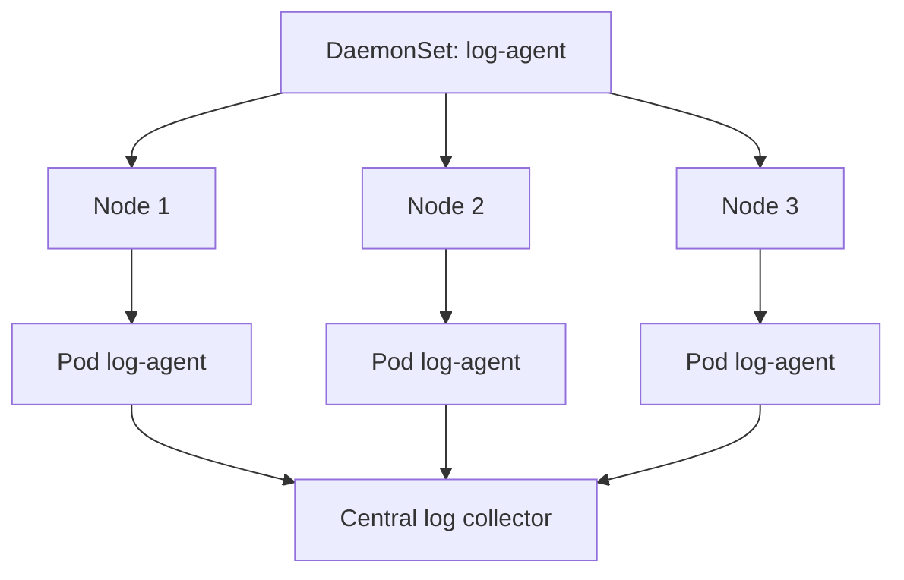

# Daemon Service

## Description

The Daemon Service pattern runs an infrastructure Pod on every node of the cluster, or on a chosen subset of nodes, using the DaemonSet resource to extend the platform's capabilities. Unlike a ReplicaSet, whose replica count follows application demand, the DaemonSet is not driven by load: the goal is to keep exactly one Pod per eligible node, and new nodes receive the Pod automatically.

It is the typical model for log collectors, monitoring agents, network and storage plugins and security components that must sit next to the node. The Pod can be restricted with `nodeSelector` or affinity, tolerate taints to run on dedicated nodes and use a high priority so it is not evicted before the applications. Because these Pods often access node resources, such as the file system or the host network, privilege configuration deserves attention. Updates use `updateStrategy`, usually `RollingUpdate` with an unavailability limit.

Other differences from the ReplicaSet: DaemonSet Pods are created with `nodeName` already set, so they do not depend on the scheduler and can run before it, which allows using the DaemonSet for Kubernetes' own components; for that reason the node's `unschedulable` field is not respected; and these Pods are treated with higher priority by other controllers, such as the descheduler, which avoids evicting them, and the cluster autoscaler, which manages them separately.

## Problems it solves

- Platform functions that must run on every node, such as log and metric collection
- Agents that depend on local node resources, such as disks, devices and the host network
- Guaranteeing automatic coverage when the cluster gains or loses nodes, with no manual intervention
- Infrastructure components that must take priority over application workloads

## When to use

- For observability agents, log collectors and per-node metric exporters
- For network, storage and security components that operate at the node level
- When a resource exists only on some nodes, such as special hardware, and the Pod must follow it
- When the number of Pods should follow the number of nodes, not application load

## When to avoid

- For ordinary application workloads, whose scale should follow demand: use a Deployment
- When one Pod per node is wasteful and a few instances are enough
- When the work is finite: use a [Batch Job](/architecture/kubernetes-patterns/behavioral/batch-job)
- When the functionality can be delivered by a [Sidecar](/architecture/cloud-design-patterns/integration-and-modernization/sidecar) next to each application, with no node access

## Trade-offs

| Benefit | Cost / Risk |
| --- | --- |
| Automatic coverage of every node, including new ones | CPU and memory use on every node, taken from application capacity |
| Direct access to local node resources | Elevated privileges widen the attack surface |
| Priority and tolerations to run on dedicated nodes | A faulty agent affects all nodes at once |
| Declarative model, no per-machine install scripts | Updating every node requires a strategy and an unavailability limit |

- **Resources:** declare requests and limits, since the agent competes with applications for node capacity.
- **Tolerations:** without `tolerations`, the Pod does not run on tainted nodes, such as control plane or dedicated hardware nodes.
- **Priority:** use a high `priorityClassName` so that essential agents are not evicted under resource pressure.
- **Security:** grant only the capabilities and host volumes that are actually needed.
- **Update:** tune `maxUnavailable` to limit how many nodes are temporarily without the agent.
- **Reaching the Pods:** there are four ways: a Service with the same selector (balanced to any node), a headless Service that returns the IPs of all Pods, `hostPort` on the node IP (which limits where the Pod fits) or the Pod itself sending data to a known destination (push).
- **Static Pods:** the kubelet can also run Pods defined in a local directory, with no controller or health checks; the DaemonSet is more integrated with the platform and is the recommended option.

## Diagram



The DaemonSet keeps one agent Pod on every node, and each agent forwards the logs of the Pods on that node, such as those of `pix-service` and `ledger-service`, to the central collector.

## Example

A fintech log agent on every node, including those with dedicated-workload taints, with high priority and read access to the host logs.

```yaml
apiVersion: apps/v1
kind: DaemonSet
metadata:
  name: log-agent
  namespace: fintech
spec:
  selector:
    matchLabels:
      app: log-agent
  updateStrategy:
    type: RollingUpdate
    rollingUpdate:
      maxUnavailable: 1
  template:
    metadata:
      labels:
        app: log-agent
    spec:
      priorityClassName: system-node-critical
      tolerations:
        - operator: Exists
          effect: NoSchedule
      containers:
        - name: agent
          image: registry.fintech.example/log-agent:2.3.0
          resources:
            requests:
              cpu: 100m
              memory: 128Mi
          volumeMounts:
            - name: varlog
              mountPath: /var/log
              readOnly: true
      volumes:
        - name: varlog
          hostPath:
            path: /var/log
```

The `hostPath` volume is read-only and the update replaces one node at a time, which limits the impact of a faulty version.

## Related patterns

- [Sidecar](/architecture/cloud-design-patterns/integration-and-modernization/sidecar) — delivers capabilities next to each application, while the DaemonSet delivers them next to each node
- [Automated Placement](/architecture/kubernetes-patterns/foundational/automated-placement) — selectors, affinities and taints determine on which nodes the DaemonSet runs
- [Predictable Demands](/architecture/kubernetes-patterns/foundational/predictable-demands) — requests and limits keep the agent from harming the applications on the node
- [Batch Job](/architecture/kubernetes-patterns/behavioral/batch-job) — contrast between continuous per-node processes and finite tasks
- [Singleton Service](/architecture/kubernetes-patterns/behavioral/singleton-service) — the opposite extreme, with a single instance in the whole cluster

## Reference

- [Kubernetes Patterns, chapter 9: Daemon Service](https://k8spatterns.com/)
- [DaemonSet in the Kubernetes documentation](https://kubernetes.io/docs/concepts/workloads/controllers/daemonset/)
