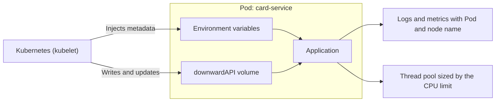

# Self Awareness

## Description

The Self Awareness pattern lets an application learn information about itself and the environment it runs in, using the Kubernetes Downward API to inject Pod metadata through environment variables or files. The application reads these values locally, with no need for a Kubernetes API client and without depending on the platform.

Even stateless, disposable applications sometimes need things that only exist at runtime: the Pod name and IP, the node name, the namespace and the service account. Other information comes from the Pod definition, such as CPU and memory requests and limits, used to tune the size of thread pools or the heap. There is also data that can change while the Pod is running, such as labels and annotations. With `fieldRef` and `resourceFieldRef`, the developer picks the keys of interest and Kubernetes fills in the values. Environment variables are fixed when the container is created; a `downwardAPI` volume, on the other hand, exposes files that are updated when labels and annotations change. For needs beyond that, such as listing other Pods, the application must query the Kubernetes API directly, with the right RBAC permissions.

## Problems it solves

- Identifying the instance in logs, metrics and traces, with the Pod and node name
- Adjusting behavior to what was reserved, such as pool and memory sizes according to the limits
- Accessing labels and annotations that change during execution, without restarting
- Avoiding coupling the application to the Kubernetes API client just to read basic data

## When to use

- When the application needs the name, IP, namespace or node for logs, metrics or registration with external services
- To size the JVM, connection pools or thread pools based on the container's requests and limits
- When labels and annotations change behavior and must be read at runtime
- To keep the application Kubernetes-agnostic, with data arriving through the environment and files

## When to avoid

- When the information is application configuration: use [ConfigMap and Secret](/architecture/kubernetes-patterns/configuration/configuration-resource)
- When the application needs cluster data beyond its own Pod, such as other resources: access the API with appropriate RBAC
- When the value must change in environment variables after creation, which does not happen
- When exposing metadata could leak sensitive information, such as internal names, to those who should not see it

## Trade-offs

| Benefit | Cost / Risk |
| --- | --- |
| Application independent of the Kubernetes API client | Covers only the Pod's own metadata, not the cluster state |
| Correct, dynamic data without configuring it manually | Environment variables are not updated after the container starts |
| Same variable and file mechanism used for configuration | Limited set of available fields |
| Automatic sizing according to the Pod's limits | Resource values must be interpreted in the correct unit |

- **Variables versus volume:** use variables for stable data and the `downwardAPI` volume for labels and annotations that change.
- **Units:** `resourceFieldRef` accepts `divisor` to deliver CPU and memory in millicores or megabytes, as the application expects.
- **Reloading:** whoever reads files must watch them to notice updates to labels and annotations; without that, a Pod restart may be needed.
- **Fixed keys:** `fieldRef` covers name, namespace, IPs, node, service account, uid, labels and annotations, and `resourceFieldRef` covers the container's CPU and memory requests and limits; any other data requires querying the Kubernetes API, as applications do when they discover Pods with certain labels to form a cluster or to monitor them.
- **Security:** do not expose anything beyond what is needed, since annotations may contain internal data.

## Diagram



The kubelet fills variables and files with the Pod metadata, and the application uses them to identify the instance and adjust its behavior without querying the Kubernetes API.

## Example

A `card-service` Pod that receives its name, namespace, IP and memory limit through variables, plus labels and annotations through a file.

```yaml
apiVersion: v1
kind: Pod
metadata:
  name: card-service-demo
  namespace: fintech
  labels:
    app: card-service
    tier: backend
  annotations:
    team: cards
spec:
  containers:
    - name: card-service
      image: registry.fintech.example/card-service:1.4.2
      env:
        - name: POD_NAME
          valueFrom:
            fieldRef:
              fieldPath: metadata.name
        - name: POD_NAMESPACE
          valueFrom:
            fieldRef:
              fieldPath: metadata.namespace
        - name: POD_IP
          valueFrom:
            fieldRef:
              fieldPath: status.podIP
        - name: MEMORY_LIMIT_MB
          valueFrom:
            resourceFieldRef:
              containerName: card-service
              resource: limits.memory
              divisor: 1Mi
      resources:
        limits:
          memory: 512Mi
      volumeMounts:
        - name: podinfo
          mountPath: /etc/podinfo
  volumes:
    - name: podinfo
      downwardAPI:
        items:
          - path: labels
            fieldRef:
              fieldPath: metadata.labels
          - path: annotations
            fieldRef:
              fieldPath: metadata.annotations
```

The variables hold from the container start, and the files in `/etc/podinfo` are updated when labels and annotations change.

## Related patterns

- [Predictable Demands](/architecture/kubernetes-patterns/foundational/predictable-demands) — the declared requests and limits are exactly the values the application can read
- [EnvVar Configuration](/architecture/kubernetes-patterns/configuration/envvar-configuration) — uses the same environment variable mechanism, but for user-defined configuration
- [Configuration Resource](/architecture/kubernetes-patterns/configuration/configuration-resource) — ConfigMap and Secret deliver configuration, while the Downward API delivers platform-generated metadata
- [Service Discovery](/architecture/kubernetes-patterns/behavioral/service-discovery) — the Pod name and namespace help build DNS names and registrations
- [Controller](/architecture/kubernetes-patterns/advanced/controller) — when the application must watch and react to cluster state, the path is the Kubernetes API

## Reference

- [Kubernetes Patterns, chapter 14: Self Awareness](https://k8spatterns.com/)
- [Expose Pod information through environment variables](https://kubernetes.io/docs/tasks/inject-data-application/environment-variable-expose-pod-information/)
- [Expose Pod information through files](https://kubernetes.io/docs/tasks/inject-data-application/downward-api-volume-expose-pod-information/)
