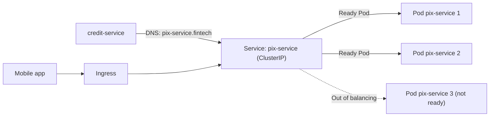

# Service Discovery

## Description

The Service Discovery pattern gives a set of Pods a stable access point, with a fixed name and address, using the Kubernetes Service resource so that consumers find producers without knowing their dynamic addresses. Pods are born and die all the time, and their IPs change on every recreation; the Service hides that volatility behind a virtual IP and a DNS name.

The Service selects Pods by labels and keeps the address list up to date, including only those that are ready, according to the readiness probe. Callers use the Service name, which the cluster DNS resolves to the virtual IP, and traffic is distributed among the Pods. In **internal** discovery, the `ClusterIP` type exposes the service inside the cluster, and the headless Service (`clusterIP: None`) directly returns the Pod IPs, useful for StatefulSets and for client-side balancing. In **manual** discovery, a Service with no selector points to Endpoints resources kept by hand (usually IPs outside the cluster), and `ExternalName` creates a DNS alias (CNAME) to an external name; this way the destination can migrate from outside to inside the cluster without changing the address clients use. In discovery from **outside** the cluster, `NodePort` opens a port on every node, `LoadBalancer` adds a cloud provider balancer and the Ingress, at the application layer, acts as an HTTP router in front of several Services, with a single balancer and external IP.

## Problems it solves

- Pod addresses that change on every restart, rescheduling or scaling
- Consumers coupled to fixed IPs or to manual configuration of destinations
- Traffic distribution among several replicas without a dedicated balancer
- Requests sent to Pods that are not yet ready or have already failed

## When to use

- Whenever a component must be called by others and runs in more than one Pod or may be recreated
- When you want discovery by DNS name or environment variables, with no explicit registration in the application
- To expose a service outside the cluster, through NodePort, LoadBalancer or Ingress
- To give a stable internal name to an external service, such as a third-party API

## When to avoid

- When the consumer must choose the instance with its own logic: use a headless Service and client-side discovery
- For advanced protocols or balancing (for example, per request or per header), which call for a layer 7 proxy or a service mesh
- To identify a specific replica of a stateful service without the headless Service
- When a single Pod is called by a known and stable name, and the Service adds nothing

## Trade-offs

| Benefit | Cost / Risk |
| --- | --- |
| Stable name and IP, independent of the Pods' lifecycle | Balancing is simple, with no awareness of load or session |
| Automatic registration and removal, driven by labels and readiness | A wrong label selector leaves the Service without endpoints, with no obvious error |
| Platform-independent application, which only uses DNS names | Depends on the cluster DNS, which must be healthy and well tuned for caching |
| Internal and external exposure options in the same model | External exposure needs more configuration and security care |

- **Readiness:** only ready Pods join the Service; a badly configured probe drops capacity or sends traffic too early.
- **Environment variables:** they are injected only when the Pod is created, so DNS is the preferred way and works regardless of creation order.
- **Full names:** use `<service>.<namespace>` for calls across namespaces.
- **Client caching:** clients that keep the resolved IP for too long may keep using old addresses.
- **Security:** combine with NetworkPolicy to control who can call whom.
- **Layer 4:** the Service balances at the transport layer; `sessionAffinity: ClientIP` pins a client to a Pod, but HTTP cookie affinity requires an Ingress or layer 7 proxy.
- **NodePort:** requires firewall rules and that the client pick a healthy node (a balancer in front helps); `externalTrafficPolicy: Local` avoids the extra hop and preserves the source IP, but only forwards to Pods on the same node.
- **LoadBalancer:** depends on cloud provider support, and the handling of the source address varies between providers.
- **Ingress:** it is the most powerful and the most complex mechanism, requires an Ingress controller in the cluster and is most useful for exposing several services under one IP when all speak the same layer 7 protocol.

## Diagram



Internal consumers call the Service name and traffic reaches only the ready Pods; the Ingress brings external traffic to the same Service.

## Example

The `pix-service` exposed inside the cluster by a Service, with a readiness probe that defines which Pods receive traffic.

```yaml
apiVersion: v1
kind: Service
metadata:
  name: pix-service
  namespace: fintech
spec:
  type: ClusterIP
  selector:
    app: pix-service
  ports:
    - name: http
      port: 80
      targetPort: 8080
---
apiVersion: apps/v1
kind: Deployment
metadata:
  name: pix-service
  namespace: fintech
spec:
  replicas: 3
  selector:
    matchLabels:
      app: pix-service
  template:
    metadata:
      labels:
        app: pix-service
    spec:
      containers:
        - name: pix-service
          image: registry.fintech.example/pix-service:1.4.2
          ports:
            - containerPort: 8080
          readinessProbe:
            httpGet:
              path: /ready
              port: 8080
```

Other services call `http://pix-service` in the same namespace or `pix-service.fintech` from outside it; only the Pods that pass the readiness probe enter the endpoint list.

## Related patterns

- [Server-Side Discovery](/architecture/microservices/service-discovery/server-side-discovery) — the Kubernetes Service is the native form of this strategy, with the platform resolving and balancing
- [Client-Side Discovery](/architecture/microservices/service-discovery/client-side-discovery) — the headless Service lets the client obtain the IPs and choose the instance
- [Health Probe](/architecture/kubernetes-patterns/foundational/health-probe) — the readiness probe determines which Pods the Service includes
- [Stateful Service](/architecture/kubernetes-patterns/behavioral/stateful-service) — uses a headless Service to give each Pod a DNS name
- [Ambassador](/architecture/cloud-design-patterns/integration-and-modernization/ambassador) — a helper proxy can abstract discovery and access to external services
- [Self Awareness](/architecture/kubernetes-patterns/behavioral/self-awareness) — the Pod can learn its own name and namespace to register itself or build DNS names

## Reference

- [Kubernetes Patterns, chapter 13: Service Discovery](https://k8spatterns.com/)
- [Service in the Kubernetes documentation](https://kubernetes.io/docs/concepts/services-networking/service/)
- [DNS for Services and Pods in the Kubernetes documentation](https://kubernetes.io/docs/concepts/services-networking/dns-pod-service/)
