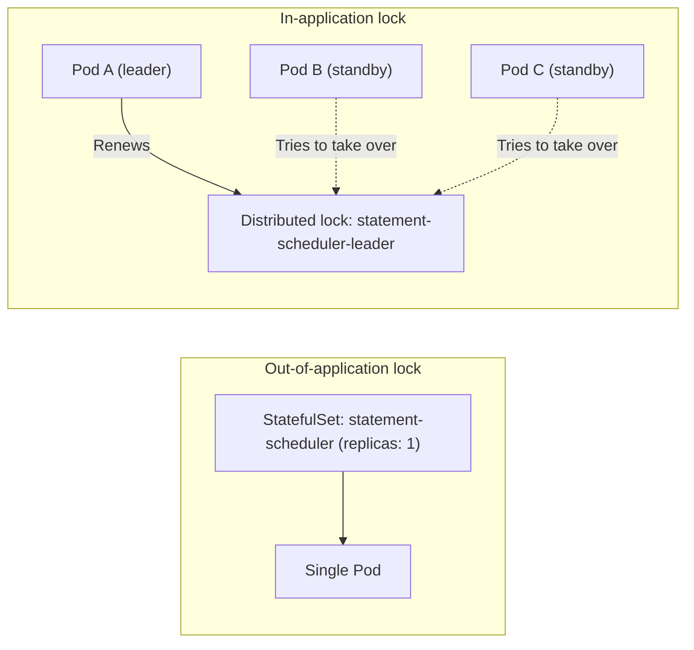

# Singleton Service

## Description

The Singleton Service pattern guarantees that only one active instance of a service runs at a time, either through external control by the platform or through a leadership contest inside the application itself. It serves tasks that cannot run in parallel, such as a consumer that must process messages in strict order or a scheduler that must not fire the same routine twice.

Do not confuse it with the GoF Singleton, which limits the instances of a class inside a process. Here the restriction applies to Pods in a distributed cluster. There are two approaches. With an **out-of-application lock**, Kubernetes enforces uniqueness: a StatefulSet with one replica offers at-most-one semantics, since it only recreates the Pod after confirming that the previous one has terminated, while a ReplicaSet with one replica favors availability and may, during partitions, briefly have two. With an **in-application lock**, several instances run, but only the leader works, with the election held through a distributed lock, such as ZooKeeper, Consul, Redis or etcd, or through the Kubernetes API itself, which offers optimistic locking when editing resources such as ConfigMap and Lease, so that only one Pod can update it at a time. The other instances stay passive, trying to acquire the lock, and take over if the leader fails. This path also avoids the risk of someone raising the replica count by mistake, something the platform does not prevent in the external approach, and allows locking only one component of the application, keeping the rest scalable.

The PodDisruptionBudget is complementary: instead of limiting how many instances run, it limits how many can be unavailable through voluntary removals, such as draining a node.

## Problems it solves

- Tasks that corrupt data or duplicate effects when run in parallel, such as ordered consumption of a queue
- Components with local state or an exclusive lock, which do not tolerate two active instances
- High availability for a service that can only have one executor, with fast takeover on failure
- Duplicated schedules and triggers when the application runs with several replicas

## When to use

- When the logic requires serial execution, such as closing the accounting day or applying migrations in a coordinated way
- When an external resource allows a single active consumer at a time
- When you must choose between strict uniqueness (at most one) and availability (at least one) and the former is the requirement
- With leader election, when the recovery time of a single replica is too long

## When to avoid

- For services that scale horizontally: a singleton becomes a bottleneck and a single point of failure
- When the logic can be made idempotent and concurrent executions can be accepted
- When the work is finite and scheduled: prefer a [Periodic Job](/architecture/kubernetes-patterns/behavioral/periodic-job)
- When the complexity of leader election outweighs the benefit for a simple case

## Trade-offs

| Benefit | Cost / Risk |
| --- | --- |
| Guaranteed serial execution, with no unwanted concurrency | Capacity limited to one instance and a risk of bottleneck |
| Simple external lock, with no extra application code | Slower recovery, since the Pod is only recreated after confirming the previous one has terminated |
| Internal election with fast failover among standby instances | Adds complexity and depends on a consensus store |
| At-most-one guarantee with a StatefulSet | During recovery, the service is briefly unavailable |

- **At-most-one versus at-least-one:** StatefulSet prefers consistency and ReplicaSet prefers availability; choose based on the business requirement.
- **Replica count:** with the external lock, nothing in the platform prevents the replica count from being raised by accident.
- **Partial singleton:** if only part of the application must be unique, the external lock prevents scaling the whole; splitting the component into another deployment unit or locking only it from inside solves this.
- **Voluntary disruptions:** a PodDisruptionBudget, with `minAvailable` or `maxUnavailable` (never both), limits voluntary removals such as node drains; it also serves quorum-based applications.
- **Headless Service:** with a StatefulSet, a Service without a cluster IP exposes the Pod through a stable DNS name.
- **Leader election:** use locks with an expiry time and renew them regularly, treating the loss of leadership as a reason to stop working immediately.

## Diagram



On the left, the platform guarantees uniqueness with a single replica; on the right, several replicas compete for a lock and only the leader does the work.

## Example

A recurring-entry scheduler of the fintech that must not run in duplicate, with a single StatefulSet replica and a PodDisruptionBudget that blocks voluntary removal.

```yaml
apiVersion: apps/v1
kind: StatefulSet
metadata:
  name: statement-scheduler
  namespace: fintech
spec:
  serviceName: statement-scheduler
  replicas: 1
  selector:
    matchLabels:
      app: statement-scheduler
  template:
    metadata:
      labels:
        app: statement-scheduler
    spec:
      containers:
        - name: scheduler
          image: registry.fintech.example/statement-service:1.4.2
          args: ["run-scheduler"]
---
apiVersion: policy/v1
kind: PodDisruptionBudget
metadata:
  name: statement-scheduler
  namespace: fintech
spec:
  maxUnavailable: 0
  selector:
    matchLabels:
      app: statement-scheduler
```

The StatefulSet with `replicas: 1` enforces at most one instance, and the PodDisruptionBudget with `maxUnavailable: 0` blocks voluntary removals, such as node drains, that would happen without coordination.

## Related patterns

- [Singleton](/coding/gof/creational/singleton) — the GoF Singleton limits the instances of a class in a process, while here uniqueness applies to Pods in a cluster
- [Leader Election](/architecture/cloud-design-patterns/distributed-coordination/leader-election) — basis of the in-application lock approach, choosing which instance works
- [Stateful Service](/architecture/kubernetes-patterns/behavioral/stateful-service) — the StatefulSet provides the identity and the at-most-one guarantee used here
- [Periodic Job](/architecture/kubernetes-patterns/behavioral/periodic-job) — alternative for scheduled tasks that only need to run once per period
- [Health Probe](/architecture/kubernetes-patterns/foundational/health-probe) — probes help detect the failure of the single instance and speed up recovery

## Reference

- [Kubernetes Patterns, chapter 10: Singleton Service](https://k8spatterns.com/)
- [StatefulSets in the Kubernetes documentation](https://kubernetes.io/docs/concepts/workloads/controllers/statefulset/)
- [Leases in the Kubernetes documentation](https://kubernetes.io/docs/concepts/architecture/leases/)
