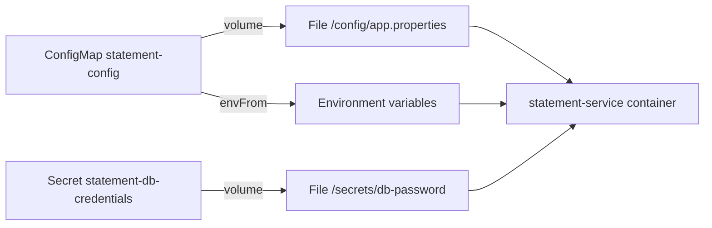

# Configuration Resource

## Description

The Configuration Resource pattern keeps an application's configuration in native Kubernetes resources, ConfigMap for regular data and Secret for confidential data, decoupling the configuration lifecycle from the application lifecycle. Both resources store key-value pairs and are used the same way; the technical difference lies in the Base64 encoding of a Secret's values and in the extra care the platform applies to them.

Keys can be consumed in two ways: as environment variables (per key with `configMapKeyRef` or all at once with `envFrom`) or as files in a volume mounted in the Pod, where each key becomes a file name. Mounted files are updated when the resource changes, which allows hot reload if the application supports it; environment variables are not.

A Secret is not encryption: Base64 is equivalent to plain text. What makes it safer is the platform's handling, such as distributing it only to the nodes that need it, keeping it in memory (tmpfs) on the nodes and allowing encryption at rest in etcd, plus access control through RBAC. This pattern is a relative of the [External Configuration Store](/architecture/cloud-design-patterns/deployment-and-topology/external-configuration-store), but distinct: here the storage is the cluster itself and delivery happens through the Pod, with no external service queried by the application.

## Problems it solves

- Limits of EnvVar Configuration: many parameters and entire files do not fit in environment variables
- Definitions scattered across image, manifests and platform, with no single place to look
- The need to change configuration without rebuilding the image or editing the workload manifest
- Separation between regular and sensitive data, with distinct access policies

## When to use

- When the configuration includes files (properties, YAML, JSON) or many key-value pairs
- When you want to concentrate configuration in a versioned resource managed by the Kubernetes API
- When the application can reload configuration files without restarting
- When credentials and certificates need a resource of their own, with RBAC and encryption at rest

## When to avoid

- When the configuration is huge: the total limit of a ConfigMap or Secret is about 1 MB, imposed by etcd
- For application data that is not configuration, such as large binary files
- When you need to guarantee immutability and version tracking outside the cluster (consider Immutable Configuration)
- When there are strict ConfigMap quotas per namespace or when RBAC access to Secrets is not well controlled

## Trade-offs

| Benefit | Cost / Risk |
| --- | --- |
| Configuration in a single place, managed by the Kubernetes API | Limit of roughly 1 MB per resource and quotas per namespace |
| Decouples the definition of configuration from its use | Anyone who can create Pods in a namespace can read that namespace's Secrets and ConfigMaps |
| Mounted files are updated without recreating the Pod | Environment variables derived from the resource do not update without a restart |
| Native resource, no extra components | Base64 is not encryption; encryption at rest and RBAC must be enabled |

- **Keys:** use uppercase for keys consumed as environment variables and real file names for those mounted as volumes.
- **Updates:** changing the resource does not restart the Pod; combine it with a content hash in the template or with reload in the application.
- **Secrets:** never version real values in Git; use secret management tools and treat the manifest as if it were public.
- **Access scope:** restrict reads per ServiceAccount and avoid allowing Pod creation to those who should not see the namespace's Secrets.
- **Outside the cluster:** for a central repository shared by several systems, evaluate the External Configuration Store.

## Diagram



The ConfigMap feeds environment variables and files, and the Secret is mounted as a file; only the mounted files are updated when the resources change.

## Example

```yaml
apiVersion: v1
kind: ConfigMap
metadata:
  name: statement-config
  namespace: fintech
data:
  STATEMENT_PAGE_SIZE: "50"
  application.properties: |
    statement.retention-days=365
    statement.export.max-rows=10000
```

```yaml
apiVersion: apps/v1
kind: Deployment
metadata:
  name: statement-service
  namespace: fintech
spec:
  replicas: 2
  selector:
    matchLabels:
      app: statement-service
  template:
    metadata:
      labels:
        app: statement-service
    spec:
      containers:
        - name: statement-service
          image: registry.fintech.example/statement-service:2.1.0
          envFrom:
            - configMapRef:
                name: statement-config
          volumeMounts:
            - name: config
              mountPath: /config
              readOnly: true
            - name: db-credentials
              mountPath: /secrets
              readOnly: true
      volumes:
        - name: config
          configMap:
            name: statement-config
        - name: db-credentials
          secret:
            secretName: statement-db-credentials
```

The ConfigMap carries a simple value and a properties file; the Deployment consumes them as environment variables and as a file, and mounts the Secret (created outside the repository) at `/secrets`.

## Related patterns

- [EnvVar Configuration](/architecture/kubernetes-patterns/configuration/envvar-configuration) — simplest way to configure, suited to a few values
- [Immutable Configuration](/architecture/kubernetes-patterns/configuration/immutable-configuration) — alternative for large, immutable configuration versioned in an image
- [Configuration Template](/architecture/kubernetes-patterns/configuration/configuration-template) — uses a ConfigMap with only the parameters that vary and generates the full files
- [Init Container](/architecture/kubernetes-patterns/structural/init-container) — prepares configuration from external sources in a shared volume
- [External Configuration Store](/architecture/cloud-design-patterns/deployment-and-topology/external-configuration-store) — stores configuration outside the cluster and the deployment, queried by the application

## Reference

- [Kubernetes Patterns, chapter 20: Configuration Resource](https://k8spatterns.com/)
- [ConfigMaps](https://kubernetes.io/docs/concepts/configuration/configmap/)
- [Secrets](https://kubernetes.io/docs/concepts/configuration/secret/)
