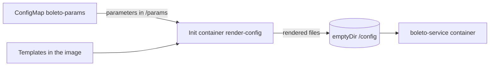

# Configuration Template

## Description

The Configuration Template pattern generates, at application startup, large and complex configuration files from a single template and a small set of environment-specific parameters. Instead of copying the whole file into a ConfigMap per environment, the template is stored once and only the values that really change, such as database addresses and log formats, are kept per environment.

In Kubernetes, the most appealing approach uses an [Init Container](/architecture/kubernetes-patterns/structural/init-container) that holds the template processor and the templates themselves. The parameters arrive through a ConfigMap mounted as a volume; the init container renders the final files into a shared `emptyDir` volume and, when it finishes, the application container starts reading the ready configuration. An alternative is to put the processing in the image ENTRYPOINT, with parameters coming from environment variables.

The main gain is maintenance without duplication: when the common configuration changes, a single template is updated, and moving the application from one environment to another changes only the parameters ConfigMap, not the Deployment. This prevents nearly identical copies from drifting apart over time.

## Problems it solves

- Large configuration files embedded in ConfigMaps, hard to escape and easy to break
- Duplication of nearly identical content across environments, with the risk of drift over time
- The roughly 1 MB limit on the set of values in ConfigMaps and Secrets
- The need to produce environment-specific configuration from a common source

## When to use

- When the application requires extensive configuration files and only a small fraction depends on the environment
- When you want a single maintenance point for the common part of the configuration
- When the per-environment parameters already live in a ConfigMap or in environment variables
- When copying the full file to each environment works today but is bound to diverge

## When to avoid

- When the configuration is small or fits comfortably in environment variables or a simple ConfigMap
- When the team does not want to take on more moving parts, such as a template processor and an extra image
- When the configuration must be validated and inspected as a final artifact before deployment
- When environments differ structurally, not just in a few values

## Trade-offs

| Benefit | Cost / Risk |
| --- | --- |
| Eliminates duplication and drift between environments (DRY) | More components: init container, processor and an image with the templates |
| Common changes are made in a single template | Template errors only show up when the Pod starts |
| The Deployment is the same in every environment; only the parameters change | Debugging the result requires inspecting the shared volume |
| Avoids embedding large, escaped files in ConfigMaps | The final configuration does not exist as an inspectable resource in the cluster |

- **Fail early:** if a required parameter is missing, the init container should fail, preventing the application from starting with incomplete configuration.
- **Parameters:** keep only values that vary per environment in the ConfigMap, and leave the rest inside the template.
- **Updates:** since rendering happens at startup, changing the ConfigMap requires recreating the Pod to reflect the change.
- **Secrets:** do not put sensitive values in ConfigMaps; pass them through a Secret, and avoid leaving them in rendered files readable by other containers.
- **Complexity:** adopt the pattern only when the configuration is really large; otherwise, [Configuration Resource](/architecture/kubernetes-patterns/configuration/configuration-resource) is simpler.

## Diagram



The init container combines the image templates with the ConfigMap parameters, writes the final configuration to a shared volume, and only then does the application start.

## Example

```yaml
apiVersion: v1
kind: ConfigMap
metadata:
  name: boleto-params
  namespace: fintech
data:
  params.yaml: |
    environment: production
    bankSlipDueDays: 3
    finePercentBasisPoints: 200
    registrationApiUrl: https://registration.fintech.example
```

```yaml
apiVersion: apps/v1
kind: Deployment
metadata:
  name: boleto-service
  namespace: fintech
spec:
  replicas: 2
  selector:
    matchLabels:
      app: boleto-service
  template:
    metadata:
      labels:
        app: boleto-service
    spec:
      initContainers:
        - name: render-config
          image: registry.fintech.example/boleto-config-templates:1.0.0
          volumeMounts:
            - name: params
              mountPath: /params
              readOnly: true
            - name: config
              mountPath: /out
      containers:
        - name: boleto-service
          image: registry.fintech.example/boleto-service:1.9.4
          volumeMounts:
            - name: config
              mountPath: /config
              readOnly: true
      volumes:
        - name: params
          configMap:
            name: boleto-params
        - name: config
          emptyDir: {}
```

The `boleto-config-templates` image contains the templates and the processor, reads `/params` and writes the final files to `/out`; for another environment, only the `boleto-params` ConfigMap changes, and the Deployment stays identical.

## Related patterns

- [Init Container](/architecture/kubernetes-patterns/structural/init-container) — runs the template processing before the application container
- [Configuration Resource](/architecture/kubernetes-patterns/configuration/configuration-resource) — provides the ConfigMap with the parameters that feed the templates
- [Immutable Configuration](/architecture/kubernetes-patterns/configuration/immutable-configuration) — alternative that packages each environment's full configuration in an image
- [EnvVar Configuration](/architecture/kubernetes-patterns/configuration/envvar-configuration) — another possible source of the template parameters
- [Sidecar](/architecture/cloud-design-patterns/integration-and-modernization/sidecar) — can keep the rendered configuration up to date during the Pod's life

## Reference

- [Kubernetes Patterns, chapter 22: Configuration Template](https://k8spatterns.com/)
- [Init Containers](https://kubernetes.io/docs/concepts/workloads/pods/init-containers/)
- [ConfigMaps](https://kubernetes.io/docs/concepts/configuration/configmap/)
