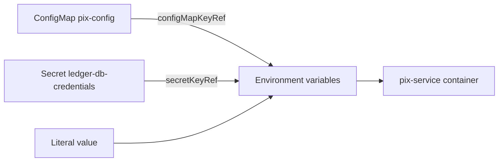

# EnvVar Configuration

## Description

The EnvVar Configuration pattern externalizes an application's configuration into environment variables, the simplest and most universally supported way to change a container's behavior without rebuilding the image. Every operating system and every language knows how to handle environment variables, which makes the approach portable across platforms.

In Kubernetes, variables are declared in the container's `env` field inside the Pod template of a Deployment. Each variable can receive a literal value or a reference (`valueFrom`) to a key of a ConfigMap, for non-sensitive data, or of a Secret, for confidential data. The indirection lets you manage the values separately from the workload definition.

Default values can be baked into the image and overridden at runtime, but they should be used with care: changing a default later requires a new build and surprises whoever relied on it. For parameters that depend on the environment, such as credentials and database addresses, it is better to have no default and fail early when the value is not provided.

## Problems it solves

- Configuration fixed in the code or in the image, which forces a rebuild of the artifact for each environment
- The need for a simple configuration mechanism that works in any language and platform
- Fine-tuning parameters (limits, addresses, flags) that change between development, staging and production
- Coupling between the workload definition and values that should be managed separately

## When to use

- When the set of parameters is small and each value is simple (text, number, boolean)
- When the application already reads its configuration from the environment, as in Twelve-Factor style applications
- When the configuration only needs to be read at startup and a change can come with a new version of the Pod
- When you want the same configuration contract in local runs, in tests and in the cluster

## When to avoid

- When there are dozens of parameters or entire configuration files: management becomes confusing and error-prone
- For high-risk secrets: environment variables are easy to read and can leak into logs and diagnostic dumps
- When the application must reload configuration at runtime, since a process environment does not change after it starts
- When the same variable is defined at several levels (image, manifest, platform) and nobody knows anymore where the final value comes from

## Trade-offs

| Benefit | Cost / Risk |
| --- | --- |
| Simplicity and universal support across languages and platforms | Does not scale well to large or structured configuration |
| Values independent of code and image | Sensitive values are exposed in the process environment and can appear in logs |
| ConfigMap and Secret indirection separates the lifecycle of configuration and workload | Definitions scattered across several levels make it hard to trace where each variable comes from |
| Reinforces immutability: changing the configuration means replacing the Pod | There is no hot tuning; any change requires restarting the container |

- **No ambiguous defaults:** for environment-dependent data, prefer requiring the value and failing at startup over assuming a silent default.
- **Traceability:** concentrate definitions in a few places, preferably in versioned ConfigMaps, to ease debugging.
- **Secrets:** use `secretKeyRef` and control access, but remember the value is still readable inside the process; consider mounting the Secret as a file.
- **Evolution:** when the number of variables grows, move to [Configuration Resource](/architecture/kubernetes-patterns/configuration/configuration-resource) or [Configuration Template](/architecture/kubernetes-patterns/configuration/configuration-template).

## Diagram



The container receives environment variables whose values come from literals, a ConfigMap or a Secret; the Pod must be recreated to reflect any change.

## Example

```yaml
apiVersion: apps/v1
kind: Deployment
metadata:
  name: pix-service
  namespace: fintech
spec:
  replicas: 2
  selector:
    matchLabels:
      app: pix-service
  template:
    metadata:
      labels:
        app: pix-service
    spec:
      containers:
        - name: pix-service
          image: registry.fintech.example/pix-service:1.4.2
          env:
            - name: LOG_LEVEL
              value: "info"
            - name: SETTLEMENT_WINDOW_SECONDS
              valueFrom:
                configMapKeyRef:
                  name: pix-config
                  key: settlement-window-seconds
            - name: LEDGER_DB_PASSWORD
              valueFrom:
                secretKeyRef:
                  name: ledger-db-credentials
                  key: password
```

`LOG_LEVEL` is a literal, the settlement window comes from a ConfigMap and the database password comes from a Secret (whose real value never appears in the manifest).

## Related patterns

- [Configuration Resource](/architecture/kubernetes-patterns/configuration/configuration-resource) — offers ConfigMap and Secret for larger configuration, with files mounted as volumes
- [Immutable Configuration](/architecture/kubernetes-patterns/configuration/immutable-configuration) — packages the configuration into a versioned image when immutability is needed
- [Configuration Template](/architecture/kubernetes-patterns/configuration/configuration-template) — generates large files from a few per-environment parameters
- [Declarative Deployment](/architecture/kubernetes-patterns/foundational/declarative-deployment) — changing a variable is applied through a rolling update of the Pod
- [External Configuration Store](/architecture/cloud-design-patterns/deployment-and-topology/external-configuration-store) — alternative that moves configuration out of the deployment lifecycle

## Reference

- [Kubernetes Patterns, chapter 19: EnvVar Configuration](https://k8spatterns.com/)
- [Define Environment Variables for a Container](https://kubernetes.io/docs/tasks/inject-data-application/define-environment-variable-container/)
