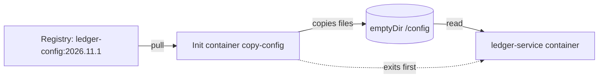

# Immutable Configuration

## Description

The Immutable Configuration pattern packages an environment's configuration data into a passive, versioned container image that is linked to the application only at runtime. Like any other image, this configuration image is published to a registry, receives version tags, can be inspected without access to the cluster and does not change once built: changing the configuration means producing a new version.

In Docker, the link can be made by exposing a directory as a volume in the configuration image and sharing it with the application container. Kubernetes has no direct support for sharing directories from inside containers, so the pattern uses an [Init Container](/architecture/kubernetes-patterns/structural/init-container): it runs the configuration image, copies the files to a shared `emptyDir` volume and exits, so the application container starts reading the files from that volume.

Switching environments becomes switching the init container image, which can be parameterized by manifest templating tools. The pattern solves immutability and configuration size, but not confidentiality: sensitive data inside an image still requires care.

## Problems it solves

- Configuration that can be changed at runtime and leaves the system in a state that is hard to reproduce
- Lack of versioning and of a controlled change process for each environment's configuration
- Configuration too large for environment variables or for the roughly 1 MB limit of a ConfigMap
- The need to inspect and distribute configuration through a registry, without cluster access

## When to use

- When the configuration must be immutable, versioned and auditable as a release artifact
- When configuration files are large and do not fit in environment variables or ConfigMaps
- When a formal change process requires promoting the same configuration across environments
- When the configuration must be distributed and examined through the same registry as the application images

## When to avoid

- When a simple ConfigMap is enough and immutability is not a requirement: the complexity does not pay off
- For sensitive data, since the image offers no protection of its own for secrets
- When the configuration changes frequently and each change cannot depend on a new build and a new rollout
- When the team does not want to maintain a different Deployment or manifest template per environment

## Trade-offs

| Benefit | Cost / Risk |
| --- | --- |
| Configuration versioned, immutable and distributed through a registry | More artifacts to build, publish and maintain |
| No practical limit on data size | Does not solve secrets; the image may expose sensitive data |
| Can be examined without accessing the cluster | Requires an init container and a shared volume in every Pod |
| Changes go through build, tag and rollout, which favors auditing | Different manifests per environment must be managed or parameterized |

- **Base image:** the init container needs a copy utility; minimal images with a shell are usually enough.
- **Promotion across environments:** keep the application image the same and change only the tag of the configuration image.
- **Rollback:** reverting the configuration means reverting the image tag, which makes reversal simple and predictable.
- **Secrets:** keep credentials out of the image and inject them through a Secret or an external manager.
- **Simpler alternative:** if immutability is not needed, [Configuration Resource](/architecture/kubernetes-patterns/configuration/configuration-resource) is enough.

## Diagram



The init container copies the configuration from the versioned image to a shared volume and exits; only then does the application container start and read the files.

## Example

```yaml
apiVersion: apps/v1
kind: Deployment
metadata:
  name: ledger-service
  namespace: fintech
spec:
  replicas: 3
  selector:
    matchLabels:
      app: ledger-service
  template:
    metadata:
      labels:
        app: ledger-service
    spec:
      initContainers:
        - name: copy-config
          image: registry.fintech.example/ledger-config:prod-2026.11.1
          args: ["/config"]
          volumeMounts:
            - name: config
              mountPath: /config
      containers:
        - name: ledger-service
          image: registry.fintech.example/ledger-service:3.2.0
          volumeMounts:
            - name: config
              mountPath: /config
              readOnly: true
      volumes:
        - name: config
          emptyDir: {}
```

The `ledger-config` image holds the production environment files and copies its content to the directory received as an argument; for another environment, just change the tag of that image.

## Related patterns

- [Init Container](/architecture/kubernetes-patterns/structural/init-container) — mechanism that links the configuration image to the application container
- [Configuration Resource](/architecture/kubernetes-patterns/configuration/configuration-resource) — simpler native alternative when immutability is not required
- [Configuration Template](/architecture/kubernetes-patterns/configuration/configuration-template) — another way to handle large configuration that changes little between environments
- [EnvVar Configuration](/architecture/kubernetes-patterns/configuration/envvar-configuration) — direct option for a few simple values
- [Declarative Deployment](/architecture/kubernetes-patterns/foundational/declarative-deployment) — changing the configuration image tag is applied through a controlled rollout

## Reference

- [Kubernetes Patterns, chapter 21: Immutable Configuration](https://k8spatterns.com/)
- [Init Containers](https://kubernetes.io/docs/concepts/workloads/pods/init-containers/)
- [Volumes](https://kubernetes.io/docs/concepts/storage/volumes/)
