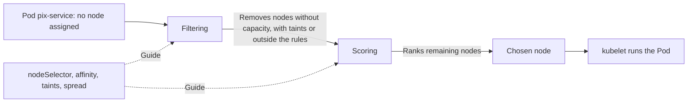

# Automated Placement

## Description

The Automated Placement pattern delegates to the Kubernetes scheduler the decision of which node each Pod will run on, considering the requested resources and the declared placement rules, and allows influencing that decision without choosing nodes manually. With dozens or hundreds of services, assigning processes to individual machines is no longer feasible, and the way they are distributed affects availability, performance and cost.

The scheduler works in two stages: first it **filters** out the nodes that do not suit the Pod (no capacity for the `requests`, missing the required volume or port, with untolerated taints) and then it **scores** the remaining ones to pick the best. The capacity considered is the node's allocatable amount, that is, the total minus what is reserved for the system and for the Kubernetes daemons. That is why the pattern depends on declared resource profiles (Predictable Demands).

When the default behavior is not enough, the decision can be guided by mechanisms that range from simple to complex: `nodeSelector` (exact node labels), **node affinity** (required or preferred rules, with richer operators), **Pod affinity and anti-affinity** (bringing Pods closer to or spreading them away from others, per node, zone or region), **taints and tolerations** (the node repels Pods that do not tolerate its mark), `topologySpreadConstraints` (even distribution per domain) and, as a last resort, custom schedulers. The descheduler, which is optional, fixes distributions that became poor over time. The recommendation is to intervene as little as possible.

## Problems it solves

- Manual distribution of dozens of services across nodes, unmaintainable as the cluster changes
- Replicas of the same service concentrated on one node or zone, becoming a single point of failure
- Workloads that need specific hardware (GPU, SSD disk) or dedicated nodes
- Services that need to stay close (low latency) or apart (isolation of sensitive data)
- Idle or fragmented resources on nodes, with capacity that nobody can use

## When to use

- In any Kubernetes workload, since the default scheduler serves most cases well
- When the `pix-service` replicas must spread across zones and nodes to tolerate infrastructure failures
- When sensitive workloads, such as the `card-service`, must run on dedicated nodes isolated from the others
- When services that communicate heavily, such as `credit-service` and its cache, benefit from staying close

## When to avoid

- To pin Pods to nodes with `nodeName` or rigid rules without real need, which brings back the problem of managing machines by hand
- With too many required rules, which can leave Pods with no eligible node (`Pending`)
- In small clusters, where rigid anti-affinity between replicas limits the number of Pods to the number of nodes
- When the problem is lack of capacity or poorly sized profiles, which placement rules do not solve

## Trade-offs

| Benefit | Cost / Risk |
| --- | --- |
| Automatic and continuous distribution, without a manual decision per Pod | Too many rules make scheduling hard to understand and can leave Pods `Pending` |
| High availability by spreading replicas across nodes and zones | Anti-affinity and spread reduce packing and can raise cost |
| Isolation and use of specific hardware through taints, tolerations and affinity | Already scheduled Pods are not moved when the cluster changes, unless the descheduler is used |
| Better use of nodes with correct resource profiles | Coarse requirements or small nodes create fragmented, underused resources |

- **Minimal intervention:** declare resource profiles, label nodes and Pods and use the simplest rules that solve the problem; avoid `nodeName`.
- **Required versus preferred:** use `required...` only for real constraints and `preferred...` for optimizations; the rules apply only at scheduling time.
- **Taints for dedicated nodes:** the node repels Pods by default, which avoids labeling every Pod when adding new node groups.
- **Descheduler:** runs on demand to remove poorly placed Pods and let the scheduler distribute them again.

## Diagram



The scheduler filters out ineligible nodes, scores the remaining ones and assigns the Pod to the best; the rules declared by the user influence both stages.

## Example

The four `pix-service` replicas require nodes from the payments pool and must spread across zones, tolerating the failure of one of them. The toleration allows using the nodes marked as dedicated.

```yaml
apiVersion: apps/v1
kind: Deployment
metadata:
  name: pix-service
  namespace: fintech
spec:
  replicas: 4
  selector:
    matchLabels:
      app: pix-service
  template:
    metadata:
      labels:
        app: pix-service
    spec:
      affinity:
        nodeAffinity:
          requiredDuringSchedulingIgnoredDuringExecution:
            nodeSelectorTerms:
              - matchExpressions:
                  - key: pool
                    operator: In
                    values: ["payments"]
      tolerations:
        - key: dedicated
          operator: Equal
          value: payments
          effect: NoSchedule
      topologySpreadConstraints:
        - maxSkew: 1
          topologyKey: topology.kubernetes.io/zone
          whenUnsatisfiable: ScheduleAnyway
          labelSelector:
            matchLabels:
              app: pix-service
      containers:
        - name: pix-service
          image: registry.fintech.example/pix-service:1.4.2
          resources:
            requests:
              cpu: 250m
              memory: 256Mi
```

The required rule restricts the Pod to the `payments` pool, while the spread, in preferred mode, distributes the replicas by zone without preventing scheduling if perfect balance is not possible.

## Related patterns

- [Predictable Demands](/architecture/kubernetes-patterns/foundational/predictable-demands) — provides the `requests` and dependencies the scheduler uses to filter and score nodes
- [Daemon Service](/architecture/kubernetes-patterns/behavioral/daemon-service) — alternative for running a Pod on every node (or a group of them), without going through scheduler decisions
- [Elastic Scale](/architecture/kubernetes-patterns/advanced/elastic-scale) — new Pods created by autoscaling are placed by the scheduler, and the cluster can grow in nodes
- [Singleton Service](/architecture/kubernetes-patterns/behavioral/singleton-service) — placement helps keep critical instances separated by failure, and a `PodDisruptionBudget` limits voluntary removals
- [Service Deployment Platform](/architecture/microservices/deployment/service-deployment-platform) — the execution platform in which automatically assigning services to machines is a central function

## Reference

- [Kubernetes Patterns, chapter 6: Automated Placement](https://k8spatterns.com/)
- [Assigning Pods to Nodes](https://kubernetes.io/docs/concepts/scheduling-eviction/assign-pod-node/)
- [Taints and Tolerations](https://kubernetes.io/docs/concepts/scheduling-eviction/taint-and-toleration/)
