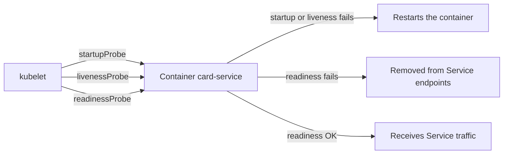

# Health Probe

## Description

The Health Probe pattern makes the application expose signals about its own state to Kubernetes, through probes that the kubelet runs periodically, so that the platform decides whether to restart the container or stop sending it traffic. Checking only that the process is up is not enough: an application can be stuck in a deadlock, out of memory or still warming up, and keep its process alive.

There are three kinds of probe. The **livenessProbe** asks whether the container is still healthy, and the corrective action on failure is to restart it. The **readinessProbe** asks whether it is ready to serve requests, and failure only removes it from the `Service` endpoints, without restarting, giving it time to recover by itself. The **startupProbe** protects slow-starting applications, postponing the other two until the first check passes. Each probe can use an HTTP request (`httpGet`), a TCP connection, a command (`exec`) or, in recent versions, gRPC, with parameters for interval, timeout and tolerated number of failures.

The probe results feed other automation: the rolling update only advances when the new Pod becomes ready, and load balancing only sends requests to ready Pods. Probes are complemented by logs on standard output and by metrics, used for investigation and alerts rather than automatic actions.

## Problems it solves

- Running processes that are stuck or unable to serve, which the kubelet would not restart on its own
- Traffic sent to Pods that are still starting, loading cache or warming up connections
- Overloaded applications that need to shield themselves from new requests for a while
- Rollouts that advance before the new version is actually able to serve
- Failures that require manual intervention to be detected and fixed

## When to use

- In every service that receives traffic, at least with a `readinessProbe` to control routing
- When the application can hang without terminating the process, which justifies a `livenessProbe`
- When startup is slow or variable, in which case the `startupProbe` avoids premature restarts
- As a prerequisite for zero-downtime rolling updates and reliable autoscaling

## When to avoid

- In `livenessProbe` checks that verify external dependencies, such as the database: a database outage would restart every replica without fixing anything
- When restarting the container does not fix the problem, since the probe would only produce restart cycles
- In heavy or slow checks, which consume resources and cause timeout failures
- In run-once jobs, where the lifecycle is already defined by the process ending

## Trade-offs

| Benefit | Cost / Risk |
| --- | --- |
| Automatic recovery of hung applications | A badly calibrated probe takes down or removes healthy Pods |
| Traffic only to replicas that are really ready | Requires implementing and maintaining health endpoints in the application |
| Safer rollouts and scaling | Aggressive probes increase load and can cause cascading restarts |
| More visibility of the application state for the platform | False sense of safety if the probe does not reflect the service's real health |

- **Lean liveness:** check only whether the process itself can respond, without querying dependencies; leave dependency evaluation to readiness, with care.
- **Readiness and dependencies:** including dependencies in readiness protects the user, but a shared dependency that is down takes all replicas out of service at the same time.
- **Parameters:** tune `periodSeconds`, `timeoutSeconds` and `failureThreshold` to real behavior; for slow startup, use `startupProbe`.
- **Shutdown:** the Pod stops receiving traffic when terminated regardless of readiness; combine with SIGTERM handling.

## Diagram



Liveness failures (and startup failures, after attempts are exhausted) lead to a container restart; readiness failures only take the Pod out of load balancing until it responds again.

## Example

The `card-service` takes up to a minute to start. The `startupProbe` grants that time, the `livenessProbe` detects hangs after that and the `readinessProbe` controls entry into load balancing.

```yaml
apiVersion: apps/v1
kind: Deployment
metadata:
  name: card-service
  namespace: fintech
spec:
  replicas: 3
  selector:
    matchLabels:
      app: card-service
  template:
    metadata:
      labels:
        app: card-service
    spec:
      containers:
        - name: card-service
          image: registry.fintech.example/card-service:2.3.0
          ports:
            - containerPort: 8080
          startupProbe:
            httpGet:
              path: /health/started
              port: 8080
            periodSeconds: 5
            failureThreshold: 12
          livenessProbe:
            httpGet:
              path: /health/live
              port: 8080
            periodSeconds: 10
            failureThreshold: 3
          readinessProbe:
            httpGet:
              path: /health/ready
              port: 8080
            periodSeconds: 5
            failureThreshold: 2
```

The `livenessProbe` only queries the process itself, while `/health/ready` may include additional checks, such as completion of the cache load.

## Related patterns

- [Health Endpoint Monitoring](/architecture/cloud-design-patterns/resiliency/health-endpoint-monitoring) — a close relative: an external monitor queries health endpoints to verify availability, while here the kubelet uses probes to act on the Pod
- [Managed Lifecycle](/architecture/kubernetes-patterns/foundational/managed-lifecycle) — the other side of the contract: probes extract information from the application, and lifecycle events send commands to it
- [Declarative Deployment](/architecture/kubernetes-patterns/foundational/declarative-deployment) — depends on the `readinessProbe` to know when to advance in the rolling update
- [Self Awareness](/architecture/kubernetes-patterns/behavioral/self-awareness) — another communication channel between the application and the platform, for metadata introspection
- [Elastic Scale](/architecture/kubernetes-patterns/advanced/elastic-scale) — replicas should only enter rotation, and count toward metrics, once they are ready

## Reference

- [Kubernetes Patterns, chapter 4: Health Probe](https://k8spatterns.com/)
- [Liveness, Readiness, and Startup Probes](https://kubernetes.io/docs/concepts/configuration/liveness-readiness-startup-probes/)
- [Configure Liveness, Readiness and Startup Probes](https://kubernetes.io/docs/tasks/configure-pod-container/configure-liveness-readiness-startup-probes/)
