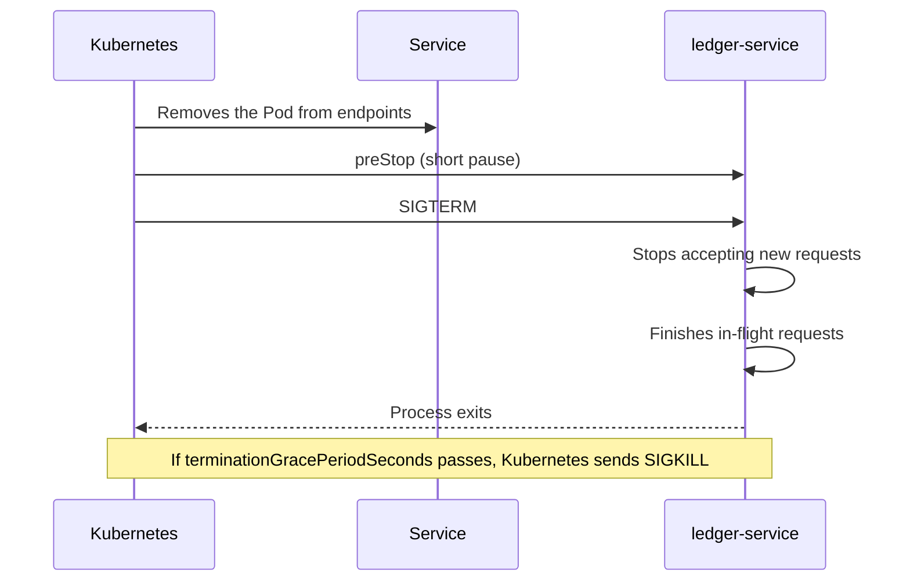

# Managed Lifecycle

## Description

The Managed Lifecycle pattern makes the application listen and react to the lifecycle events emitted by Kubernetes, such as termination signals and start and stop hooks, so it can start and finish cleanly, without losing work in progress. While health probes extract information from the application, this pattern is the reverse channel: the platform sends commands and the application decides how to respond.

When terminating a container, whether because of Pod removal, a rolling update, eviction or a liveness failure, Kubernetes sends the **SIGTERM** signal and waits a grace period (30 seconds by default, adjustable with `terminationGracePeriodSeconds`) before sending **SIGKILL**, which kills the process by force. The application should handle SIGTERM by ceasing to accept new requests, finishing those in progress, releasing connections and flushing data. For this, the main process must receive the signal (beware of shell scripts in the entrypoint that do not forward it).

There are also hooks at the container level. **postStart** runs right after the container is created, in parallel with the main process, and blocks the container state until it finishes. **preStop** runs before SIGTERM is sent and allows starting the shutdown when the process cannot handle the signal, or simply buying time, for example so the Pod leaves load balancing before stopping. The hooks support `exec` and `httpGet`, and their execution must be idempotent, since the guarantee is at least once. For Pod-level initialization with ordering guarantees, init containers are used.

## Problems it solves

- In-flight requests interrupted when a Pod is removed during a deploy or a scale down
- Unpersisted data or half-finished transactions when the process is killed abruptly
- Open connections that are not released, leaving clients and databases with dangling sessions
- Applications that need preparation or warm-up right after starting
- Traffic still directed to a Pod that has just received the termination signal

## When to use

- In services that process long requests or financial operations, such as the `ledger-service`, which cannot be cut in the middle
- When in-flight work must be completed or returned to the queue before shutting down
- When the application holds connections, locks or files that must be released on shutdown
- When the Pod needs a short pause to leave load balancing before it stops accepting connections

## When to avoid

- For critical logic inside `postStart`, since there is no ordering guarantee relative to the main process
- For long Pod-level initialization tasks, where an init container offers better guarantees
- With very high `terminationGracePeriodSeconds` without need, which slow down rollouts and node draining
- To rely on `preStop` as the only cleanup mechanism, since its failure does not prevent the container from being removed

## Trade-offs

| Benefit | Cost / Risk |
| --- | --- |
| Clean shutdowns, without losing in-flight requests | The application must implement signal handling and the shutdown logic |
| Fewer errors visible to users during deploys and scaling | Long grace periods make rollouts and node draining slower |
| Ability to prepare the application right after it starts | Hooks may run more than once or before the main process is ready |
| Predictable behavior aligned with the POSIX process model | If SIGKILL arrives before the end, the remaining work is lost anyway |

- **SIGTERM handling:** stop accepting connections, finish what is in progress and exit within the grace period.
- **Signal propagation:** make sure the main process is PID 1 or that the entrypoint forwards the signal.
- **Race with load balancing:** endpoint removal and SIGTERM happen in parallel; a short `preStop` with `sleep` reduces errors from requests still on their way.
- **Idempotence:** hooks have at-least-once semantics and must tolerate repeated executions.

## Diagram



The Pod leaves load balancing, goes through `preStop` and receives SIGTERM; the application finishes the work in progress and exits, or is killed by force at the end of the grace period.

## Example

The `ledger-service` is given a 45-second grace period to complete in-flight entries. The `preStop` hook makes a short pause to give the Pod time to leave load balancing before SIGTERM arrives.

```yaml
apiVersion: v1
kind: Pod
metadata:
  name: ledger-service
  namespace: fintech
  labels:
    app: ledger-service
spec:
  terminationGracePeriodSeconds: 45
  containers:
    - name: ledger-service
      image: registry.fintech.example/ledger-service:3.1.0
      ports:
        - containerPort: 8080
      lifecycle:
        preStop:
          exec:
            command: ["sleep", "5"]   # lets the Pod leave load balancing
```

After the `preStop`, the process receives SIGTERM and must finish pending entries (each reversal remains a new ledger entry) before exiting.

## Related patterns

- [Health Probe](/architecture/kubernetes-patterns/foundational/health-probe) — the opposite channel: probes read the application state, while the lifecycle sends events to it
- [Declarative Deployment](/architecture/kubernetes-patterns/foundational/declarative-deployment) — rolling updates depend on clean shutdowns to avoid losing requests
- [Init Container](/architecture/kubernetes-patterns/structural/init-container) — Pod-level initialization, with guaranteed order and completion, in contrast to per-container hooks
- [Singleton Service](/architecture/kubernetes-patterns/behavioral/singleton-service) — the orderly handover of the active instance depends on the previous one shutting down correctly
- [Sidecar](/architecture/cloud-design-patterns/integration-and-modernization/sidecar) — helper containers also follow the Pod lifecycle and need to shut down in a coordinated way

## Reference

- [Kubernetes Patterns, chapter 5: Managed Lifecycle](https://k8spatterns.com/)
- [Container Lifecycle Hooks](https://kubernetes.io/docs/concepts/containers/container-lifecycle-hooks/)
- [Pod Lifecycle](https://kubernetes.io/docs/concepts/workloads/pods/pod-lifecycle/)
