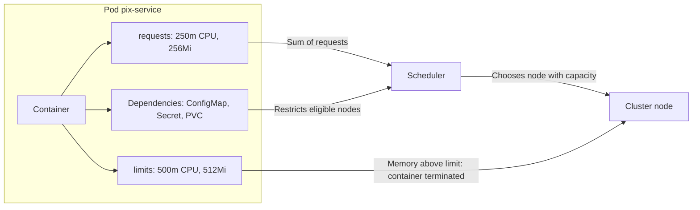

# Predictable Demands

## Description

The Predictable Demands pattern consists of declaring, in each workload manifest, the runtime dependencies and the resource profile of its containers, so that Kubernetes knows where to place them and how to treat them when the cluster is under pressure. Without this declaration, the platform sees each container as a black box and can only discard it when the nodes fill up.

There are two kinds of demand. **Runtime dependencies** are resources that must exist for the container to work: persistent volumes (`PersistentVolumeClaim`), a `ConfigMap` and `Secret` consumed as variables or files, or fixed ports on the host (`hostPort`). They restrict which nodes the Pod can run on, or even prevent it from starting. **Resource profiles** are the `requests` (the minimum CPU and memory the container needs) and the `limits` (the ceiling it may consume). The scheduler uses only the `requests` to choose a node.

The combination of `requests` and `limits` defines the Pod's quality of service class (Best-Effort, Burstable or Guaranteed), which determines who is removed first when a node runs out of memory. CPU is a compressible resource, and the container is merely throttled; memory is incompressible, and a container that exceeds it is terminated. The pattern is complemented by `PriorityClass`, `ResourceQuota` and `LimitRange`, which organize priorities and limits per namespace.

## Problems it solves

- Pods placed on nodes without real capacity, causing slowness, throttling or out-of-memory kills
- Containers terminated without warning for consuming more memory than the node could offer
- Capacity planning done in the dark, without knowing how much each service needs
- A team or service consuming all the resources of a shared cluster and affecting the others
- Pods that get scheduled but do not start because an expected `ConfigMap`, `Secret` or volume does not exist

## When to use

- In every workload run on a shared cluster, with CPU and memory `requests` for each container
- When the service needs persistent storage, external configuration or specific ports
- When there are critical services (such as Pix processing) that must be the last to suffer eviction
- To do capacity planning and size nodes based on profiles measured in load tests

## When to avoid

- In disposable experiments or local development environments, where the Best-Effort class is acceptable
- When the values would be guesses without measurement: invented numbers distort the scheduler and waste capacity
- For `hostPort`, unless truly needed, since it limits scheduling to one Pod per node and reduces flexibility
- For very tight CPU `limits` on latency-sensitive services, which suffer throttling even when the node is idle

## Trade-offs

| Benefit | Cost / Risk |
| --- | --- |
| Predictable scheduling, with Pods on nodes that really fit their demand | Requires measuring and revisiting resource profiles as the service evolves |
| Clear priority between workloads when nodes come under pressure | Values that are too high waste capacity and raise infrastructure cost |
| A concrete basis for capacity and cost per environment | Values that are too low cause CPU throttling or termination for lack of memory |
| Isolation between teams through `ResourceQuota` and `LimitRange` | Poorly defined priorities can cause preemption of other teams' important Pods |

- **QoS class:** `requests` equal to `limits` places the Pod in Guaranteed, the most protected class; use it for services that cannot be removed, such as the ledger.
- **Measurement:** use load tests and real metrics to choose the values, instead of copying them from another service.
- **Priority versus QoS:** `PriorityClass` influences scheduling order and preemption, while QoS influences eviction order on the node; they are independent mechanisms.
- **Governance:** `ResourceQuota` limits the total per namespace and `LimitRange` defines minimum, maximum and default values per container.

## Diagram



The scheduler uses the `requests` and the declared dependencies to choose a node with capacity; the `limits`, in turn, apply at runtime, throttling CPU and terminating the container that exceeds its memory.

## Example

The `pix-service` declares that it needs a `ConfigMap`, reserves 250 millicores and 256 MiB and accepts growing to double that, and uses a `PriorityClass` to be scheduled before less important workloads.

```yaml
apiVersion: scheduling.k8s.io/v1
kind: PriorityClass
metadata:
  name: payments-critical
value: 100000
globalDefault: false
description: "Realtime payment services"
---
apiVersion: v1
kind: Pod
metadata:
  name: pix-service
  namespace: fintech
  labels:
    app: pix-service
spec:
  priorityClassName: payments-critical
  containers:
    - name: pix-service
      image: registry.fintech.example/pix-service:1.4.2
      envFrom:
        - configMapRef:
            name: pix-service-config   # dependency: must exist
      resources:
        requests:
          cpu: 250m
          memory: 256Mi
        limits:
          cpu: 500m
          memory: 512Mi
```

Because `requests` and `limits` differ, the Pod is Burstable; to make it Guaranteed, it would be enough to make the two values equal.

## Related patterns

- [Automated Placement](/architecture/kubernetes-patterns/foundational/automated-placement) — uses the profiles declared here to decide which node each Pod will run on
- [Health Probe](/architecture/kubernetes-patterns/foundational/health-probe) — another contract between the application and the platform, focused on health state instead of resources
- [Elastic Scale](/architecture/kubernetes-patterns/advanced/elastic-scale) — the `requests` are the calculation base for utilization-based autoscaling
- [Configuration Resource](/architecture/kubernetes-patterns/configuration/configuration-resource) — `ConfigMap` and `Secret` are runtime dependencies declared by this pattern
- [Service Deployment Platform](/architecture/microservices/deployment/service-deployment-platform) — the execution platform that consumes these declarations to run the services

## Reference

- [Kubernetes Patterns, chapter 2: Predictable Demands](https://k8spatterns.com/)
- [Resource Management for Pods and Containers](https://kubernetes.io/docs/concepts/configuration/manage-resources-containers/)
- [Pod Priority and Preemption](https://kubernetes.io/docs/concepts/scheduling-eviction/pod-priority-preemption/)
