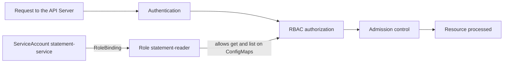

# Access Control

## Description

The Access Control pattern defines who can do what on the Kubernetes API server, granting each user and each workload only the permissions strictly necessary through RBAC. Every request to the API goes through three stages: authentication (who the subject is), authorization (which actions it may perform) and admission control (last checks and modifications before the request is processed).

Subjects can be human users, which do not exist as resources in the API and are authenticated by external mechanisms (OIDC, client certificates, authenticating proxy, among others), or `ServiceAccount`s, the workload identity of Pods, with a temporary JWT token mounted through a projected volume. There are also groups, such as `system:authenticated` or `system:serviceaccounts`. Permissions are described in a `Role` (rules with `apiGroups`, `resources` and `verbs`, limited to a namespace) or in a `ClusterRole` (valid for the whole cluster, or reused across several namespaces), and tied to subjects by a `RoleBinding` or `ClusterRoleBinding`. A `ClusterRole` with `aggregationRule` aggregates rules from other `ClusterRole`s by label selectors.

The strength of the pattern is least privilege: no wildcards (`*`), no `cluster-admin` for Pods and no automatic mounting of the `ServiceAccount` token when the application does not use the API.

## Problems it solves

- Workloads with excessive privileges that read or change resources of other applications
- Privilege escalation from a compromised Pod that uses the `ServiceAccount` token to talk to the API
- Broad, hard-to-audit permissions granted by wildcards or unnecessary `ClusterRoleBinding`s
- Operators and controllers that need privileged access to cluster resources and require fine-grained restrictions
- Lack of separation between what humans and what workloads can do in the cluster

## When to use

- In every shared cluster, to grant role-based access to people, teams and automations
- When an application talks to the Kubernetes API, such as controllers, operators and deployment tools
- To reuse the same set of rules across several namespaces with a `ClusterRole` and `RoleBinding`s
- To restrict which `Secret`s a `ServiceAccount` can mount and how it pulls images from private registries

## When to avoid

- For authorization at the application level (who can see which customer's statement): RBAC covers access to the Kubernetes API, not business logic
- `ClusterRoleBinding` when per-namespace `RoleBinding`s are enough: the former applies to all namespaces, including `kube-system`
- Wildcards in `apiGroups`, `resources` or `verbs`, except for well-justified exceptions
- Assigning `cluster-admin` to any Pod, ever

## Trade-offs

| Benefit | Cost / Risk |
| --- | --- |
| Granular, auditable permissions per subject, resource and verb | A powerful model, but complex to understand and to debug |
| Rule reuse with `ClusterRole` and aggregation | `ClusterRoleBinding` and wildcards grant broad access and open a path to privilege escalation |
| Temporary `ServiceAccount` tokens bound to the Pod | Tokens mounted by default widen the damage of a compromised Pod |
| Built-in escalation prevention (`escalate` and `bind` verbs) | Requires discipline to keep rules minimal over time |

- **No wildcards:** adopt a general "no wildcards" policy, relaxed only for justified exceptions.
- **No `cluster-admin` in Pods:** a `ServiceAccount` with high privileges can read `Secret`s and change permissions in any namespace.
- **Do not mount the token without need:** with `automountServiceAccountToken: false`, an attacker who compromises the Pod has no API credentials.
- **Debugging:** `kubectl auth can-i` (with `--as`) queries the access review API; tools such as rakkess and KubiScan help view the permission matrix and find risky permissions.
- **Authentication and admission:** these are usually the administrator's responsibility; admission control through webhooks validates or changes resources before they are stored.

## Diagram



Each request goes through authentication, authorization and admission; at the authorization stage, the `RoleBinding` connects the `ServiceAccount` to the `Role` that lists exactly what it can do.

## Example

```yaml
apiVersion: v1
kind: ServiceAccount
metadata:
  name: statement-service
  namespace: fintech
automountServiceAccountToken: false
---
apiVersion: rbac.authorization.k8s.io/v1
kind: Role
metadata:
  name: statement-reader
  namespace: fintech
rules:
  - apiGroups: [""]
    resources: ["configmaps"]
    verbs: ["get", "list", "watch"]
---
apiVersion: rbac.authorization.k8s.io/v1
kind: RoleBinding
metadata:
  name: statement-service-reader
  namespace: fintech
subjects:
  - kind: ServiceAccount
    name: statement-service
    namespace: fintech
roleRef:
  apiGroup: rbac.authorization.k8s.io
  kind: Role
  name: statement-reader
```

The `statement-service` `ServiceAccount` can only read `ConfigMap`s in the `fintech` namespace, with no wildcards. With `automountServiceAccountToken: false`, Pods of this account do not receive the token by default; a Pod that really calls the API must enable the token in its own spec.

## Related patterns

- [Network Segmentation](/architecture/kubernetes-patterns/security/network-segmentation) — `AuthorizationPolicy` at the application level is distinct from RBAC, which protects the Kubernetes API
- [Secure Configuration](/architecture/kubernetes-patterns/security/secure-configuration) — RBAC rules define who reads `Secret`s inside the cluster
- [Controller](/architecture/kubernetes-patterns/advanced/controller) — controllers watch cluster resources and need fine-grained read and write permissions
- [Operator](/architecture/kubernetes-patterns/advanced/operator) — operators extend the API with CRDs and need tightly restricted roles
- [Gatekeeper](/architecture/cloud-design-patterns/security-and-access/gatekeeper) — both place a checkpoint between the requester and the resource, here at the authorization and admission stages of the API
- [Federated Identity](/architecture/cloud-design-patterns/security-and-access/federated-identity) — OIDC authentication delegates user identity to an external provider

## Reference

- [Kubernetes Patterns, chapter 26: Access Control](https://k8spatterns.com/)
- [Using RBAC Authorization](https://kubernetes.io/docs/reference/access-authn-authz/rbac/)
- [Configure Service Accounts for Pods](https://kubernetes.io/docs/tasks/configure-pod-container/configure-service-account/)
