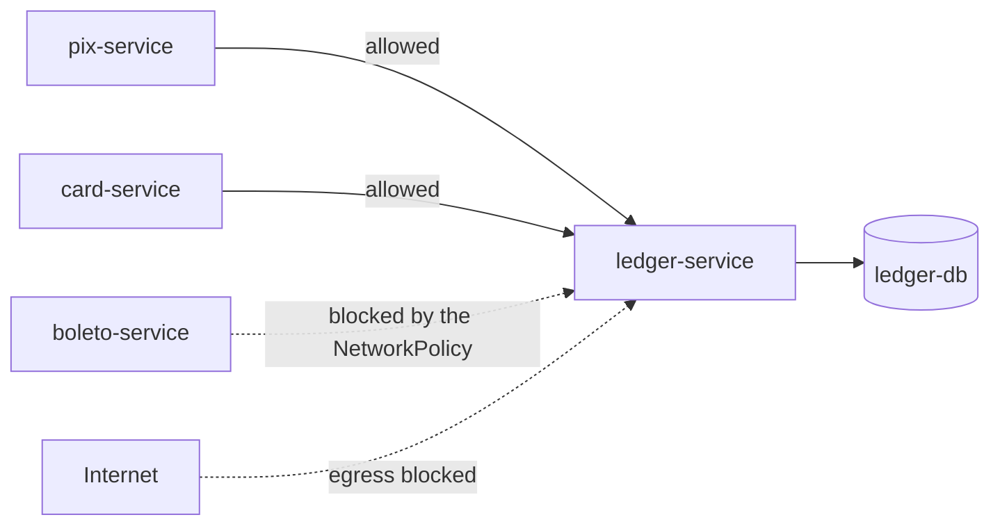

# Network Segmentation

## Description

The Network Segmentation pattern splits the flat Kubernetes network into isolated segments, defined by the developers themselves as "application firewalls" that control who can talk to whom. By default, any Pod reaches any other Pod in the cluster, regardless of namespace, which is a risk when several applications from different teams share the same cluster.

There are two complementary ways to apply the pattern. The first uses the native `NetworkPolicy` resource, which works at layers L3 and L4: a label-based Pod selector indicates which Pods are affected, and lists of `ingress` and `egress` rules indicate the allowed sources and destinations (by Pod, namespace, IP range or port). The rules are enforced by the CNI plugin, which must support `NetworkPolicy`. The second uses a service mesh such as Istio, whose `AuthorizationPolicy` resource allows filtering by HTTP parameters (methods, paths, identity), at layer L7. The two mechanisms add up: traffic reaches the Pod only if both allow it.

The recommended practice is to start from a "deny-all" policy and open only the necessary routes, using consistent labels (for example, an `app` label per application and role labels) to translate the application's dependency graph into rules.

## Problems it solves

- Unrestricted communication between Pods of different applications and teams, which widens the blast radius of a breach
- Uncontrolled outbound (egress) traffic, allowing data exfiltration or access to improper external destinations
- Dependence on firewall administrators who do not know the application's dependency graph
- Lightweight network isolation between tenants in shared clusters (multitenancy)
- The need to restrict calls by HTTP method and path, which layer L3/L4 cannot see

## When to use

- When several applications or teams share the same cluster
- When sensitive services (for example, the ledger database) must be reached only by specific components
- To limit the outbound traffic of Pods to what is strictly necessary
- When the policy needs HTTP or identity filters, by adding a service mesh

## When to avoid

- In clusters whose CNI plugin does not support `NetworkPolicy`: the rules are accepted by the API but have no effect
- In small, fully trusted environments, where the cost of maintaining the policies outweighs the benefit
- For strong isolation between tenants: something more encapsulated may be needed, such as a virtual control plane per tenant

## Trade-offs

| Benefit | Cost / Risk |
| --- | --- |
| Smaller blast radius of a security breach | Many `NetworkPolicy` resources to create and maintain as the graph grows |
| Developers define the topology alongside the application | Harder debugging when `NetworkPolicy` and `AuthorizationPolicy` must be checked in parallel |
| Lightweight isolation between tenants without extra infrastructure | There is no valid default policy for the whole cluster: each namespace needs its own |
| HTTP method and path filters with a service mesh | The service mesh adds components and resource consumption |

- **Start with deny-all:** without a restrictive default policy, any forgotten Pod stays open. Careful: an empty list (`ingress: []`) denies everything, while a list with one empty element (`[{}]`) allows everything.
- **Pragmatic egress:** denying all egress is not viable, since every Pod needs DNS; a common approach is to allow egress inside the cluster, block external egress and open external destinations case by case.
- **`policyTypes`:** for an egress-only policy, declare `policyTypes: [Egress]`; otherwise ingress is also considered and ends up blocked.
- **Tooling:** for existing systems, eBPF-based tools such as Inspektor Gadget and Cilium (audit mode) help discover real traffic and generate policies; the quality of the result depends on the coverage of the use cases exercised.

## Diagram



Only `pix-service` and `card-service` reach `ledger-service`; any other Pod, or external destination, is blocked by the policy that starts from deny-all.

## Example

```yaml
apiVersion: networking.k8s.io/v1
kind: NetworkPolicy
metadata:
  name: default-deny-ingress
  namespace: fintech
spec:
  podSelector: {}
  policyTypes:
    - Ingress
---
apiVersion: networking.k8s.io/v1
kind: NetworkPolicy
metadata:
  name: allow-ledger-clients
  namespace: fintech
spec:
  podSelector:
    matchLabels:
      app: ledger-service
  policyTypes:
    - Ingress
  ingress:
    - from:
        - podSelector:
            matchLabels:
              app: pix-service
        - podSelector:
            matchLabels:
              app: card-service
      ports:
        - protocol: TCP
          port: 8080
```

The first policy denies all incoming traffic to the Pods of the `fintech` namespace. The second opens port 8080 of `ledger-service` only to `pix-service` and `card-service` Pods.

## Related patterns

- [Process Containment](/architecture/kubernetes-patterns/security/process-containment) — contains the process inside the node, while this pattern contains what it can reach over the network
- [Access Control](/architecture/kubernetes-patterns/security/access-control) — protects access to the Kubernetes API, while segmentation protects traffic between Pods
- [Service Discovery](/architecture/kubernetes-patterns/behavioral/service-discovery) — the service names Pods use to find each other are what network policies come to restrict
- [Sidecar](/architecture/cloud-design-patterns/integration-and-modernization/sidecar) — is how the service mesh intercepts L7 traffic to apply `AuthorizationPolicy`
- [Ambassador](/architecture/cloud-design-patterns/integration-and-modernization/ambassador) — the mesh proxy acts as an ambassador for the application's outbound traffic
- [Gatekeeper](/architecture/cloud-design-patterns/security-and-access/gatekeeper) — another control point that validates requests before they reach the protected resource

## Reference

- [Kubernetes Patterns, chapter 24: Network Segmentation](https://k8spatterns.com/)
- [Network Policies](https://kubernetes.io/docs/concepts/services-networking/network-policies/)
- [Declare Network Policy](https://kubernetes.io/docs/tasks/administer-cluster/declare-network-policy/)
