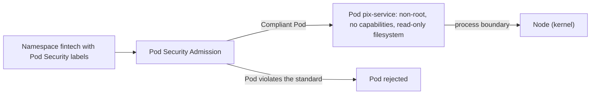

# Process Containment

## Description

The Process Containment pattern applies the principle of least privilege to every container, restricting the process to only the permissions it actually needs to run. Even with static code analysis and image and dependency scanning, no check guarantees the total absence of vulnerabilities, so the Kubernetes configuration acts as one more line of defense: if an attacker compromises the application, they remain locked inside the boundary defined for the process.

These restrictions are declared in the `securityContext` of the Pod (applies to all containers and volumes) and of the container (applies only to it, and wins on conflicts). The most common measures are running as a non-root user (`runAsNonRoot`, `runAsUser`), blocking privilege escalation (`allowPrivilegeEscalation: false`), avoiding `privileged` containers, dropping all Linux capabilities and adding back only the necessary ones, and mounting the root filesystem as read-only. `seccompProfile` and `seLinuxOptions` limit system calls and object access even further.

Because configuring this Pod by Pod is error-prone, the cluster administrator enforces minimum standards per namespace with the Pod Security Standards (Privileged, Baseline and Restricted profiles, which are cumulative) and the Pod Security Admission controller, which acts through namespace labels in three modes: `warn`, `audit` and `enforce`.

## Problems it solves

- An attacker who exploits a flaw in the application and tries to take over the node or the cluster
- Containers that run as root by default, or that gain root privileges through escalation
- The runtime's default set of capabilities, which is more generous than most processes need
- Writes to the container filesystem to tamper with configuration or install executables
- Inconsistent security settings across teams, depending on who writes each manifest

## When to use

- In practically every production workload, as the default configuration
- When the application is stateless, does not write to local disk and does not need special privileges
- To enforce a minimum security level on all Pods of a namespace in a centralized way
- When containerizing legacy applications, defining an explicit non-root user in the image

## When to avoid

- For infrastructure containers that need broad access to the node (build systems, network or storage plugins): they need more permissive profiles, restricted to trusted namespaces
- When forcing `runAsUser` without checking file ownership in the image, which causes permission failures at runtime
- As a substitute for image scanning, code review and access control: it is an additional layer, not the only one

## Trade-offs

| Benefit | Cost / Risk |
| --- | --- |
| Smaller attack surface and containment of compromised processes | Legacy applications may not work without adjustments (root, disk writes, low ports) |
| Security standard applied uniformly per namespace | The Restricted profile has an adoption cost and requires reviewing existing manifests |
| Reinforces container immutability (read-only filesystem) | Applications that write temporary files need dedicated volumes |
| Configuration failures show up early, with `warn` and `audit` | Discovering the capabilities that are really needed takes work |

- **Gradual adoption:** start with `warn` and `audit` to see the impact before turning on `enforce`.
- **Drop everything and add back what is needed:** start from no capabilities and add them one by one; an alternative is to use a port above 1024 instead of `NET_BIND_SERVICE`.
- **Tasks as root:** if file permissions must be adjusted, do it in a short-lived init container and keep the application container non-root.
- **Shift left:** run in development with the same security standards as production to avoid late surprises.

## Diagram



The namespace declares the required security standard; the controller admits only compliant Pods, and each admitted Pod runs with minimum privileges, without reaching the node.

## Example

```yaml
apiVersion: v1
kind: Namespace
metadata:
  name: fintech
  labels:
    pod-security.kubernetes.io/enforce: baseline
    pod-security.kubernetes.io/warn: restricted
    pod-security.kubernetes.io/audit: restricted
---
apiVersion: v1
kind: Pod
metadata:
  name: pix-service
  namespace: fintech
  labels:
    app: pix-service
spec:
  securityContext:
    runAsNonRoot: true
    runAsUser: 10001
    runAsGroup: 10001
    seccompProfile:
      type: RuntimeDefault
  containers:
    - name: pix-service
      image: registry.fintech.example/pix-service:1.4.2
      securityContext:
        allowPrivilegeEscalation: false
        readOnlyRootFilesystem: true
        capabilities:
          drop: ["ALL"]
      volumeMounts:
        - name: tmp
          mountPath: /tmp
  volumes:
    - name: tmp
      emptyDir: {}
```

The namespace rejects Pods outside the Baseline profile and warns about those that do not meet Restricted. The Pod runs without root, without privilege escalation, without capabilities and with a read-only root filesystem, using an `emptyDir` only for temporary files.

## Related patterns

- [Network Segmentation](/architecture/kubernetes-patterns/security/network-segmentation) — complements process containment by also limiting what the process can reach over the network
- [Access Control](/architecture/kubernetes-patterns/security/access-control) — restricts what the Pod can do in the Kubernetes API, while this pattern restricts what it does on the node
- [Stateless Service](/architecture/kubernetes-patterns/behavioral/stateless-service) — applications without local state are the ones that work best with a read-only filesystem
- [Init Container](/architecture/kubernetes-patterns/structural/init-container) — lets you concentrate tasks that require root in a short step before the application container
- [Image Builder](/architecture/kubernetes-patterns/advanced/image-builder) — image builds often need more privileges and deserve their own isolation
- [Gatekeeper](/architecture/cloud-design-patterns/security-and-access/gatekeeper) — also places a validation layer between the attacker and the protected resource

## Reference

- [Kubernetes Patterns, chapter 23: Process Containment](https://k8spatterns.com/)
- [Configure a Security Context for a Pod or Container](https://kubernetes.io/docs/tasks/configure-pod-container/security-context/)
- [Pod Security Admission](https://kubernetes.io/docs/concepts/security/pod-security-admission/)
