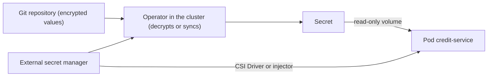

# Secure Configuration

## Description

The Secure Configuration pattern protects an application's credentials and other confidential data by keeping them encrypted outside the cluster or in an external secret manager, and delivering them to the Pod only at the moment of use. This matters because a Kubernetes `Secret` is only Base64-encoded, not encrypted: as soon as it leaves the cluster, for example into a Git repository in a GitOps flow, it is exposed, and inside the cluster any administrator with broad read access can read it.

The chapter groups the solutions into two categories. In **out-of-cluster encryption**, the encrypted data lives in an accessible place (such as Git) and is converted into a `Secret` on entering the cluster: Sealed Secrets stores the value in a `SealedSecret` resource that an operator decrypts inside the cluster (encryption is done by the `kubeseal` tool); the External Secrets Operator syncs secrets from an external manager into `Secret`s through the `SecretStore` and `ExternalSecret` resources; Sops is a command-line tool, with no server-side component, that encrypts the values of YAML or JSON files, with local keys (age) or keys in a key management service.

In **centralized secret management**, the data lives in a service such as HashiCorp Vault or the cloud providers' managers. The Secrets Store CSI Driver mounts these secrets as volumes without writing them to etcd, and injectors such as the Vault Agent Injector add an init container or sidecar to the Pod through a mutating webhook.

## Problems it solves

- Secrets versioned in Git without encryption, in GitOps flows
- Cluster administrators, or anyone with broad read access to `Secret`s, who can read the credentials of every application
- Coupling of application code to the proprietary libraries of a secret manager
- Lack of rotation and of centralized auditing of credentials
- Mixed responsibilities between whoever deploys the application and whoever manages the secrets

## When to use

- When manifests, including credentials, are stored in shared or public repositories
- When trust in the cluster administrators is limited, or there are confidentiality and compliance requirements
- When the organization already runs a secret manager (Vault or the cloud provider's) and wants to reuse it
- When it is important that no confidential data stays permanently stored in the cluster

## When to avoid

- In simple, low-risk scenarios where a `Secret` with restrictive RBAC and etcd encryption at rest are enough
- When the team cannot operate extra components (operator, CSI driver, injector), since each is one more piece to install and debug
- As an absolute guarantee: anyone who gets root access to the cluster and containers will always have some way to reach the data

## Trade-offs

| Benefit | Cost / Risk |
| --- | --- |
| Secrets can live in Git safely (Sealed Secrets, Sops) | Sealed Secrets requires an always-running operator and a backup of the private key |
| An external manager brings rotation, auditing and fine-grained access control | External Secrets and CSI add components and a dependency on an external service |
| Sops works client-side only, with no component in the cluster | Once delivered to the cluster, the data can be read by anyone with elevated API access |
| The CSI Driver avoids storing the secret in etcd | Complex setup that is harder to diagnose |
| Separation of roles between whoever deploys and whoever manages secrets | Security annotations can leak into the application deployment (injectors) |

- **Choose by goal:** Sops to encrypt what goes into repositories; External Secrets to separate obtaining the credential from using it; the CSI Driver to keep secrets out of the cluster; sidecar injectors to shield the application from direct access to the manager.
- **No secrets in code:** decrypting inside the application works anywhere, but couples business logic to this aspect; platform solutions are more transparent.
- **Rotation:** a sidecar can update the secret locally when the manager rotates it, while an init container fetches it only once.
- **SMS versus KMS:** a secret manager stores the data; a key management service stores only the keys used to encrypt data elsewhere.

## Diagram



Confidential data reaches the Pod by two paths: converted into a `Secret` by an operator from encrypted or synced data, or mounted straight from an external manager, without going through etcd.

## Example

```yaml
apiVersion: apps/v1
kind: Deployment
metadata:
  name: credit-service
  namespace: fintech
spec:
  replicas: 2
  selector:
    matchLabels:
      app: credit-service
  template:
    metadata:
      labels:
        app: credit-service
    spec:
      containers:
        - name: credit-service
          image: registry.fintech.example/credit-service:1.4.2
          volumeMounts:
            - name: db-credentials
              mountPath: /etc/secrets
              readOnly: true
      volumes:
        - name: db-credentials
          secret:
            secretName: credit-db-credentials
            defaultMode: 0400
```

The Deployment consumes the `credit-db-credentials` `Secret` as read-only files with permission `0400`, instead of environment variables. Whoever creates this `Secret` is the chosen mechanism (Sealed Secrets, External Secrets, Sops), so the value never appears in clear text in Git; this manifest contains no secret value.

## Related patterns

- [Configuration Resource](/architecture/kubernetes-patterns/configuration/configuration-resource) — defines the `Secret` that this pattern protects with additional techniques
- [Access Control](/architecture/kubernetes-patterns/security/access-control) — RBAC rules restrict who reads `Secret`s inside the cluster
- [Init Container](/architecture/kubernetes-patterns/structural/init-container) — can fetch the secret from an external manager once, before the application starts
- [Sidecar](/architecture/cloud-design-patterns/integration-and-modernization/sidecar) — can sync and update the secret locally when it is rotated
- [External Configuration Store](/architecture/cloud-design-patterns/deployment-and-topology/external-configuration-store) — same idea of keeping configuration outside the application, here focused on confidentiality
- [Operator](/architecture/kubernetes-patterns/advanced/operator) — Sealed Secrets and External Secrets are operators that reconcile their own resources into `Secret`s

## Reference

- [Kubernetes Patterns, chapter 25: Secure Configuration](https://k8spatterns.com/)
- [Secrets](https://kubernetes.io/docs/concepts/configuration/secret/)
- [Good practices for Kubernetes Secrets](https://kubernetes.io/docs/concepts/security/secrets-good-practices/)
