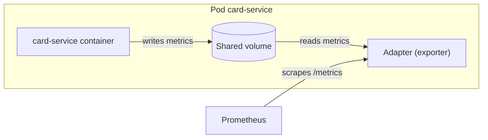

# Adapter

## Description

The Adapter pattern uses a helper container in the same Pod to make a heterogeneous system expose a uniform, normalized interface that can be consumed from outside the Pod. It is a specialization of the Sidecar with a single purpose: adapting access to the application, without changing the application.

The most common example is monitoring. Services written in different languages publish metrics in different formats, or only write them to files, while the monitoring tool expects a single format and protocol. Each Pod then gets an adapter container that reads the application-specific metrics (for example, from a file on a shared volume) and exposes them on an HTTP endpoint in the expected format.

The same reasoning applies to logs: the adapter normalizes formats and levels of detail, enriches the lines with Pod context, and hands them to the central aggregator. It works as a reverse proxy that hides the application's complexity behind a standard interface.

## Problems it solves

- Heterogeneous services that expose metrics, logs, or status in formats incompatible with the system consuming them
- The need to integrate a legacy or third-party application into an observability standard without being able to change its code
- Monitoring tools that would otherwise need to know the format of every service
- Conversion logic duplicated inside each application, in each language

## When to use

- When several services must appear to monitoring or to the log aggregator in a single format
- When the application cannot be modified (third-party image, legacy code) but must integrate with a platform standard
- When you want the application to know nothing about the tools that observe it
- When the conversion can be done from shared local data, such as files on a volume or a port on localhost

## When to avoid

- When the application already exposes the expected format or can adopt it with a simple library
- When the conversion requires deep access to the application's internal logic
- When the cost of an extra container per Pod outweighs the benefit, as with very numerous, small Pods
- When the need is outbound connectivity rather than a standardized inbound interface: use an Ambassador

## Trade-offs

| Benefit | Cost / Risk |
| --- | --- |
| A single interface for heterogeneous systems, simplifying the consumer | One extra container per Pod, consuming CPU and memory |
| Application decoupled from the monitoring or logging tool | One more component to package, version, and maintain |
| Adapters reusable across applications that share the same source format | The conversion can become stale if the application's format changes |
| Observability tool can be swapped without touching the application | The adapter shares the Pod's lifecycle and scale |

- **Shared data:** the adapter usually reads local data through a volume or localhost, so the format of that channel becomes a contract between the two containers.
- **Single responsibility:** keep the adapter focused on translating; business logic does not belong in it.
- **Resources:** set requests and limits for the adapter, since it counts toward the Pod total.
- **Distinct name:** calling the pattern Adapter, rather than just Sidecar, conveys the container's intent more precisely.

## Diagram



The application writes metrics in its own format to a shared volume. The adapter reads them, converts them to the format Prometheus understands, and exposes them over HTTP, without the `card-service` knowing that monitoring exists.

## Example

The `card-service` records the authorization time of each purchase in a log file. An adapter in the same Pod reads that file and publishes the metrics for Prometheus.

```yaml
apiVersion: apps/v1
kind: Deployment
metadata:
  name: card-service
  namespace: fintech
spec:
  replicas: 2
  selector:
    matchLabels:
      app: card-service
  template:
    metadata:
      labels:
        app: card-service
    spec:
      containers:
        - name: card-service
          image: registry.fintech.example/card-service:2.1.0
          env:
            - name: AUTH_LOG_FILE
              value: /logs/authorizations.log
          volumeMounts:
            - name: logs
              mountPath: /logs
        - name: metrics-adapter
          image: registry.fintech.example/card-metrics-exporter:0.3.1
          env:
            - name: AUTH_LOG_FILE
              value: /logs/authorizations.log
          ports:
            - containerPort: 9100
          volumeMounts:
            - name: logs
              mountPath: /logs
              readOnly: true
      volumes:
        - name: logs
          emptyDir: {}
```

Both containers share the `logs` volume; the adapter mounts the volume read-only and publishes the metrics on port 9100.

## Related patterns

- [Sidecar](/architecture/cloud-design-patterns/integration-and-modernization/sidecar) — the Adapter is a specialization of the Sidecar focused on normalizing the application's interface.
- [Ambassador](/architecture/cloud-design-patterns/integration-and-modernization/ambassador) — the other Sidecar specialization: it acts as a proxy to the outside world, while the Adapter exposes the application uniformly.
- [Adapter (GoF)](/coding/gof/structural/adapter) — the same principle of converting interfaces, applied to classes inside the code instead of to containers.
- [Health Probe](/architecture/kubernetes-patterns/foundational/health-probe) — an adapter can translate a legacy application's state into a standard health endpoint.
- [Self Awareness](/architecture/kubernetes-patterns/behavioral/self-awareness) — the adapter can enrich logs and metrics with Pod information.

## Reference

- [Kubernetes Patterns, chapter 17: Adapter](https://k8spatterns.com/)
- [Pods (Kubernetes documentation)](https://kubernetes.io/docs/concepts/workloads/pods/)
