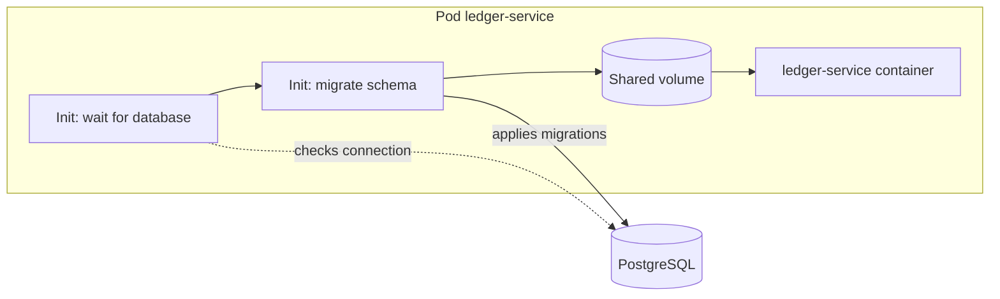

# Init Container

## Description

The Init Container pattern separates a Pod's initialization tasks from the application containers, running them beforehand, in sequence, and with their own lifecycle. At the Pod level it is the equivalent of a class constructor: it prepares the environment and validates preconditions before the real work begins.

A Pod's containers are split into two groups. Init containers run one at a time, in the declared order, and each one must finish successfully before the next starts. Only after the last one do the application containers start, in parallel and in no defined order. If an init container fails, the Pod is restarted (according to its `restartPolicy`) and all of them run again, so it is good practice to make them idempotent.

Because they belong to the same Pod, init containers and application containers share volumes, network, and security settings, and land on the same node. This lets one team own the application image while another owns setup tooling (migrations, permissions, data loading) without mixing them in the same image.

## Problems it solves

- Preparation steps (database schema, file permissions, initial data load) mixed into the application code or image
- Setup tools and libraries that should not ship in the final image, increasing its size and attack surface
- An application that needs elevated permissions only during initialization but should not keep them while running
- The application starting before an external dependency is ready, causing cascading failures at startup
- No ordering guarantee between initialization steps when everything runs as parallel containers

## When to use

- When the application depends on preparation that must finish before the first request, such as migrating a schema or downloading artifacts
- When setup tools should not be part of the application image
- When startup must be delayed until a dependency (database, queue, service) responds
- When initialization requires privileges that the running application should not have
- When different teams maintain the application and its preparation

## When to avoid

- When the task must run continuously alongside the application: use a Sidecar
- When the preparation can be done by the application process itself in a simple and safe way
- When the step is slow and heavy and would repeat on every Pod restart; prefer a separate Job, run once per release
- When the logic is cluster policy (injecting default values into every Pod): that is the role of admission webhooks, maintained by administrators

## Trade-offs

| Benefit | Cost / Risk |
| --- | --- |
| Separation of concerns between initialization and the application | Every Pod restart repeats all init containers |
| Order and success of each step guaranteed before the application | A failure or endless wait keeps the Pod from becoming ready |
| Smaller application image with fewer privileges | Pod requests and limits take the largest init container into account, which can over-reserve resources |
| Setup images reused across different applications | With no readiness probe on init containers, diagnosis relies on logs and events |

- **Idempotency:** since the Pod may restart, each init container must produce the same result if run more than once.
- **Resources:** the Pod's effective request and limit is the larger of the most demanding init container and the sum of the application containers; a heavy init container reserves capacity nobody else can use.
- **External dependencies:** waiting for a service in an init container simplifies startup, but it hides problems if there is no timeout and alerting.
- **Debugging:** temporarily replacing the application command with a `sleep` helps inspect the volumes filled by the init container.
- **Combining with Sidecar:** use both when you need guaranteed initialization and also continuous updating of the data.

## Diagram



The init containers run in sequence: first it waits for the database to respond, then the schema is migrated. Only when both finish successfully is the `ledger-service` container started.

## Example

The `ledger-service` should only start after the database accepts connections and the ledger migrations have been applied. The migration image is kept apart from the application image.

```yaml
apiVersion: apps/v1
kind: Deployment
metadata:
  name: ledger-service
  namespace: fintech
spec:
  replicas: 2
  selector:
    matchLabels:
      app: ledger-service
  template:
    metadata:
      labels:
        app: ledger-service
    spec:
      initContainers:
        - name: wait-for-db
          image: registry.fintech.example/tools/pg-isready:1.0.0
          args: ["--host=ledger-db", "--timeout=120"]
        - name: migrate-schema
          image: registry.fintech.example/ledger-migrations:1.4.2
          env:
            - name: DB_HOST
              value: ledger-db
      containers:
        - name: ledger-service
          image: registry.fintech.example/ledger-service:1.4.2
          ports:
            - containerPort: 8080
```

Both init containers run in the declared order and the migration is idempotent, so restarting the Pod is safe.

## Related patterns

- [Sidecar](/architecture/cloud-design-patterns/integration-and-modernization/sidecar) — runs next to the application for the whole life of the Pod, while the Init Container runs and finishes before it.
- [Managed Lifecycle](/architecture/kubernetes-patterns/foundational/managed-lifecycle) — complements initialization with post-start and pre-stop hooks for the application.
- [Health Probe](/architecture/kubernetes-patterns/foundational/health-probe) — after the init containers finish, probes indicate when the application is alive and ready.
- [Predictable Demands](/architecture/kubernetes-patterns/foundational/predictable-demands) — Pod requests and limits take the most demanding init container into account.
- [Self Awareness](/architecture/kubernetes-patterns/behavioral/self-awareness) — an init container can use the Pod's information to generate configuration before startup.

## Reference

- [Kubernetes Patterns, chapter 14: Init Container](https://k8spatterns.com/)
- [Init Containers (Kubernetes documentation)](https://kubernetes.io/docs/concepts/workloads/pods/init-containers/)
