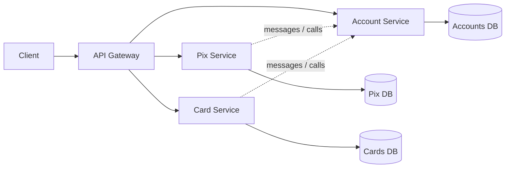

# Microservice Architecture

## Description

Microservice Architecture structures the application as two or more independently deployable, loosely coupled services. Each service contains one or more subdomains, and each subdomain belongs to a single service (except for shared libraries).

A team owns the services that contain its subdomains. Typically each service has its own repository and deployment pipeline, and an API Gateway serves as the entry point for clients. Operations that span services are implemented with collaboration patterns such as Saga and API Composition.

The style trades the simplicity of a single component for team autonomy and flexibility, at the cost of dealing with the challenges of distributed systems.

## Problems it solves

- How to group the application's subdomains into deployable or executable components.
- The need for simple components that are easy to understand, with team autonomy to develop and deploy.
- The need for fast pipelines, made possible by small components.
- Support for multiple technology stacks.
- Segregating subdomains by scalability, availability, or security.

## When to use

- Mission-critical applications that need to change quickly, frequently, and reliably.
- Organizations with several cross-functional teams and automated continuous delivery.
- When subdomains have distinct scalability, availability, security, or technology requirements.

## When to avoid

- Small applications, or ones with a still-unstable domain, where service boundaries would be guesswork.
- Teams without maturity in automation, observability, and operating distributed systems.
- When ACID transactions across subdomains and low interaction latency are core requirements.

## Trade-offs

| Benefit | Cost / Risk |
| --- | --- |
| Small services that are easy to understand | Distributed operations are complex to understand and debug |
| Teams develop, test, and deploy independently | Some distributed operations can be inefficient |
| Fast builds and tests per service | A database per service usually requires eventual consistency |
| Different technology stacks per service | Runtime coupling can reduce availability |
| Grouping by scalability, security, etc. | Design-time coupling can force coordinated changes |

- Requires investment in observability, service discovery, resilience, and deployment automation.
- Defining the right boundaries (by business capability or subdomain) is decisive for reducing coupling.

## Diagram

Each service is deployed independently, owns its own database, and is accessed through an API Gateway; collaboration between services happens through messages or remote calls. The source illustrates the pattern with orders and deliveries.

## Related patterns

- [Monolithic Architecture](/architecture/microservices/architectural-style/monolithic-architecture) — the alternative style, with a single deployable component.
- [Decompose by Business Capability](/architecture/microservices/service-boundaries/decompose-by-business-capability) — defines the service boundaries.
- [Decompose by Subdomain](/architecture/microservices/service-boundaries/decompose-by-subdomain) — defines the service boundaries based on DDD.
- [Database per Service](/architecture/microservices/service-collaboration/database-per-service) — each service owns its own data.
- [Saga](/architecture/cloud-design-patterns/distributed-coordination/saga) — consistency for operations that span services.
- [API Composition](/architecture/microservices/service-collaboration/api-composition) — queries that combine data from several services.
- [CQRS](/architecture/cloud-design-patterns/data-management/cqrs) — efficient queries over distributed data.
- [Messaging](/architecture/microservices/communication-styles/messaging) — asynchronous communication between services.
- [Remote Procedure Invocation](/architecture/microservices/communication-styles/remote-procedure-invocation) — synchronous communication between services.
- [Transactional Outbox](/architecture/microservices/transactional-messaging/transactional-outbox) — atomic publication of messages and data updates.
- [API Gateway](/architecture/microservices/external-api/api-gateway) — entry point for clients.
- [Client-side Discovery](/architecture/microservices/service-discovery/client-side-discovery) — locating service instances.
- [Server-side Discovery](/architecture/microservices/service-discovery/server-side-discovery) — locating instances through a router.
- [Circuit Breaker](/architecture/cloud-design-patterns/resiliency/circuit-breaker) — prevents cascading failures between services.
- [Access Token](/architecture/microservices/security/access-token) — propagating identity between services.
- [Log Aggregation](/architecture/microservices/observability/log-aggregation) — observability for distributed systems.
- [Distributed Tracing](/architecture/microservices/observability/distributed-tracing) — tracing requests across services.
- [Health Check API](/architecture/cloud-design-patterns/resiliency/health-endpoint-monitoring) — checking the health of each service.
- [Service Component Test](/architecture/microservices/testing/service-component-test) — testing each service in isolation.
- [Microservice Chassis](/architecture/microservices/cross-cutting-concerns/microservice-chassis) — reusable cross-cutting concerns.
- [Externalized Configuration](/architecture/cloud-design-patterns/deployment-and-topology/external-configuration-store) — configuration kept outside the artifact.

## Reference

- [Pattern page on microservices.io](https://microservices.io/patterns/microservices.html)
