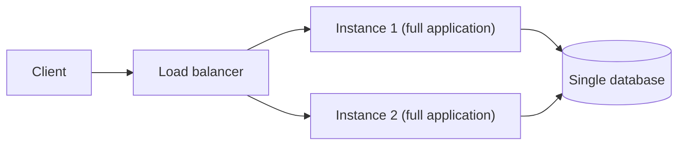

# Monolithic Architecture

## Description

Monolithic Architecture structures the application as a single deployable component backed by a single database. All subdomains (business capabilities made up of business logic and adapters) live inside that component, so all operations are local.

To scale, you run several identical instances of the component behind a load balancer. Deployment happens as a single unit: any change, small or large, produces a new complete artifact.

The pattern is the natural starting point for many applications and remains a good choice when the application size and the number of teams are small.

## Problems it solves

- How to organize the application's subdomains into deployable or executable components.
- The need for simple, efficient interactions between subdomains, with no network calls.
- The need for ACID transactions instead of eventual consistency.
- The desire to minimize runtime and design-time coupling between components.

## When to use

- New or small applications, with few teams and a domain that's still being discovered.
- When ACID transactions and efficient local interactions matter more than team autonomy.
- When the organization lacks the automation and operations maturity for distributed systems.

## When to avoid

- When many teams need to develop and deploy independently and frequently.
- When subdomains require distinct scalability, availability, or security.
- When different technology stacks are needed per subdomain.
- When the build and test time of the single component stalls the delivery pipeline.

## Trade-offs

| Benefit | Cost / Risk |
| --- | --- |
| Local interactions that are easy to understand, debug, and run efficiently | A large component that's hard to understand and maintain |
| ACID transactions for most operations | Teams share the same codebase, reducing autonomy and requiring coordination |
| No runtime or design-time coupling between distributed components | Slow builds and tests make the pipeline longer |
| Simple operation and deployment | A single technology stack; upgrades are expensive |
| | Subdomains can't be scaled, secured, or made highly available independently |

- Costs grow with the size of the application and the number of teams.
- Mitigations: modularize into vertical slices (presentation, business, and persistence), apply physical design principles to reduce build coupling, and use an automated merge queue, incremental builds, and parallel build and test execution.

## Diagram

All instances contain every subdomain and share a single database; scaling is achieved by replicating the entire application.

## Related patterns

- [Microservice Architecture](/architecture/microservices/architectural-style/microservice-architecture) — an alternative that addresses the monolith's limitations by splitting the application into independent services.
- [Shared Database](/architecture/microservices/service-collaboration/shared-database) — the monolith naturally uses a single database shared by all modules.
- [Strangler Application](/architecture/cloud-design-patterns/integration-and-modernization/strangler-fig) — a strategy for gradually migrating a monolith to services.

## Reference

- [Pattern page on microservices.io](https://microservices.io/patterns/monolithic.html)
