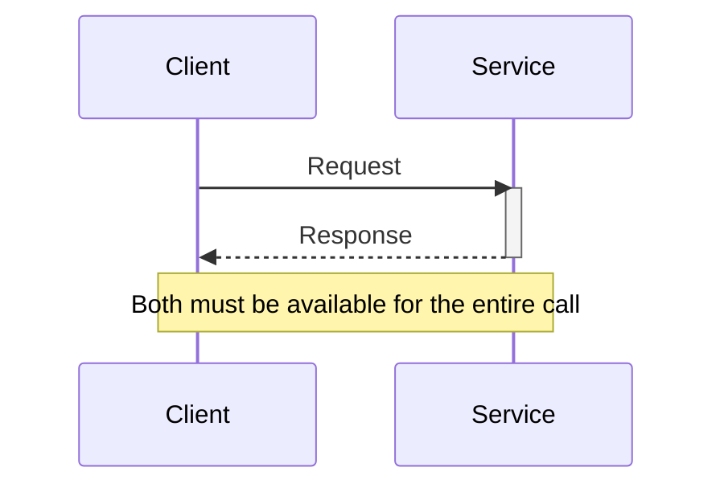

# Remote Procedure Invocation

## Description

Remote Procedure Invocation (RPI) is the communication style in which a client sends a request to a service using a synchronous request/response protocol, as if it were invoking a remote procedure. The client sends the request, waits for the response, and only then continues with its flow.

In a microservices architecture, this is the most direct interprocess communication mechanism: the service exposes an interface (for example REST, gRPC, or Apache Thrift) and other services consume it directly over the network, with no intermediaries. Since there's no broker, the topology is simple and the behavior is easy to understand and debug.

The flip side is runtime coupling: client and service must both be available for the whole interaction. That's why RPI usually comes with service discovery, externalized configuration of the location, and failure-protection mechanisms.

In Enterprise Integration Patterns, Remote Procedure Invocation applies encapsulation to integration: each application is treated as a large object or component with encapsulated data and exposes a running interface. Whoever needs a piece of data asks its owner, and whoever needs to change it calls the owner, which preserves integrity and can change its internals without affecting the others. In return, applications remain tightly coupled through the calls, and the ordering and timing requirements between operations make independent evolution harder, points that seem minor inside a single application but weigh heavily in integration.

## Problems it solves

- Services need to collaborate to serve client requests and, for that, need an interprocess communication mechanism.
- The need for a simple request/response interaction, where the caller needs the result to continue.
- The desire to avoid operating a message broker in cases where synchronous communication is enough.

## When to use

- The interaction is naturally request/response and the client needs the answer immediately.
- The team prioritizes simplicity and familiarity with technologies such as REST and gRPC.
- You don't want to introduce and operate a message broker.

### When to avoid

- When you need notifications, requests with asynchronous responses, or publish/subscribe; in those cases prefer Messaging.
- When high availability requires the client to keep operating even if the service is down.
- When long chains of synchronous calls would drag the combined availability down unacceptably.

## Trade-offs

| Benefit | Cost / Risk |
| --- | --- |
| Simple and familiar to most developers | Basically supports only request/response; doesn't directly offer notifications or publish/subscribe |
| No intermediary broker needed | Reduced availability: client and service must be up at the same time |
| Direct control flow and debugging | Runtime coupling and propagation of failures and latency between services |

Additional considerations:

- **Discovery:** the client needs to discover the location of the service instances (client-side or server-side discovery) and obtain the logical address through externalized configuration.
- **Resilience:** use *timeouts* and Circuit Breaker on calls to keep failures from cascading.
- **Error mapping:** translate protocol error responses (for example, HTTP 409) into domain errors on the client.

## Diagram

The client sends the request directly to the service and keeps waiting for the response, which is what characterizes the runtime coupling.

## Related patterns

- [Messaging](/architecture/microservices/communication-styles/messaging) — the asynchronous, broker-based alternative to RPI.
- [Domain-specific Protocol](/architecture/microservices/communication-styles/domain-specific-protocol) — another alternative, using a domain-specific protocol.
- [Externalized Configuration](/architecture/cloud-design-patterns/deployment-and-topology/external-configuration-store) — provides the service's logical location (for example, the URL).
- [Client-side Discovery](/architecture/microservices/service-discovery/client-side-discovery) — the client locates the service instance by querying the registry.
- [Server-side Discovery](/architecture/microservices/service-discovery/server-side-discovery) — a router locates the instance on the client's behalf.
- [Circuit Breaker](/architecture/cloud-design-patterns/resiliency/circuit-breaker) — improves the reliability of synchronous calls.
- [File Transfer](/architecture/eip/integration-styles/file-transfer) — a file-based integration style, batch-oriented and with no direct calls.
- [Shared Database](/architecture/microservices/service-collaboration/shared-database) — a style in which data lives in a common database instead of being encapsulated.
- [Message Endpoint](/architecture/eip/messaging-endpoints/message-endpoint) — the application's access point to messaging, analogous to the interface exposed by the remote call.

## Reference

- [Pattern page on microservices.io](https://microservices.io/patterns/communication-style/rpi.html)
- [Pattern page on Enterprise Integration Patterns](https://www.enterpriseintegrationpatterns.com/EncapsulatedSynchronousIntegration.html)
