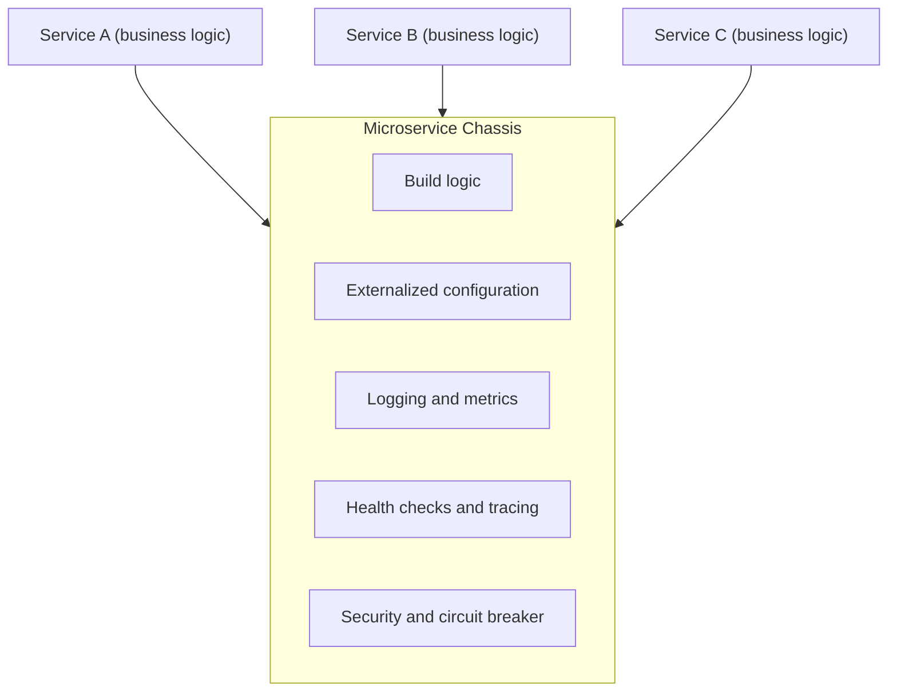

# Microservice Chassis

## Description

The Microservice Chassis is a shared framework that serves as the foundation for all of an organization's services. It bundles reusable build logic (compile, test, and package, for example into a container image) and the mechanisms for cross-cutting concerns: security, externalized configuration, logging, health checks, metrics, distributed tracing, service registration and discovery, and circuit breakers.

In practice, the chassis is usually assembled by composing and configuring existing frameworks and libraries, exposing them as a single versioned dependency. Each service declares that dependency and focuses its code on business logic.

When the cross-cutting requirements change, the owning team publishes a new version of the chassis and services adopt it by updating the dependency, instead of changing duplicated code across dozens of repositories.

## Problems it solves

- How to quickly create a maintainable, production-ready service so the team can focus on business logic.
- Each service needs build logic and cross-cutting concerns, including technology-specific ones (such as connection pools).
- Creating new services should be fast and easy, since in microservices they are numerous and appear within days or weeks.
- Updating existing services when build or cross-cutting requirements change should be fast and simple.

## When to use

- When the organization maintains many services in the same language or framework and needs consistent behavior across them.
- When cross-cutting concerns change often and need to be propagated cheaply.
- When there's a platform team able to maintain the chassis as an internal product.

## When to avoid

- When there are few services or a single team; the cost of maintaining your own framework outweighs the gain.
- When the environment is highly polyglot and there isn't enough volume to justify a chassis per language.

## Trade-offs

| Benefit | Cost / Risk |
| --- | --- |
| Fast, centralized updates of dependencies, build, and cross-cutting code | A chassis is needed for each language or framework |
| Consistent logging, metrics, security, and tracing across services | Adopting a new technology gets harder, since it requires a new chassis |
| Teams focused on business logic | Services are coupled to the chassis's versions and decisions |

- **Version governance:** breaking changes in the chassis force coordinated updates; adopt semantic versioning and deprecation windows.
- **Scope:** avoid putting business logic in the chassis so you don't create a distributed monolith of dependencies.
- **Alternative without shared code:** some concerns can move into the infrastructure (service mesh, sidecar).

## Diagram

The services contain only business logic and depend on the chassis, which provides build and cross-cutting concerns in a shared, versioned way.

## Related patterns

- [Service Template](/architecture/microservices/cross-cutting-concerns/service-template) — an alternative or complement: it holds the service-specific code and configuration, usually using the chassis.
- [Externalized Configuration](/architecture/cloud-design-patterns/deployment-and-topology/external-configuration-store) — a cross-cutting concern commonly provided by the chassis.
- [Self Registration](/architecture/microservices/service-discovery/self-registration) — the chassis often registers the service in the service registry.
- [Client-side Discovery](/architecture/microservices/service-discovery/client-side-discovery) — also commonly handled by the chassis.
- [Distributed Tracing](/architecture/microservices/observability/distributed-tracing) — the chassis can instrument the code automatically.
- [Health Check API](/architecture/cloud-design-patterns/resiliency/health-endpoint-monitoring) — a standard endpoint provided by the chassis.
- [Circuit Breaker](/architecture/cloud-design-patterns/resiliency/circuit-breaker) — can be implemented by the chassis framework.
- [Sidecar](/architecture/cloud-design-patterns/integration-and-modernization/sidecar) — moves cross-cutting concerns into a separate, language-independent process.

## Reference

- [Pattern page on microservices.io](https://microservices.io/patterns/microservice-chassis.html)
