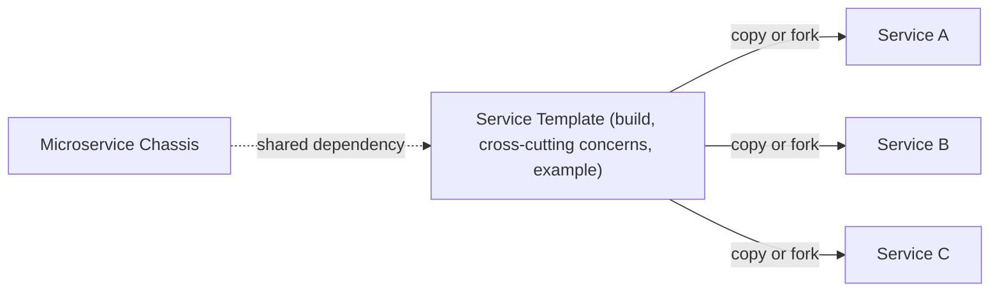

# Service Template

## Description

The Service Template is a source-code template that developers copy to start a new service. It's an executable service that already includes the build logic, the cross-cutting concerns (security, externalized configuration, logging, health checks, metrics, distributed tracing), and an example of business logic.

When creating a service, the team copies or forks the template and replaces the example with the real logic. The service starts out with the organization's practices already applied, which shortens time to production and encourages consistency.

The template usually relies on a Microservice Chassis for the shared framework code and contains only the service-specific code and configuration.

## Problems it solves

- How to quickly create a maintainable, production-ready service so the team can focus on business logic.
- Each service needs build logic and cross-cutting concerns, including technology-specific ones.
- Creating a new service should be fast and easy.
- Updating existing services when build or cross-cutting requirements change should be simple (the standalone template's weak spot).

## When to use

- When new services are created frequently and need to follow an organizational standard.
- When you want to speed up project startup without immediately investing in a shared framework.
- Together with a chassis, to provide the service-specific skeleton.

### When to avoid

- When cross-cutting concerns change often and the changes have to be propagated to many existing services.
- When there are few services, in which case the template would be overkill.

## Trade-offs

| Benefit | Cost / Risk |
| --- | --- |
| Quick start for new services | It's copy-and-paste reuse: changes to the template have to be applied to each service individually |
| Cross-cutting concerns implemented consistently, encouraging good practices | Even with a Git fork, services tend to drift from the template over time |
| No runtime dependency on a custom framework | A template is needed per language or framework, making it harder to adopt new technologies |

- **Maintenance:** keep the template up to date and automate migration (for example, scripts or automated PRs).
- **Combination:** using the template with a chassis reduces the amount of copied code and makes updates easier.

## Diagram

Each new service starts from a copy of the template, which can depend on a chassis for the shared code.

## Related patterns

- [Microservice Chassis](/architecture/microservices/cross-cutting-concerns/microservice-chassis) — an alternative or complement: it centralizes the shared code, updatable by version.
- [Externalized Configuration](/cloud/cloud-design-patterns/deployment-and-topology/external-configuration-store) — a cross-cutting concern already solved in the template.
- [Health Check API](/cloud/cloud-design-patterns/resiliency/health-endpoint-monitoring) — an endpoint included in the template.
- [Distributed Tracing](/architecture/microservices/observability/distributed-tracing) — instrumentation already configured in the template.

## Reference

- [Pattern page on microservices.io](https://microservices.io/patterns/service-template.html)
