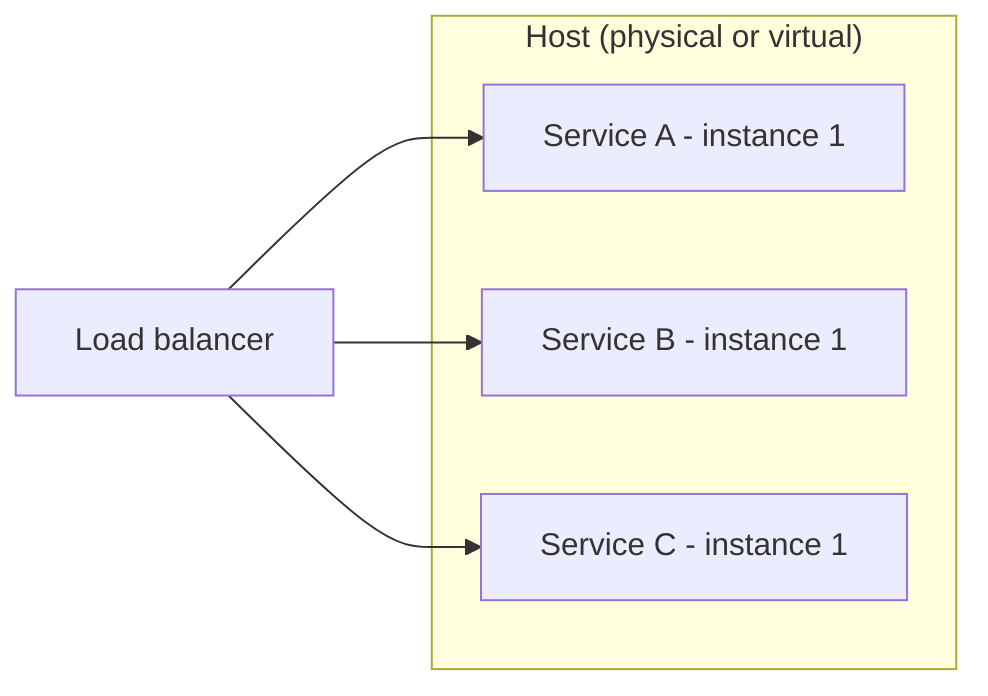

# Multiple Service Instances per Host

## Description

In this pattern, instances of different services run on the same host, which can be physical or virtual. The host is provisioned once and several instances are deployed on top of it, sharing the operating system, CPU, memory, and disk.

There are two common variations: each instance runs as an independent process (for example, one application server per instance), or several instances run inside the same process or runtime (for example, several web applications on the same application server).

## Problems it solves

- How to package and deploy services that use different languages, frameworks, and versions.
- How to run multiple instances of each service for throughput and availability.
- How to deploy the application cost-effectively, making better use of each host.
- How to keep deployments fast and instances monitorable.

## When to use

- When infrastructure cost is the main concern and the services have low resource consumption.
- When there are few services, with dependencies that are compatible with each other.
- In legacy environments or ones without support for virtualization or containers.

### When to avoid

- When services have conflicting resource requirements or dependency versions.
- When strong isolation and hard CPU and memory limits per instance are required.
- When several instances share the same process and need to be monitored individually.

## Trade-offs

| Benefit | Cost / Risk |
| --- | --- |
| More efficient use of host resources | Conflicting resource requirements between services |
| Fewer hosts to provision and pay for | Dependency version conflicts |
| Simple deployment on traditional infrastructure | Hard to limit each instance's consumption |
| Fast instance startup (no new host to create) | No per-instance isolation or monitoring when they share the JVM/process |

- A faulty or resource-hungry instance can affect its neighbors on the same host (the noisy neighbor effect).
- Per-instance observability requires additional instrumentation.

## Diagram

Several different services share the resources of a single host.

## Related patterns

- [Service Instance per Host](/architecture/microservices/deployment/service-instance-per-host) — an alternative that isolates each instance on its own host.
- [Serverless Deployment](/architecture/microservices/deployment/serverless-deployment) — an alternative that hides the concept of a server.
- [Compute Resource Consolidation](/architecture/cloud-design-patterns/deployment-and-topology/compute-resource-consolidation) — the same idea of consolidating workloads to reduce cost.

## Reference

- [Pattern page on microservices.io](https://microservices.io/patterns/deployment/multiple-services-per-host.html)
