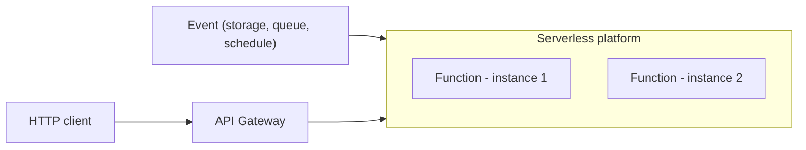

# Serverless Deployment

## Description

The service is deployed on infrastructure that hides any concept of a server, whether physical, virtual, or container. You upload the packaged code (for example, a ZIP file), describe the desired performance characteristics, and the platform runs the service, charging per request according to the resources consumed.

Internally the provider uses containers or VMs, but the user doesn't manage them. Functions are stateless and triggered by events, HTTP requests through a gateway, explicit calls to the platform API, or schedules. Examples: AWS Lambda, Google Cloud Functions, and Azure Functions.

## Problems it solves

- The effort of managing servers, operating systems, and scaling.
- Paying for idle or underused capacity.
- Automatic elasticity in the face of load variations.
- Fast deployment, with no infrastructure provisioning.

## When to use

- Stateless, event-driven or request-driven workloads.
- Intermittent workloads or ones with unpredictable spikes.
- When you want to minimize infrastructure operations.

### When to avoid

- Long-running or stateful services, such as databases and message brokers.
- Services that subscribe to queues on a broker such as RabbitMQ.
- Applications with slow startup or that are latency-sensitive because of cold starts.

## Trade-offs

| Benefit | Cost / Risk |
| --- | --- |
| No low-level infrastructure management | Significant constraints, such as few supported languages |
| High elasticity with automatic scaling | Suitable only for stateless, request-driven services |
| Pay per request, with no idle cost | Limited input sources |
| Simple deployment | Cold starts and sudden spikes can cause high latency |

- There's a risk of provider lock-in.
- Distributed debugging and observability require specific tooling.

## Diagram

The platform creates and scales function instances on demand, driven by requests and events.

## Related patterns

- [Multiple Service Instances per Host](/architecture/microservices/deployment/multiple-service-instances-per-host) — an alternative deployment approach.
- [Service Instance per Host](/architecture/microservices/deployment/service-instance-per-host) — an alternative; the serverless platform probably uses it internally.
- [Service Instance per Container](/architecture/microservices/deployment/service-instance-per-container) — an alternative in which the team manages the containers.
- [Service Instance per VM](/architecture/microservices/deployment/service-instance-per-vm) — an alternative in which the team manages the VMs.

## Reference

- [Pattern page on microservices.io](https://microservices.io/patterns/deployment/serverless-deployment.html)
