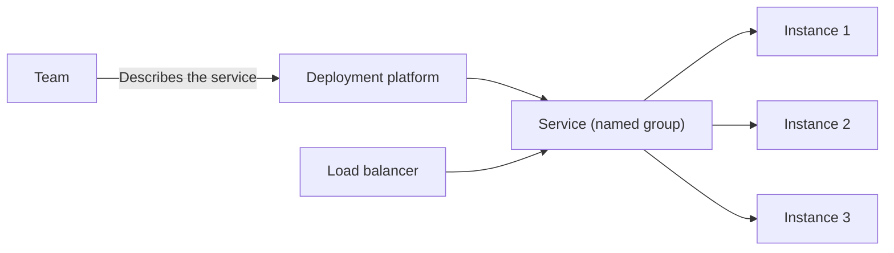

# Service Deployment Platform

## Description

The pattern proposes using a deployment platform, that is, automated infrastructure for deploying applications. The platform offers a service abstraction: a named group of highly available instances, normally load balanced.

Instead of manually managing hosts, VMs, or containers, the team describes the desired service and the platform takes care of placement, scaling, failure recovery, and exposing the instances. Examples include container orchestrators such as Kubernetes and PaaS platforms.

## Problems it solves

- The effort of manually deploying and operating many instances of many services.
- The need for independent deployment and scaling per service.
- Isolation, CPU and memory limits, and monitoring of each instance.
- Reliable, cost-effective deployment.

## When to use

- When there are many services and instances to operate.
- When you want to automate deployment, scaling, recovery, and load balancing.
- When you want to standardize how teams deploy.

### When to avoid

- When there are few services and the overhead of operating or learning the platform isn't worth it.
- When the platform doesn't meet specific networking, compliance, or latency requirements.

## Trade-offs

| Benefit | Cost / Risk |
| --- | --- |
| Automated deployment, scaling, and recovery | Platform complexity and learning curve |
| Service abstraction with load balancing and high availability | Dependence on the chosen platform |
| Standardization across services | Cost of operating or buying the platform |
| Less manual infrastructure work | Less control over low-level details |

- Some platforms already include service registration and discovery.

## Diagram

The team declares the service and the platform keeps the instances running and balanced.

## Related patterns

- [Service Registry](/architecture/microservices/service-discovery/service-registry) — provided by some platforms.
- [Server-Side Discovery](/architecture/microservices/service-discovery/server-side-discovery) — also offered by some platforms.
- [Service Instance per Container](/architecture/microservices/deployment/service-instance-per-container) — the model used internally by container-based platforms.
- [Service Instance per VM](/architecture/microservices/deployment/service-instance-per-vm) — a model the platform may use internally.

## Reference

- [Pattern page on microservices.io](https://microservices.io/patterns/deployment/service-deployment-platform.html)
